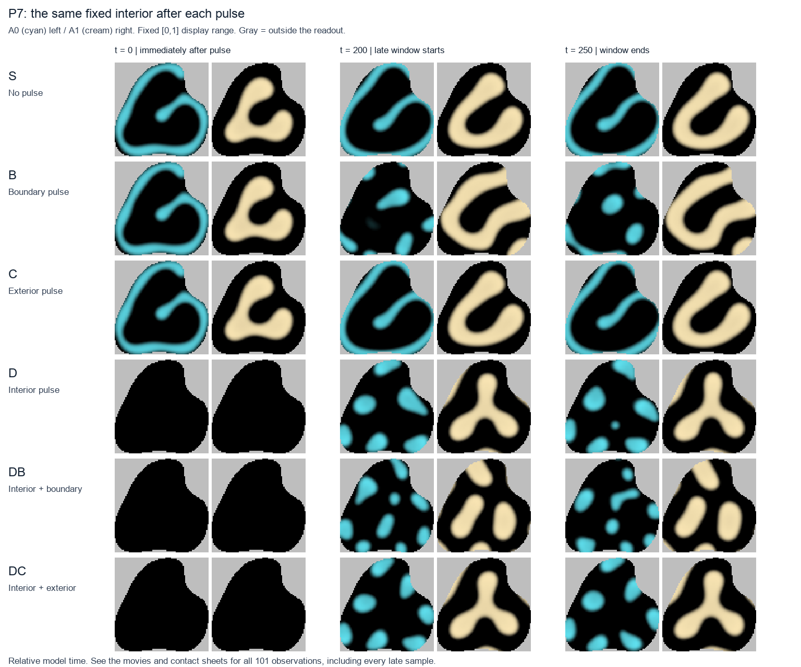
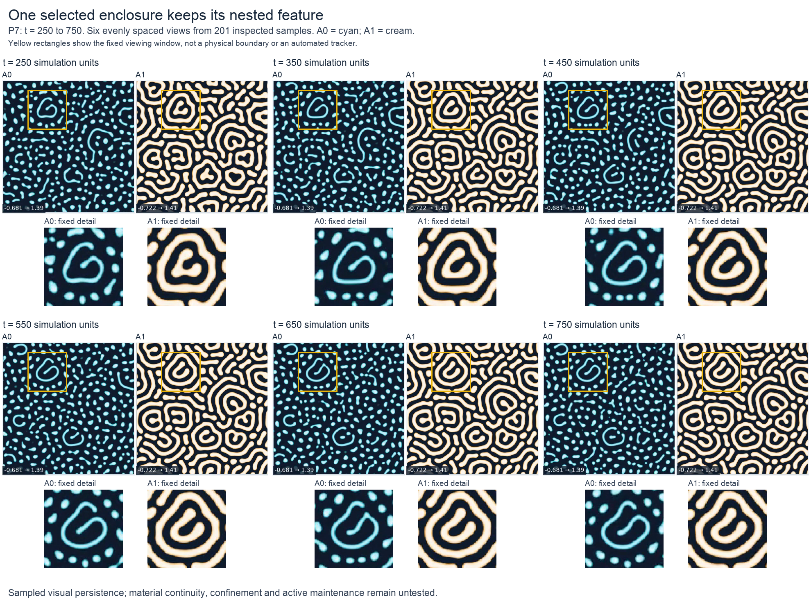

# Research demonstrations and organism evaluations

Can a world produce localized organizations with distinguishing features that
remain recognizable through time? That is the immediate target. Replication then
means copying those features; selection is a later question. Generic blobs
splitting or transient asymmetries in a soup do not establish organisms.

One standing evaluator combines quantitative evidence with inspection of actual
spatial trajectories. The [versioned rubric](evaluation/rubric-v0.1.md) asks about
local individuality, distinctive organization and persistence of that organization.
Missing essential evidence cannot be offset by a high aggregate score.

Diffusion-led field equations are one model class, not a requirement. The current
PhySim dynamics remain a reproducible reference. Explicitly versioned alternatives
may be proposed and judged against the same organism target, with appropriate
numerical checks.

**Latest reviewed result · 23 October 2026 — P7's early formation:** The selected
structure develops its curled interior from a localized spot already present at
initialization. All 101 early observations were inspected. The evaluator found
no parent producing multiple continuing individuals on this exact track and
closed this historical copying route. The earlier persistence finding remains
supported.

[Read the formation result](updates/2026-10-23-p7-ancestry.md)
· [Read the independent evaluator assessment](evaluation/2026-10-23-p7-ancestry.md)
· [Inspect the original keyframes and evidence](../docs/assets/research/2026-10-23-p7-ancestry/README.md).

[Watch the 12.625-second formation sequence](../docs/assets/research/2026-10-23-p7-ancestry/early-history.mp4).
The movie includes every saved observation from time 0 to 250, with full A0/A1
context and a fixed detail view. Cyan and cream are two interacting fields.
This is a retrospective formation record; it establishes neither material ancestry
nor spontaneous origin, and it supplies no replication event.

**Earlier completed comparison · 23 October 2026 — the P7 recovery test:** Persistent visible organization survived in controls, but the specified original feature did not return after interior erasure in the two interpretable recovery cases.
The boundary-only case and the interior-plus-boundary case are censored: their
fixed readout or the apparent individual's continuation becomes ambiguous.
They cannot establish selective nonrecovery. The standing evaluator recommends
stopping this fixed claim as a completed limited negative.

[Read the six-case result](updates/2026-10-23-p7-recovery.md)
· [Read the independent evaluator report](evaluation/2026-10-23-p7-recovery.md)
· [Inspect the exact evidence and display conventions](../docs/assets/research/2026-10-23-p7-recovery/README.md).

[Watch the 20.2-second interior comparison](../docs/assets/research/2026-10-23-p7-recovery/interior.mp4)
· [Watch the corresponding full-domain context](../docs/assets/research/2026-10-23-p7-recovery/context.mp4).
Cyan and cream show the two activator fields; gray excludes pixels from the fixed
interior readout. Both movies show all 101 saved observations without interpolating
motion. The overview shows only three times; the report evaluates all 21 late
observations per case. The earlier visible-organization finding below remains
supported; recovery-based maintenance and a conditional boundary contribution
are not established.

**Persistence assessment · 23 October 2026:** one selected P7 enclosure and its
specified internal curled stripe remain recognizable in all 201 saved observations
from time 250 through 750. The standing evaluator judges all three rubric gates
supported for this individual and sampled interval. This is an organism-like
candidate at the level of visible organization. A largely stationary patterned
island remains a competing explanation; active maintenance remains unestablished.
[Read the evaluator's persistence assessment](evaluation/2026-10-23-p7-persistence.md).

[Watch the original 19-second full-context movie](../docs/assets/research/2026-10-23-p7-persistence/native-context.mp4).
The selected interval starts 6.25 seconds into the movie. The full report identifies
the chosen enclosure and feature and explains the retrospective selection and
sampling limits.

**Earlier methods checkpoint · 23 October 2026:** the static construction
validated the intervention and readout. In six saved static cases, the interior
feature was readable when preserved and absent after the interior pulse. That
earlier setup study ran no time evolution; the recovery result is reported above.
[Read the six-case comparison](updates/2026-10-23-p7-static-construction.md)
· [Read the evaluator's independent assessment](evaluation/2026-10-23-p7-static-construction.md).

The earlier controlled demonstrations below show activity depending on protective
action and signal production. Those active patterns still grow. They do not
establish bounded maintenance or inherited function. The comparisons use different
preparations and should be read separately. The fields are quantities that react
locally and spread across a spatial grid; activity uses a stated field threshold.

## A controlled demonstration: what keeps activity going?

[Watch the 32-second comparison](../docs/assets/research/2026-10-20/production-payment.mp4)
· [Read the experiment and controls](updates/2026-10-20.md#removing-the-resource-charge-did-not-rescue-production-off-activity)

Three copies begin in the same state. One keeps producing a protective signal and
paying its associated resource charge. A second stops producing the signal while
retaining the charge's formula. A third removes both terms. The intact pattern
stays active and expands; both production-off paths lose activity at the fixed
late samples. Removing the charge as well does not restore late activity.

This supports production dependence in this preparation. It does not show that
the charge has no effect: the two production-off paths have different sampled
loss times, and a fixed charge formula does not fix the amount actually paid.
The article gives the exact measurements and limitations.

## Two more demonstrations

**Protective action helps activity persist.** In a separate preparation, disabling
only the protective action leads to loss of activity while the intact control
persists and grows. The movie shows saved binary activity masks, not intermediate
concentration measurements. Persistence here does not establish confinement or
recovery.

[Watch the 32-second comparison](../docs/assets/research/2026-10-20/protective-action.mp4)
· [Read the controls and evidence audit](updates/2026-10-20.md#removing-protective-action-caused-activity-to-fade)

**Restoring an initial surrounding signal does not prevent branching.** A selected
pattern stays unbranched at the saved times through time 100 in its original world
but splits after isolation. Restoring the initial exterior signal, either as its
original spatial profile or as a uniform matched mean, does not prevent that
split. Here a split means one detected activity region becomes two; it does not
track material ancestry or demonstrate inherited function. Continued environmental
influence remains unresolved.

[Watch the 22-second comparison](../docs/assets/research/2026-10-20/initial-x1.mp4)
· [Read the four matched preparations](updates/2026-10-20.md#restoring-the-initial-surrounding-signal-did-not-prevent-branching)

## Current priority · 23 October 2026

The selected P7 track now supplies a reviewed formation sequence and later
persistence. All three essential rubric gates remain supported for the accepted
later interval. Active maintenance is strengthening evidence, not a fourth gate
before asking about feature copying.

The complete retained history of this selected track supplies no observed parent
producing multiple continuing individuals. The historical ancestry route closes
without a copying experiment, horizon extension or substitute individual. Future
copying work needs a traceable parent-to-descendants record with the distinguishing
features visible through time. No new experiment follows automatically.

The fixed recovery/conditional-boundary claim also remains stopped as a limited
negative. Its [assessment](evaluation/2026-10-23-p7-recovery.md) and earlier
conclusions remain unchanged.

The prepared growth-feedback comparison remains held. Its current evidence plan
would not by itself establish persistent distinctive organization, and no feedback
outcome is available. Explicitly versioned alternative dynamics remain eligible
for future work under the same organism rubric.

## Follow the work and inspect the evidence

We publish explanations and demonstrations when reviewed experiments provide a
meaningful result, including informative failures. Each update states the
question, intervention, controls, observed behavior, conclusion, remaining limits
and next question. The evaluator authors independent progress assessments, including
negative judgments, missing evidence and recommendations to stop marginal work. This page provides the current entry point; the dated notes
preserve how the findings developed.

- [Latest evaluator report: P7 formation and ancestry](evaluation/2026-10-23-p7-ancestry.md)
- [P7 recovery comparison](evaluation/2026-10-23-p7-recovery.md)
- [Earlier P7 feature-persistence assessment](evaluation/2026-10-23-p7-persistence.md)
- [Initial calibration and earlier comparisons](evaluation/2026-10-23.md)
- [Organism rubric v0.1](evaluation/rubric-v0.1.md)
- [Calibration image provenance](../docs/assets/research/2026-10-23-evaluation/image-provenance.json)
- [Dated research updates](updates/README.md)
- [Latest retained-evidence result: P7 formation](updates/2026-10-23-p7-ancestry.md)
- [Completed controlled comparison: P7 recovery](updates/2026-10-23-p7-recovery.md)
- [Earlier controlled demonstrations: 20 October 2026](updates/2026-10-20.md)
- [Saved source evidence](../docs/assets/research/2026-10-20/evidence)
- [Video provenance, exact hashes and display conventions](../docs/assets/research/2026-10-20/provenance.json)
- [Reproducible presentation renderer](../scripts/render_research_update.py)

Videos use actual saved frames, visible simulation times and fixed display
settings. Frames are held between recorded samples; no unobserved motion is
invented. The linked articles distinguish concentrations, threshold masks,
sampled events and evidence that was not saved.
