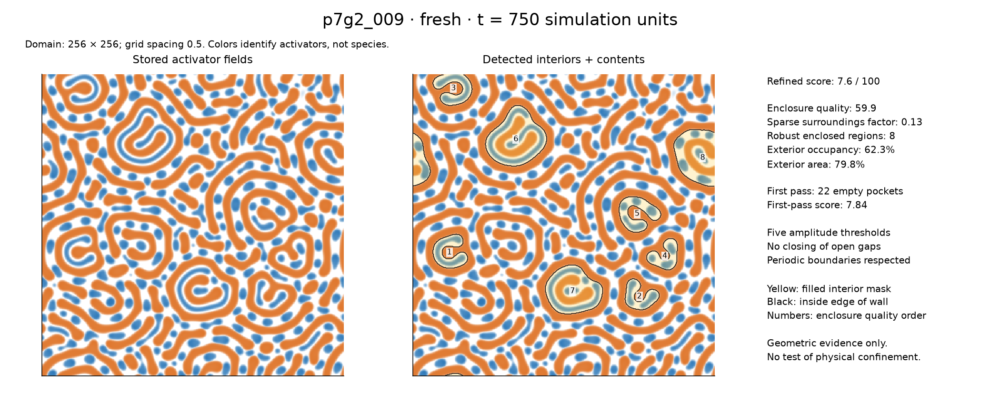
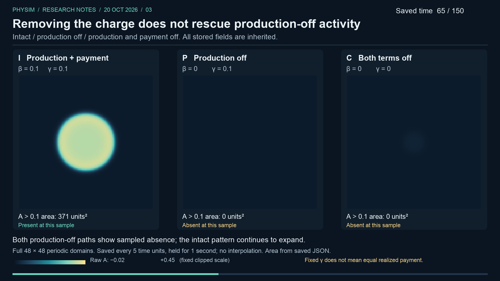

# Research demonstrations and organism evaluations

Can a world produce localized organizations with distinguishing features that
remain recognizable through time? That is the immediate target. Replication then
means copying those features; selection is a later question. Generic blobs
splitting or transient asymmetries in a soup do not establish organisms.

One standing evaluator combines quantitative evidence with inspection of actual
spatial trajectories. The [versioned rubric](evaluation/rubric-v0.1.md) asks about
local individuality, distinctive organization and persistence of that organization.
Missing essential evidence cannot be offset by a high aggregate score.

Diffusion-led field equations are one model class, not a requirement. The current
PhySim dynamics remain a reproducible reference. Explicitly versioned alternatives
may be proposed and judged against the same organism target, with appropriate
numerical checks.

**Latest evaluation · 23 October 2026:** the inspected examples do not yet establish
all three organism gates. Earlier multicolor enclosures are a more direct lead for
structured interiors than the recent activity-only demonstrations. The key gap is
whether the same enclosure and its distinguishing contents persist over time.
[Read the evaluator's assessment and next decision](evaluation/2026-10-23.md).

This is one saved frame of candidate `p7g2_009`, not proof of persistence. Colors
identify activator fields, and numbered interiors are within-frame detection
ranks, not tracked organisms. The evaluator report explains the evidence and limits.

The earlier controlled demonstrations below show activity depending on protective
action and signal production. Those active patterns still grow. They do not
establish bounded maintenance or inherited function. The comparisons use different
preparations and should be read separately. The fields are quantities that react
locally and spread across a spatial grid; activity uses a stated field threshold.

## A controlled demonstration: what keeps activity going?

[Watch the 32-second comparison](../docs/assets/research/2026-10-20/production-payment.mp4)
· [Read the experiment and controls](updates/2026-10-20.md#removing-the-resource-charge-did-not-rescue-production-off-activity)

Three copies begin in the same state. One keeps producing a protective signal and
paying its associated resource charge. A second stops producing the signal while
retaining the charge's formula. A third removes both terms. The intact pattern
stays active and expands; both production-off paths lose activity at the fixed
late samples. Removing the charge as well does not restore late activity.

This supports production dependence in this preparation. It does not show that
the charge has no effect: the two production-off paths have different sampled
loss times, and a fixed charge formula does not fix the amount actually paid.
The article gives the exact measurements and limitations.

## Two more demonstrations

**Protective action helps activity persist.** In a separate preparation, disabling
only the protective action leads to loss of activity while the intact control
persists and grows. The movie shows saved binary activity masks, not intermediate
concentration measurements. Persistence here does not establish confinement or
recovery.

[Watch the 32-second comparison](../docs/assets/research/2026-10-20/protective-action.mp4)
· [Read the controls and evidence audit](updates/2026-10-20.md#removing-protective-action-caused-activity-to-fade)

**Restoring an initial surrounding signal does not prevent branching.** A selected
pattern stays unbranched at the saved times through time 100 in its original world
but splits after isolation. Restoring the initial exterior signal, either as its
original spatial profile or as a uniform matched mean, does not prevent that
split. Here a split means one detected activity region becomes two; it does not
track material ancestry or demonstrate inherited function. Continued environmental
influence remains unresolved.

[Watch the 22-second comparison](../docs/assets/research/2026-10-20/initial-x1.mp4)
· [Read the four matched preparations](updates/2026-10-20.md#restoring-the-initial-surrounding-signal-did-not-prevent-branching)

## Current priority · 23 October 2026

The evaluator recommends one bounded review of the saved `p7g2_009` trajectory:
track the same localized enclosure and ask whether its internal organization
persists, rather than counting similar shapes in successive frames. This is an
evidence question to resolve before another dynamics run. It does not commit
future experiments to diffusion-led physics.

The prepared growth-feedback comparison is held. It could test bounded activity,
but its current evidence plan would not by itself establish persistent distinctive
organization. The earlier startup failure remains a launch failure with no
scientific outcome; no feedback result is available. See the evaluator's report
for the recommendation and its limits.

## Follow the work and inspect the evidence

We publish explanations and demonstrations when reviewed experiments provide a
meaningful result, including informative failures. Each update states the
question, intervention, controls, observed behavior, conclusion, remaining limits
and next question. The evaluator authors independent progress assessments, including
negative judgments, missing evidence and recommendations to stop marginal work. This page provides the current entry point; the dated notes
preserve how the findings developed.

- [Latest evaluator report and calibrated examples](evaluation/2026-10-23.md)
- [Organism rubric v0.1](evaluation/rubric-v0.1.md)
- [Calibration image provenance](../docs/assets/research/2026-10-23-evaluation/image-provenance.json)
- [Dated research updates](updates/README.md)
- [Latest completed demonstration set: 20 October 2026](updates/2026-10-20.md)
- [Saved source evidence](../docs/assets/research/2026-10-20/evidence)
- [Video provenance, exact hashes and display conventions](../docs/assets/research/2026-10-20/provenance.json)
- [Reproducible presentation renderer](../scripts/render_research_update.py)

Videos use actual saved frames, visible simulation times and fixed display
settings. Frames are held between recorded samples; no unobserved motion is
invented. The linked articles distinguish concentrations, threshold masks,
sampled events and evidence that was not saved.
