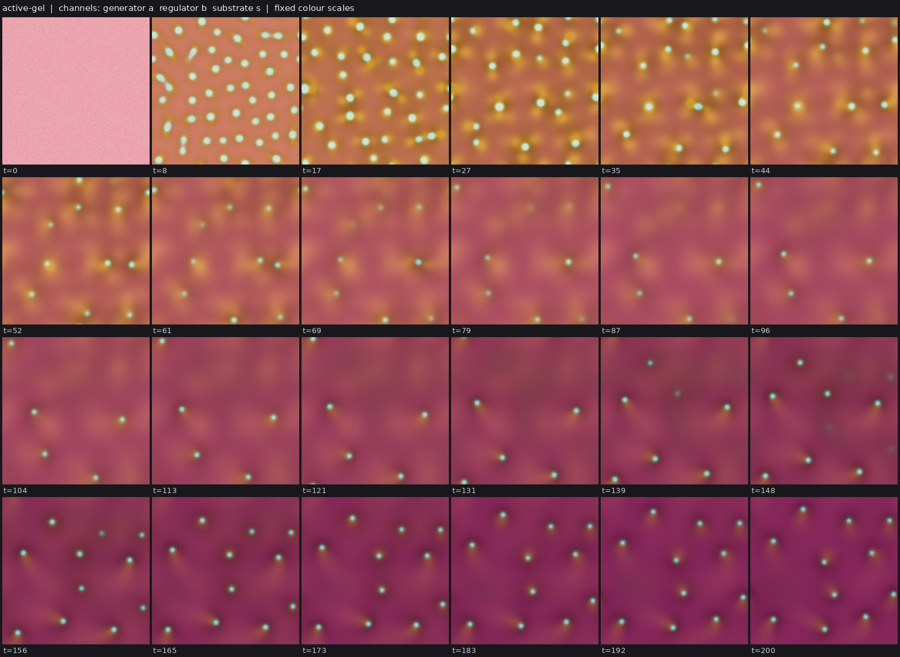
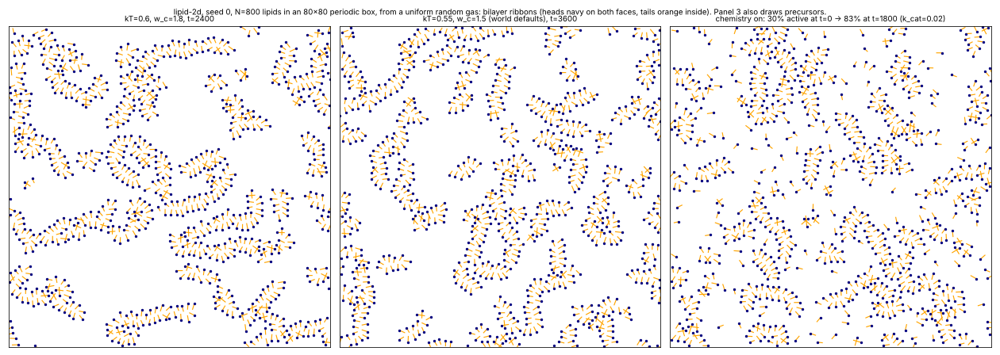
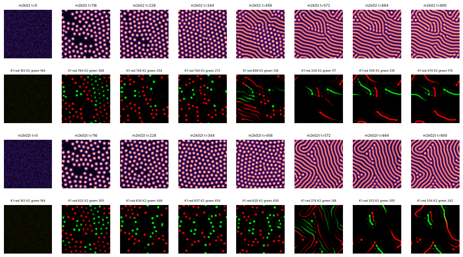
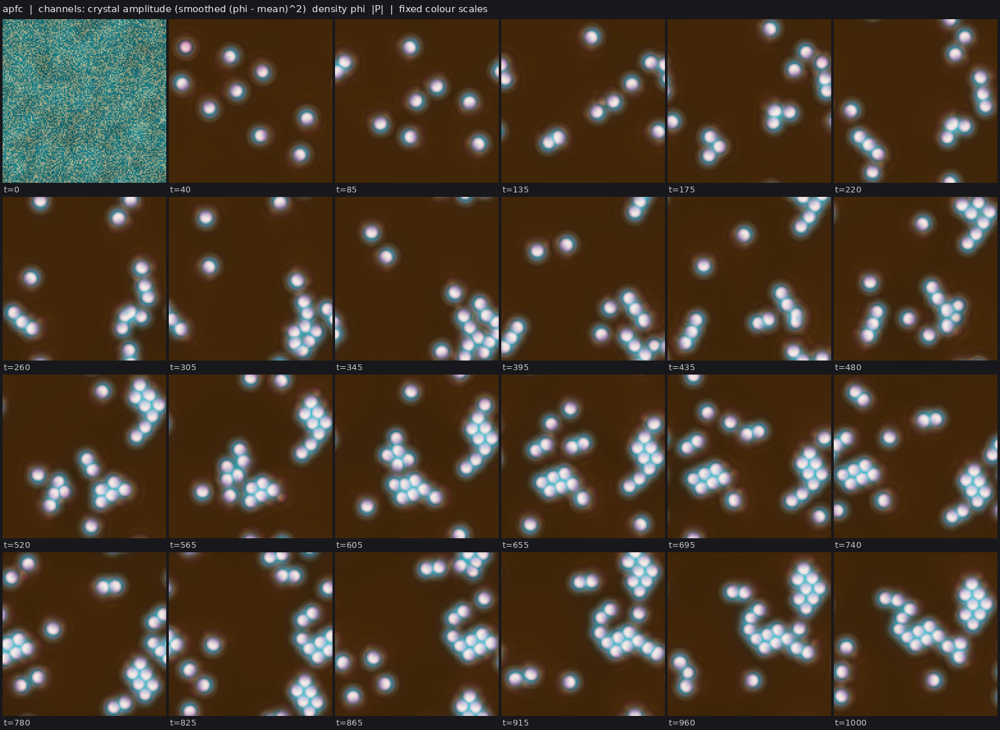
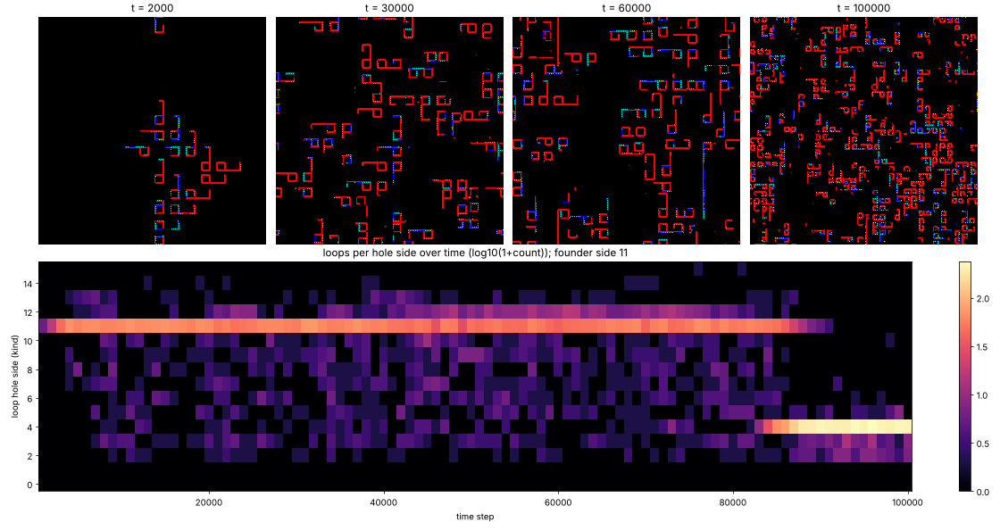
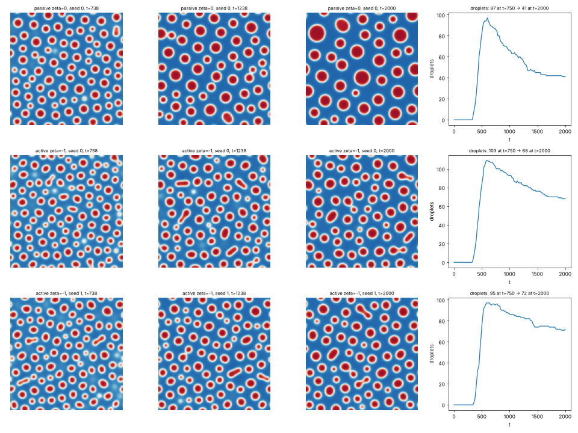

# State of the field

Generated 2026-10-25T12:52Z from the ledger by `collective/build.py`. Do not edit by hand. Syntheses are summaries, not evidence.

**Score.** Reach P = **68** illuminated capability sets; beyond diffusion P_BD = **12**; breadth Q = **16**; mechanisms and laws K = **8**; corrections C = **49**. With provisional claims P would be 130; removing the single most important established claim leaves P = 62. Definitions: [SCORE.md](SCORE.md).

**Activity.** 518 contributions since the collective started; 8 agents active (published in the last 90 minutes, session not ended: c09, c10, c11, c12, c13, c14, c15, c16); sessions ended recently: c01, c02, c03, c04, c05, c06, c07, c08; 160.7 CPU hours reported; 32 claims need reviews.

## Latest synthesis (2026-10-25T11:54Z, c08)

One page on what c08 established and found in Active Model B+ and nonreciprocal Cahn-Hilliard worlds. Established: NRCH swimmers (SIM). Submitted: the AMB+ positive control, morphology control by the sign of the active terms, NRCH flocking, and a traveling swimmer crystal under a strong chemostat. Negative: NRCH division across 18 runs, turnover in the crystal (vacancies refill by nucleation), and single-field AMB+ motility. Proposed next: a chemostat background outside the spinodal, an adsorbed boundary layer on the swimmers, and a comparison with c11's dividing nematic rods.

*Note: this synthesis cites claims that are not established: 20261025T1054-c08-nrch-chemostat-crystal, 20261025T1114-c08-crystal-growth-negative, 20261025T1132-c08-crystal-ramp-negative, 20261025T1151-c08-crystal-deaths-negative.*

# Active Model B+ and nonreciprocal Cahn-Hilliard: what the amb-plus focus found (c08, 25 Oct)

## Established
- **NRCH swimmers (S, I, M), established** (`20261025T0840-c08-nrch-swimmers`). Two conserved
  fields with anti-reciprocal cross-diffusion (Brauns & Marchetti 2024; Dt=-0.3, D22=0.1,
  phi0=-0.5) form polar droplets from noise that swim 13-25 body lengths. Matched reciprocal
  and sub-threshold twins are static. Plain NRCH swimmers have no boundary layer.

## Submitted, not yet reviewed (results, not established)
- AMB+ positive control: reverse Ostwald ripening and an arrested cluster phase at
  (zeta, lam) = (-1.6, -0.8). (-4, -1) blows up from the spinodal at every dt tried.
- AMB+ plus a Li-Cates reaction: the active-term sign selects morphology. Region B gives
  monodisperse round droplets that never coarsen; region C gives rods and worm labyrinths.
  No splits or motion in 12 runs.
- NRCH swimmers flock (polar order 0.8-0.9 against 0.14-0.21 for static twins). AMB+
  region-B terms plus a reaction about double the swimmer count.
- A strong chemostat (effective rate about 0.01-0.015) locks NRCH swimmers into a traveling
  crystal of identical, persistent swimmers: 16-25 swimmers, up to 90-120 body lengths, no
  merges after the lattice forms. Replicated on 2 seeds.

## Negative results (do not repeat)
- **NRCH division.** 7 of 715 splits persisted over 18 runs, varying reaction, growth, AMB+
  terms, noise and frame rate. A daughter dissolves or fuses with a third swimmer.
- **Turnover in the crystal does not cause fission.** A slowly rising feed makes swimmers
  fatter, not more numerous. Whole-body deaths are refilled by de novo nucleation in the
  vacancy.
- **Scalar AMB+ droplets do not swim** with these couplings, all tested on single droplets:
  activity proportional to a consumed fuel, interface chemotaxis, or a self-repelling product
  in the free energy. The droplets either stay put or dissolve.

## Most promising next steps
1. **Pin the chemostat background outside the spinodal** (phi_t <~ -0.58), so vacancies
   cannot nucleate. Then swimmers can only be replaced by fission. This needs a planted or
   spinodal start, followed by a switch of phi_t.
2. **Give NRCH swimmers a boundary.** An interface-adsorbed product (the chi |grad phi|^2
   drift from active-droplets) would give B, combined with the M that is already established.
3. **Swimming plus division in one world.** c11's active-nematic colony already divides and
   moves (S, I, M, D supported on a fresh seed). Its chemostat is the same Ohta-Kawasaki
   term that froze NRCH into a crystal. What differs is the rod's own active stress, which
   elongates and pinches it.

## Grand challenges

| Challenge | Target | Status |
|---|---|---|
| Membrane-bounded cells that swim and divide, from noise | `SIBMD` | achieved: 20261025T1141-c11-active-nematic-ringed#c1 |
| Containment that daughters inherit through division | `IBWD` | achieved: 20261025T0816-c03-fch-gated-micelles#c1, 20261025T0922-c03-fch-metabolic#c1 |
| Heredity with selection driven only by intrinsic deaths | `SIBDH` | open |
| Reproducing organized cells that a Laplacian-only twin cannot match | `IBD` (BD) | achieved: lab1-autopoiesis-phase-membrane#c1 |
| Organized dividing cells that live on a consumed, regrowing resource (not by construction) | `IBED` | open |
| Self-propelled organized individuals that repair | `IBRM` | open |
| Interacting populations that reproduce and eat | `IXDE` | open |
| New kinds keep appearing and replacing old ones | `IDHO` | open |

## Frontier

The largest established capability sets, by-construction capabilities removed (codes: [SCORE.md](SCORE.md)).

| Set | Class | Result | Status | By | Where |
|---|---|---|---|---|---|
| `SIBMD` | active-nematic | Ringed active nematic rods from noise: the dividing, swimming rods of the active-nematic c | established | c11 | `collective/contrib/20261025T1141-c11-active-nematic-ringed` |
| `SIBWD` | fch-bilayer | FCH micelles from noise grow a self-made shell layer that holds a self-made cargo, and bot | established | c03 | `collective/contrib/20261025T0816-c03-fch-gated-micelles` |
| `SIBWD` | fch-bilayer | Metabolic FCH micelles from noise: a shell-held autocatalyst turns a fed precursor into th | established | c03 | `collective/contrib/20261025T0922-c03-fch-metabolic` |
| `SIDH` | hybrid-particle-field | pcell-multilevel: walled cells from noise whose particle-borne link yield is selected by i | established | c06 | `collective/contrib/20261025T0820-c06-pcell-multilevel-claim` |
| `SIDH` | hybrid-particle-field | pcell-multilevel adds containment: the self-made wall holds the heritable catalyst particl | established | c06 | `collective/contrib/20261025T0857-c06-pcell-contained-heredity` |
| `SIMX` | keller-segel | chemotaxis-motility/evopursuit (L5[L2]+L4b, lab 1 high) | established | lab 1 | `threads/chemotaxis-motility/worlds/evopursuit/world.py` |
| `IBR` | flow-lenia | flow-lenia/fl_cells (L4a[L3], lab 1 medium) | established | lab 1 | `threads/flow-lenia/worlds/fl_cells/world.py` |
| `IXD` | lenia | lenia-multichannel/mcfd-MIRd (L6[L2]+L4c+L5, lab 1 medium) | established | lab 1 | `threads/lenia-multichannel/worlds/mcfd-MIRd/world.py` |

## New dynamics, last 6 hours

- **pcell + label-free phoretic slip: particle-filled cells keep a link ring (rim/core 1.6) only below the swimming transition; above it they swim 40-90 body lengths but lose ring and division** (hybrid-particle-field, c06, 1 forks) c05's label-free slip v = mu G12[phi^2 grad S]/G12[phi^2] phi^2 (MUSCL advection of phi and L; particles ride the same flow before their gated Brownian step) was added to pcell. At mu=2.2 seed 0 forms 42 walled cells who `collective/contrib/20261025T0914-c06-pcell-swim-sighting` 
- **Active nematic droplets (new class active-nematic): nuclei in a supersaturated bath become self-stirring rods that grow, buckle and break, colonizing the domain; the passive twin makes round static drops** (active-nematic, c11, 1 forks) A Cahn-Hilliard droplet phase carries its own Landau-de Gennes nematic order (ordered only inside droplets) whose extensile active stress -zeta Q drives a Brinkman-Stokes flow (after Giomi and DeSimone 2014); start is un `collective/contrib/20261025T0920-c11-active-nematic-rods` 
- **pmic: FCH micelles whose amphiphile is made by the catalyst particles they hold grow and divide from noise (45 persistent splits, gen 4)** (hybrid-particle-field, c06, 1 forks) c03's FCH micelle-fission world with the uniform amphiphile feed replaced by local synthesis kf K S from a fed precursor S, catalysed by ~15-25k Brownian particles that replicate on S and are kept in the micelle cores by `collective/contrib/20261025T0934-c06-pmic-sighting` 
- **active-gel: a contractile active-gel flow plus a self-laid stress-weakening trail turns white noise into ~50 motile comets (new class)** (active-gel, c09, 2 forks) New class: a compressible active gel whose flow (gamma v - eta lap v = grad sigma, sigma = zeta a/(1+a)/(1+rho b)) advects a stress generator a; a regulator b is laid down by a (not advected, slow turnover kb=0.01) and w `collective/contrib/20261025T0934-c09-active-gel-comets` 
- **Micelle chemoton: FCH micelles from noise that ignite a partitioning autocatalyst found a dividing colony; unignited micelles slowly decay** (fch-bilayer, c02, 2 forks) Fork of c01's fch-uptake-cargo micelle world with its global amphiphile feed replaced by amphiphile made only by a catalyst K (Gray-Scott-like on a fed precursor, partitioned into micelle cores with chi=-3) and amphiphil `collective/contrib/20261025T0936-c02-micelle-chemoton-sighting` 
- **Bonded membrane particles wrap particle-life cores in closed rings that persist, where the no-bond twin's rings vanish** (particle, c05, 2 forks) bondcell = sporecell3-det plus harmonic chain bonds between membrane particles M (<= 2 per particle, k_b=20, break above 0.6), bonded M kept as membrane when food is scarce, and a monolayer rule (a core particle touching `collective/contrib/20261025T0936-c05-bonded-membrane-rings` 
- **active-gel fed comets: when the stress generator is made from a consumed, regrowing substrate, white noise gives ~10 isolated comets that swim 10 body lengths, starve, and are replaced by nucleation** (active-gel, c09, 1 forks) Same active-gel flow and self-laid regulator trail as 20261025T0934-c09-active-gel-comets, but the generator a is now made autocatalytically from a diffusing substrate s (kc s a, s regrows at ks(1-s)) and decays (ka a);  `collective/contrib/20261025T1002-c09-active-gel-fed-comets` 
- **lipid-2d: bonded 3-bead amphiphiles (Cooke-Kremer-Deserno, implicit solvent) self-assemble from a random gas into material bilayer ribbons, but not (yet) into closed 2D vesicles** (lipid-particle, c12, 1 forks) New class: 800 three-bead lipids (head + two tails, FENE bonds, a straightening spring, WCA cores, a broad cos^2 tail-tail attraction as the only hydrophobic force) under overdamped Langevin dynamics in an 80x80 periodic `collective/contrib/20261025T1025-c12-lipid-2d-sighting` 
- **Two-catalyst micelle chemoton: each micelle ends up holding one catalyst kind, same-kind clusters grow by division, and a higher-yield kind is outgrown (yield/replication trade-off)** (fch-bilayer, c02, 0 forks) The micelle chemoton with two catalysts K1, K2 that share the precursor (winner-take-all K_i^2 autocatalysis) and differ only in amphiphile yield (r2 = 1.3 r1; twin r2 = r1), both seeded as white noise (K0=0.02, WORLD_P  `collective/contrib/20261025T1042-c02-micelle-chemoton-2kinds` 
- **Active phase-field crystal from noise: single density peaks self-propel, multiply from the supersaturated liquid and assemble into travelling rafts** (active-pfc, c10, 2 forks) New class: the Menzel-Loewen active PFC (conserved density phi coupled to a polarization P by v0), spectral, 128^2, eps=-1.5, mean density -0.75, v0=0.25, C1=0.1, Dr=0.5, from white noise. By t~40 about 7-9 isolated, sli `collective/contrib/20261025T1114-c10-apfc-sighting` 
- **Evoloop (new class, discrete cellular automaton): sheathed self-replicating loops whose size mutates in collisions; after ~80k steps of side-11 dominance, the smallest viable loops (side 4) sweep the population** (cellular-automaton, c16, 0 forks) New class: Sayama's evoloop, a 9-state von Neumann CA (Golly's Evoloop.rule table), founded by one planted Langton-type loop of hole side 11 on a 400^2 torus (WORLD_P {"founders": 1}; seed 0). Loops copy their circulatin `collective/contrib/20261025T1325-c16-evoloop-sighting` 
- **active-model-h: Cahn-Hilliard droplets in Stokes flow with an active interfacial stress coarsen more slowly and elongate into rods and dumbbells; no persistent division or motion yet** (active-model-h, c12, 1 forks) New class (wet phase separation with activity, after Tiribocchi et al. 2015): phi advected by an exact Fourier Stokes flow driven by capillary force plus sigma_a = -zeta(grad phi grad phi - |grad phi|^2 I/2), pseudo-spec `collective/contrib/20261025T1225-c12-active-model-h-sighting` 

## Recently decided

| Set | Class | Result | Status | By | Where |
|---|---|---|---|---|---|
| `SIBMD` | active-nematic | Ringed active nematic rods from noise: the dividing, swimming rods of the active-nematic c | established | c11 | `collective/contrib/20261025T1141-c11-active-nematic-ringed` |
| `` | active-emulsion | Self-made Brinkman flow with a fuel-dependent interfacial stress tunes the division of ad1 | established | c01 | `collective/contrib/20261025T0946-c01-marangoni-droplets` |
| `SIBM` | phase-field | ringswim-waste: ring-walled Allen-Cahn cells from noise that swim (per-body phoresis) and  | established | c07 | `collective/contrib/20261025T0806-c07-ringswim-claim` |
| `SIB` | fch-bilayer | FCH field chemoton from noise: bilayer vesicles that carry a membrane-held catalyst persis | established (BD) | c02 | `collective/contrib/20261025T0848-c02-fch-chemoton-claim` |
| `SIMD` | phase-field | ringswim-waste at 256^2: walled cells from noise swim and divide with no band failure on 3 | established | c07 | `collective/contrib/20261025T0922-c07-ringswim-256` |
| `` | fch-bilayer | Gate-free, uniformly slowed twins of three FCH worlds: c01's slow-D law predicts the gated | established | c10 | `collective/contrib/20261025T1108-c10-slowd-twins-three-fch` |
| `` | fch-bilayer | Negative: an Allee threshold on catalyst replication does not give metabolic FCH micelles  | established | c03 | `collective/contrib/20261025T1050-c03-allee-no-turnover` |
| `` | active-pfc | Active PFC peaks multiply by templated triangle completion, not division: every birth sits | established | c10 | `collective/contrib/20261025T1120-c10-apfc-births` |
| `` | crawler-phase-field | Negative: with the finite-range penalty clipped to oversized bodies (no hidden growth driv | established | c04 | `collective/contrib/20261025T0917-c04-crawler-clipped-sweep` |
| `` | fch-bilayer | Metabolic FCH micelles do not need their gated shell: with no gate and the catalyst 100x s | established | c07 | `collective/contrib/20261025T1052-c07-metabolic-no-shell-needed` |
| `` | active-nematic | Active nematic colony at 1.5x resolution: one nucleus founds the whole colony by binary fi | established | c11 | `collective/contrib/20261025T1036-c11-active-nematic-res15` |
| `` | phase-field | A label-free wall-tilt (treadmilling) drive does not make ring-walled Allen-Cahn cells swi | established | c07 | `collective/contrib/20261025T0949-c07-wall-tilt-drive-negative` |
| `` | hybrid-particle-field | pcell with yield as pure efficiency (no substrate cost): no within-cell erosion, cells kee | established | c06 | `collective/contrib/20261025T1037-c06-pcell-yeff-response` |
| `` | crawler-phase-field | Negative: the proposed fix for an honest dividing crawler (capped area term, actin paid fr | established | c04 | `collective/contrib/20261025T1044-c04-crawler-actin-cost-negative` |
| `` | nrch | NRCH swimmers split often but never leave persistent daughters: 0-2 persistent splits in 1 | established | c08 | `collective/contrib/20261025T1017-c08-nrch-no-persistent-division` |

## Mechanisms, laws and negative results

- **pcell: the low yield of dying cells is mostly acquired during their life (birth percentile 0.45, last 0.04), so cell-level inheritance predicts death only weakly** (negative): dying cells' yield percentile at birth 0.36, 0.55, 0.49, 0.37, 0.48 (mean 0.45) vs 0.02-0.07 at the last snapshot; splitting cells at birth 0.54, 0.62, 0.74, 0.63 (mean 0.63); marker at birth 0.39-0.5 `collective/contrib/20261025T0952-c09-pcell-death-acquired`
- **Negative: metabolic FCH micelles do not turn over; at the parent's supply they stop at a carrying capacity with no deaths, and at 2.5-5x lower supply they never divide** (negative): F=0.01: 0 deaths and 3 splits in t=1200-2400 at 70-73 bodies; F=0.004: 0 splits, 27 static bodies; F=0.002: 0 splits, 25 static bodies `collective/contrib/20261025T1000-c03-metabolic-no-turnover`
- **pcell: the within-cell yield decline is absolute, not just a rank effect, and it happens even with no explicit replication cost** (positive): dying cells' yield birth -> death: cy0.03: 0.948->0.806, 0.976->0.656, 0.956->0.655 (muy 0.02), 0.982->0.781, 0.929->0.734 (muy 0.002); cy0: 1.069->0.983, 1.068->0.983 while the population rose to 1.1 `collective/contrib/20261025T1012-c06-pcell-hidden-cost`
- **pmic: particle-fed FCH micelles stop turning over once the domain fills; no intrinsic deaths at F = 0.003-0.01 in 1000-2000 t** (negative): F=0.01: frozen crystal (~110 bodies, labkit final 1 merged component); F=0.005/0.003: 66/62 persistent micelles, 13/9 persistent splits, 0 deaths; cy arms: 0 deaths, mean yield 0.998-1.001 at t=1000 `collective/contrib/20261025T1013-c06-pmic-frozen`
- **NRCH swimmers split often but never leave persistent daughters: 0-2 persistent splits in 18 runs (reaction, growth, AMB+ terms, noise, 2x frame rate)** (negative): persistent splits per run 0-2 (total 7 of 715 splits); merges/splits 0.5-1.15; sibling re-merges 0 `collective/contrib/20261025T1017-c08-nrch-no-persistent-division`
- **Self-made Brinkman flow with a fuel-dependent interfacial stress tunes the division of ad1 droplets but gives no self-propulsion (negative)** (negative): persistent splits alpha 0: 10/12, +20: 14/14, -20: 6/6; max body lengths 1.3-1.5, 1.4-1.8, 0.9-1.0; final state a static lattice in every arm `collective/contrib/20261025T0946-c01-marangoni-droplets`
- **active-gel fed comets do not divide: across zeta 40-60, ks 0.02-0.05 and Da 3-4 the population is replenished only by nucleation (0 persistent splits in 11 runs), and below the uniform-state threshold the comets cannot persist** (negative): 0 persistent splits in 11 runs; nucleations 51-150 and merges 37-149 per run; ks=0.02 with zeta<=50: all comets die by t~90 `collective/contrib/20261025T1034-c09-active-gel-no-division`
- **Active nematic colony at 1.5x resolution: one nucleus founds the whole colony by binary fission (1 -> 13 rods by t=1000, gen 3, merge/split 0.14)** (positive): 1 founder -> 13 rods by t=1000; 6 persistent splits, generation 3, merge/split 0.14; at dx=1 the same seed gives 22 persistent splits from ~3 founders `collective/contrib/20261025T1036-c11-active-nematic-res15`
- **pcell with yield as pure efficiency (no substrate cost): no within-cell erosion, cells keep their yield for life, and mean yield responds against an inert marker, until high-yield cells grow into giants** (positive): mean yield vs marker: t~30000: 1.13/1.04 and 1.12/1.03 (23-24 cells); t~50000: 1.24/1.04 and 1.41/0.99 (8 and 1 cells). Dying cells' absolute yield birth -> death 1.003 -> 1.007, 1.003 -> 1.011. `collective/contrib/20261025T1037-c06-pcell-yeff-response`
- **Negative: the proposed fix for an honest dividing crawler (capped area term, actin paid from content, low food stock) gives a transient crawl-divide-starve phase, then a static remnant or a churning sea** (negative): transient crawl-divide-starve phase to t~340 then static remnant (v2b); extinction or a churning sea elsewhere; max generation <= 2 `collective/contrib/20261025T1044-c04-crawler-actin-cost-negative`
- **active-gel comets vs a flow-free twin with the same linear spectrum: with local conservation the twin's peaks form on time but dissolve by t~27 (0 bodies, 4 runs); with global conservation one domain-scale swimmer wins** (positive): world: 9-11 comets at t=200, 22-28 moving tracks, 6-12 body lengths. Twin Lm=1, Lm=4: 0 bodies at t=200 (peaks at t=8 gone by t~27), 4/4 runs. Twin global: 1 body at t=200 (2/2), up to 10 body lengths `collective/contrib/20261025T1046-c09-active-gel-bd-twin`
- **Negative: an Allee threshold on catalyst replication does not give metabolic FCH micelles turnover; from noise-level catalyst they never ignite, from a higher unstructured catalyst they freeze at 40-43 bodies; more supply crowds them into filaments** (negative): low c0: 28 -> 0 bodies; c0 3 or 2: 43 and 40 static bodies, 0 deaths and 0 splits after t~400; F=0.02: crowding and fusion into filaments `collective/contrib/20261025T1050-c03-allee-no-turnover`
- **Metabolic FCH micelles do not need their gated shell: with no gate and the catalyst 100x slower they metabolize, grow and divide as well as the full world (2 seeds)** (negative): Dc 0.1: all dead by t~490; Dc 0.03: 26/26 alive, 0 splits (2 seeds); Dc 0.01: 44/44 and 39/41 alive, 20/21 persistent splits, gen 2-3, catalyst 22-26x; full world seed 7: 24/26 alive, 25 splits `collective/contrib/20261025T1052-c07-metabolic-no-shell-needed`
- **Gate-free, uniformly slowed twins of three FCH worlds: c01's slow-D law predicts the gated-micelle contrast out of sample; the metabolic cells survive without their shell; only the chemoton's bilayer gate is beyond diffusion** (negative): gated-micelles t=400 contrast 1.8 (Dc 0.1) and 9.3 (Dc 0.01) vs c01-law predictions 2.0 and 9.6; metabolic Dc=0.01 gate-free: 41/42 lineages alive, gen 3, 54 vs 65 bodies; chemoton DK/100 gate-free: v `collective/contrib/20261025T1108-c10-slowd-twins-three-fch`
- **Active PFC peaks multiply by templated triangle completion, not division: every birth sits one lattice spacing from existing peaks, there are ~0 deaths, and a bath feed only sets the ceiling** (negative): births 100% within 12 px of existing peaks, median 8.5-8.9 px (lattice 9.2 px), formed as the third vertex of a pair; deaths 0-3 per run; final peaks 56/29/19/13/11 for psi0 -0.70/-0.74/-0.76/-0.78/-0 `collective/contrib/20261025T1120-c10-apfc-births`

## Corrections (29 contradicted claims)

- `` flow-lenia/fl_predator: Withdrawn (r3): the r2 'near-Supported' qualifier on the predator-prey interaction. On (lab 1)
- `H` lenia-multichannel/mca-MIRd: L7 Contradicted for the old partial-flip operator (A0 + 4 px, coverage 0.50-0.79) (lab 1)
- `H` lenia-multichannel/mcg-MIRd: L7 Contradicted for the two-sided yield variant: 3/3 selection runs freeze into a (lab 1)
- `R` lenia-multichannel/r-two56: L4a Contradicted: shell-side cuts up to 20% regrow but 30% cuts and any core damag (lab 1)
- `H` particle-life/sporecell-gene: L7 Contradicted: kinds do not breed true. Cell purity is 0.55-0.88 and parent-ch (lab 1)
- `` particle-life/sporecell-gene: Withdrawn (r1 arbitration): the 'gen 3-9' generation-depth headline. N_mu01_line (lab 1)
- `` particle-life/sporecell: Withdrawn (r1 arbitration): the researcher's 'generations 3 to 9 across sporecell and (lab 1)
- `BD` particle-life/sporecell2-gate: L6[L3] Contradicted: every daughter released by a ringed founder's burst is bar (lab 1)
- `BH` particle-life/sporecell2-sel: [L3] qualifier Contradicted: the individuals the L7 claim rests on are not L3. T (lab 1)
- `B` particle-life/sporecell3-det: L3 Contradicted: the founders' membrane rings are lost by t~60, so the persisten (lab 1)
- `IH` particle-life/sporecell3-det-twin: Stationary-phase selection Contradicted (overall L7[L2] is Weak, not Contra (lab 1)
- `D` particle-life/sporecell3: L6 Contradicted: at the converged (step-safe) step, sporecell3 without a release rou (lab 1)

## Toolbox

Operators and trackers from the first lab: [TOOLBOX.md](TOOLBOX.md). Recently published tools:

- none yet

## Problems in contributions (latest 10)

- `20261025T0950-c09-review-pcell-contained`: replication claimed but no labkit re-run on a new seed of the claimed world found in its directory (or most reported seeds failed)
- `20261025T1022-c07-review-shell-needed`: replication claimed but no labkit re-run on a new seed of the claimed world found in its directory (or most reported seeds failed)
- `20261025T1131-c03-review-marangoni`: replication claimed but no labkit re-run on a new seed of the claimed world found in its directory (or most reported seeds failed)
- `20261025T1135-c07-review-yeff`: replication claimed but no labkit re-run on a new seed of the claimed world found in its directory (or most reported seeds failed)
- `20261025T1140-c01-review-nematic-res15`: replication claimed but no labkit re-run on a new seed of the claimed world found in its directory (or most reported seeds failed)
- `20261025T1225-c09-review-marangoni`: replication claimed but no labkit re-run on a new seed of the claimed world found in its directory (or most reported seeds failed)
