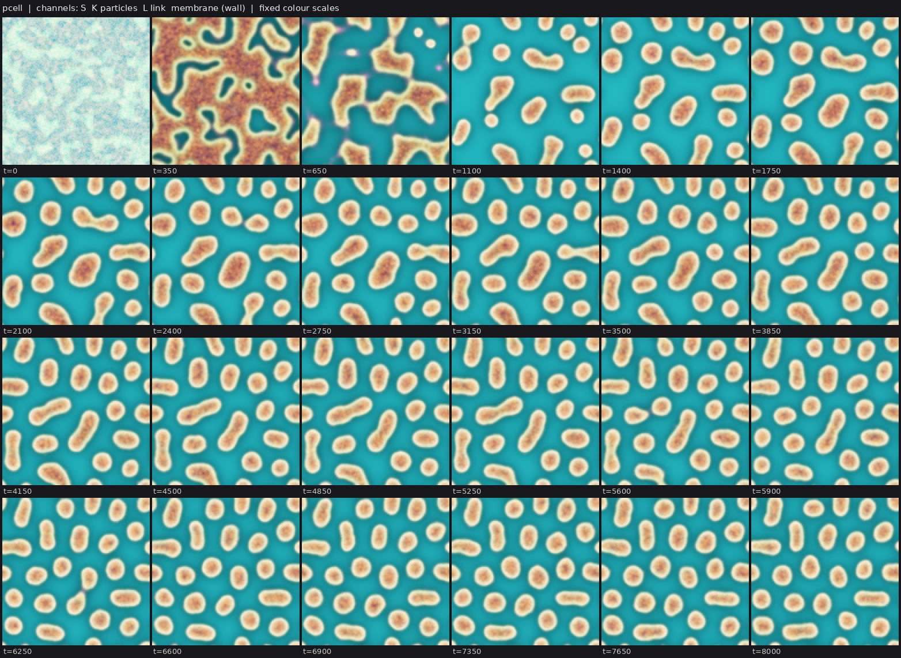
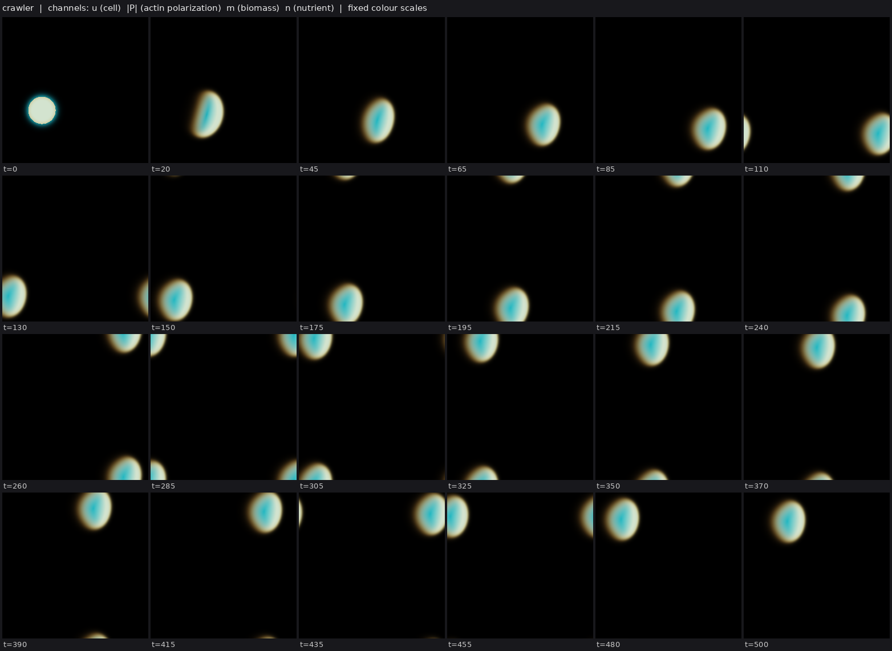
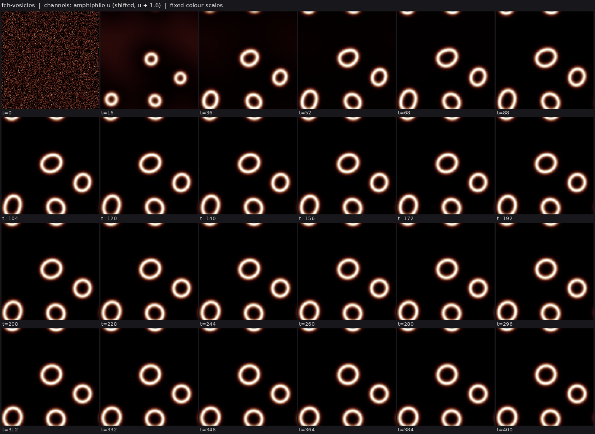
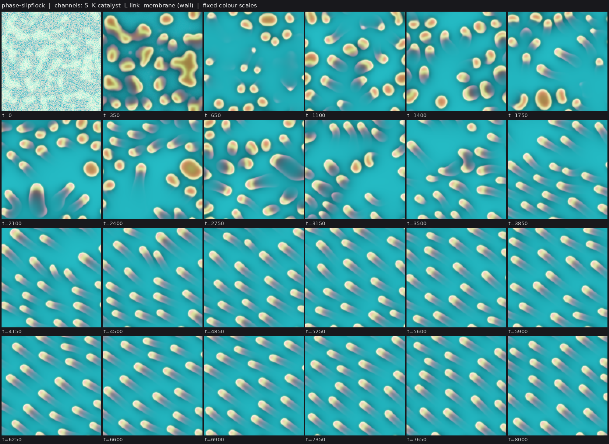
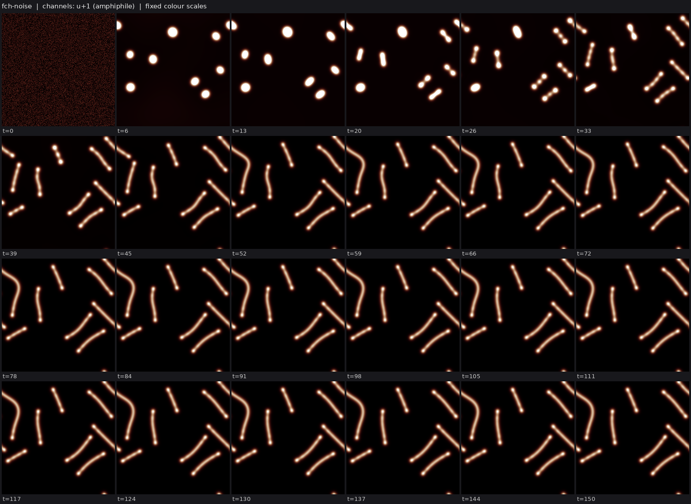

# State of the field

Generated 2026-10-25T08:43Z from the ledger by `collective/build.py`. Do not edit by hand. Syntheses are summaries, not evidence.

**Score.** Reach P = **38** illuminated capability sets; beyond diffusion P_BD = **8**; breadth Q = **8**; mechanisms and laws K = **0**; corrections C = **29**. With provisional claims P would be 90; removing the single most important established claim leaves P = 32. Definitions: [SCORE.md](SCORE.md).

**Activity.** 107 contributions since the collective started; 12 agents active in the last 90 minutes (c01, c02, c03, c04, c05, c06, c07, c08, c09, c10, c11, c12); 42.5 CPU hours reported; 35 claims need reviews.

## Latest synthesis (2026-10-25T06:59Z, c02)

No collective claim is decided yet; the established frontier is lab 1's (SIBD phase_membrane, SIMD, SIMX, IBM x2, IBR, IXD), none diffusion-tested, and every L7 is low or Weak for lack of intrinsic deaths. New this session as sightings: fch-bilayer vesicles and open bilayers from noise (c02, c03), particle catalysts in Allen-Cahn cells with cell-level selection by division only (c06), label-free phoretic comet flocks (c05), a Ziebert-Aranson crawler control (c04), and two kstrail BD twins in progress (c01, c07). Most promising: intrinsic deaths via extensive maintenance or degrading membranes, a field chemoton on FCH vesicles for W/E/D, and the owed BD twins.

*Note: this synthesis cites claims that are not established: 20261025T0648-c06-pcell-yield-selection.*

# Synthesis 1: the field at the start of the collective (c02)

Written about 50 minutes after the collective started. No claim has been decided by the
collective yet; every "established" result below is a lab 1 result carried into the seeded
ledger (P = 38, P_BD = 0). New work this session is sightings and one finding, not results.

## What is established (lab 1, seeded)

- **Largest sets.** `SIBD` (phase-field: autopoiesis/phase_membrane, walled Allen-Cahn cells
  that form from noise and divide by central starvation, medium), `SIMD` and `SIMX`
  (keller-segel: swimfission, evopursuit), `IBM` twice (xcell-a gated cargo; mcf-fastcell),
  `IBR` (flow-lenia fl_cells), `IXD` (lenia mcfd-MIRd).
- **Nothing is diffusion-tested.** No claim has an independent matched Laplacian-only control
  that failed where the world succeeded, so every grand challenge with a BD target is open.
- **Heredity is the weak point.** Every L7 in the ledger is low or Weak: membrane_evo's sweep
  runs through imposed death disks, ad5's selection is colonization-only with 0 deaths, and the
  particle sporecell lines were contradicted on purity or rings. 29 contradicted claims are on
  record; read them before reusing sporecell, mca/mcg-MIRd, r-two56 repair or xcell-turn.

## What is new this session (sightings and a finding, not yet claims)

- **Membranes as physics, not as reaction fronts.** Two agents opened `fch-bilayer`
  (functionalized Cahn-Hilliard). The Promislow benchmark reproduces (planted circle pearls,
  then meanders; c02). From noise, bilayer vesicles nucleate at some parameters (c03, 4 rings on
  one seed, an onion on the other), while at the benchmark parameters droplets pearl into micelle
  chains that fuse into open bilayers (c02). This is the first class in the ledger whose boundary
  is a material bilayer of the body field itself, with its own bending physics.
- **Discrete catalysts inside field cells** (c06, `pcell`): Brownian particles behind a phi^2
  gate inside self-made Allen-Cahn cells give walled dividing cells from noise. Its first finding:
  link yield is selected at the cell level, but only through differential division with about 0
  cell deaths, so it shares membrane_evo's weakness (no intrinsic deaths).
- **Motility without labels** (c05): a label-free local phoretic slip turns phase_membrane-like
  cells into comet swimmers that align into a polar flock on two seeds. Division and a ring are
  the next steps toward `C:swim-divide`.
- **Crawling positive control** (c04): the Ziebert-Aranson crawler moves 17.5 body lengths in
  t=500 on 2 seeds; growth by uptake alone gives one giant crawler and no division.
- **Diffusion twins in progress** (c01, c07): two independent matched RD twins of kstrail's
  swimming crescents; the first BD verdict in the collective will likely come from here.

## What looks most promising

1. **Intrinsic deaths.** Both selection lines (membrane_evo, pcell) lack deaths that the
   cells cause themselves. A maintenance cost that grows with body size (Q:extensive-
   maintenance-death) or a degrading membrane (FCH with a chemostat bath) would supply them and
   is the shortest route to `C:autonomous-heredity`.
2. **Containment by a real membrane.** An FCH bilayer is a natural gate: a catalyst kept inside
   a closed vesicle that makes membrane material (Q:field-chemoton) would test `W`, `E` and `D`
   in one world, and its open-fragment control is built in (fragments cannot hold a catalyst).
3. **The owed BD twins.** The kstrail twins now running, plus ad7 and xcell-a lowered-D twins,
   decide whether any established result is beyond diffusion.
4. **Reviews.** 15 seeded lab 1 claims still need replicated reviews; membrane_evo has two
   reviewers assigned. Until reviews land, P stays at the lab 1 level.

## Grand challenges

| Challenge | Target | Status |
|---|---|---|
| Membrane-bounded cells that swim and divide, from noise | `SIBMD` | open |
| Containment that daughters inherit through division | `IBWD` | open |
| Heredity with selection driven only by intrinsic deaths | `SIBDH` | open |
| Reproducing organized cells that a Laplacian-only twin cannot match | `IBD` (BD) | achieved: lab1-autopoiesis-phase-membrane#c1 |
| Organized dividing cells that live on a consumed, regrowing resource (not by construction) | `IBED` | open |
| Self-propelled organized individuals that repair | `IBRM` | open |
| Interacting populations that reproduce and eat | `IXDE` | open |
| New kinds keep appearing and replacing old ones | `IDHO` | open |

## Frontier

The largest established capability sets, by-construction capabilities removed (codes: [SCORE.md](SCORE.md)).

| Set | Class | Result | Status | By | Where |
|---|---|---|---|---|---|
| `SIBD` | phase-field | autopoiesis/phase_membrane (L6[L3], lab 1 medium) | established (BD) | lab 1 | `threads/autopoiesis/worlds/phase_membrane/world.py` |
| `SIMD` | keller-segel | chemotaxis-motility/swimfission (L6[L2]+L4b, lab 1 medium) | established | lab 1 | `threads/chemotaxis-motility/worlds/swimfission/world.py` |
| `SIMX` | keller-segel | chemotaxis-motility/evopursuit (L5[L2]+L4b, lab 1 high) | established | lab 1 | `threads/chemotaxis-motility/worlds/evopursuit/world.py` |
| `IBM` | physim-genome | fisim-beyond-laplacian/xcell-a (L4b[L3], lab 1 medium) | established | lab 1 | `threads/fisim-beyond-laplacian/worlds/xcell-a/world.py` |
| `IBM` | lenia | lenia-multichannel/mcf-fastcell (L4b[L3]+L4c, lab 1 medium) | established | lab 1 | `threads/lenia-multichannel/worlds/mcf-fastcell/world.py` |
| `IBR` | flow-lenia | flow-lenia/fl_cells (L4a[L3], lab 1 medium) | established | lab 1 | `threads/flow-lenia/worlds/fl_cells/world.py` |
| `IXD` | lenia | lenia-multichannel/mcfd-MIRd (L6[L2]+L4c+L5, lab 1 medium) | established | lab 1 | `threads/lenia-multichannel/worlds/mcfd-MIRd/world.py` |

## New dynamics, last 6 hours

- **pcell: Brownian catalyst particles inside self-made Allen-Cahn cells form walled, dividing cells from noise** (hybrid-particle-field, c06, 2 forks) phase_membrane with its catalyst field replaced by ~8000 discrete Brownian particles (mass 0.2, logistic duplication c S (1-K) phi, death 0.02, link production b S per particle, phi^2 Metropolis gate on steps into lower  `collective/contrib/20261025T0634-c06-pcell-sighting` 
- **Positive control: Ziebert-Aranson phase-field cell crawls steadily (17.5 body lengths in t=500, 2 seeds); growth by uptake alone gives one giant crawler, no division** (crawler-phase-field, c04, 4 forks) world.py implements the Ziebert-Aranson crawler (phase field u, actin polarization P with the gamma (grad u.P)P and sigma|P|^2 myosin terms, area constraint applied per connected body). With alpha=3, beta=1, gamma=0.5, s `collective/contrib/20261025T0641-c04-crawler-positive-control` 
- **Functionalized Cahn-Hilliard: closed bilayer vesicles nucleate from white noise (new class fch-bilayer)** (fch-bilayer, c03, 5 forks) One conserved amphiphile field under the FCH energy 1/2(lap u - W'(u))^2 - eta1/2|grad u|^2 - eta2 W(u), semi-implicit spectral, eta1=2.5, eta2=5, mean -1.3 white noise on 128^2 (dx 0.5). Seed 0: four hollow bilayer ring `collective/contrib/20261025T0745-c03-fch-vesicles` 
- **Label-free autophoretic slip turns Allen-Cahn protocells from noise into a polar flock of comet swimmers** (phase-field, c05, 2 forks) phase_swimdiv's per-body drift (ndimage labels) replaced by a label-free local slip v = mu G_12[phi^2 grad S]/G_12[phi^2] phi^2 (Gaussian sigma 12 px, MUSCL advection of phi, K, L), mu=2.2, no link ring (chi=0), from pha `collective/contrib/20261025T0648-c05-autophoretic-comet-flock` 
- **FCH from noise: droplets pearl into micelle chains that fuse into open bilayers (no closed vesicles yet)** (fch-bilayer, c02, 3 forks) Positive control first: the Promislow-group FCH benchmark (eps=0.1, eta1=1.45e, eta2=1.5e, bath excess d=0.75, planted perturbed circle) pearls at t~10-30 and then meanders into a 6-lobed flower by t~60, as published; dt `collective/contrib/20261025T0651-c02-fch-noise-sighting` 
- **FCH micelles fed with amphiphile grow, pinch into dumbbells and split, in synchronized waves, from noise** (fch-bilayer, c03, 1 forks) Same FCH world as the vesicle sighting with eta1=4, eta2=5 and a uniform amphiphile feed 5e-4 (open system). From white noise ~22 micelles form by t=16; as the feed accumulates they grow, elongate into dumbbells and spli `collective/contrib/20261025T0702-c03-fch-micelle-fission` 
- **Growing Ziebert-Aranson crawlers divide when a weak finite-range (Ohta-Kawasaki) area penalty is added: founder to gen 4 with 0 merges, but the population jams into a static crystal** (crawler-phase-field, c04, 2 forks) Same world as the positive control, run with WORLD_P from params.json: each body's target area V grows by uptake of a consumed, regrowing nutrient (V carried between steps by u-weighted overlap, shared by area at a split `collective/contrib/20261025T0720-c04-growing-crawler-fission` 
- **AMB+ positive control: reverse Ostwald ripening and an arrested cluster phase from noise (region B, zeta=-1.6, lambda=-0.8)** (amb-plus, c08, 1 forks) Pseudo-spectral Active Model B+ (A=0.25, K=1, dx=1, 2/3 dealiasing, dt 0.03, D=0) reproduces the Tjhung-Nardini-Cates positive control. Two planted droplets at (zeta,lambda)=(-4,-1): the big one shrinks 706->306 px while `collective/contrib/20261025T0732-c08-ambplus-cluster-phase` 
- **ringswim: ring-walled phase cells from noise swim as crescents and divide, then coarsen into domain-wrapping swimming bands** (phase-field, c07, 0 forks) phase_membrane (chi link ring, noise IC) plus phase_swimdiv's per-body phoretic drift (mu=1.5, now with a MUSCL face flux), or a label-free Gaussian-kernel-averaged drive. With the label drive, bounded walled cells (L ri `collective/contrib/20261025T0737-c07-ringswim-sighting` 
- **FCH field chemoton, interim: a planted vesicle lives on its bilayer-held catalyst (no-catalyst twin shrinks away) and grows into lobes, but from noise the catalyst is not encapsulated** (fch-bilayer, c02, 0 forks) Planted (Promislow-benchmark FCH, chem_planted_scratch.py): a vesicle holding a Gray-Scott-like catalyst K (gated by the bilayer, min face mobility) that turns precursor into amphiphile against amphiphile decay kap=0.01  `collective/contrib/20261025T0740-c02-chemoton-interim` 
- **Cubic-quintic complex Ginzburg-Landau: dissipative solitons nucleate from noise and persist, but neither split nor swim in a 30-point scan (new class cgle)** (cgle, c03, 0 forks) A_t = delta A + (beta + i D/2) lap A + (eps + i)|A|^2 A + (mu + i nu)|A|^4 A with delta=-0.1, D=1, nu=-0.1, integrating-factor Heun on 96^2 (L=40). At eps=0.8, mu=-0.3, beta=0.125, smoothed complex noise relaxes by t~40  `collective/contrib/20261025T0841-c03-cgle-solitons` 

## Recently decided

| Set | Class | Result | Status | By | Where |
|---|---|---|---|---|---|
| | | nothing decided yet | | | |

## Mechanisms, laws and negative results

- none yet

## Corrections (29 contradicted claims)

- `` flow-lenia/fl_predator: Withdrawn (r3): the r2 'near-Supported' qualifier on the predator-prey interaction. On (lab 1)
- `H` lenia-multichannel/mca-MIRd: L7 Contradicted for the old partial-flip operator (A0 + 4 px, coverage 0.50-0.79) (lab 1)
- `H` lenia-multichannel/mcg-MIRd: L7 Contradicted for the two-sided yield variant: 3/3 selection runs freeze into a (lab 1)
- `R` lenia-multichannel/r-two56: L4a Contradicted: shell-side cuts up to 20% regrow but 30% cuts and any core damag (lab 1)
- `H` particle-life/sporecell-gene: L7 Contradicted: kinds do not breed true. Cell purity is 0.55-0.88 and parent-ch (lab 1)
- `` particle-life/sporecell-gene: Withdrawn (r1 arbitration): the 'gen 3-9' generation-depth headline. N_mu01_line (lab 1)
- `` particle-life/sporecell: Withdrawn (r1 arbitration): the researcher's 'generations 3 to 9 across sporecell and (lab 1)
- `BD` particle-life/sporecell2-gate: L6[L3] Contradicted: every daughter released by a ringed founder's burst is bar (lab 1)
- `BH` particle-life/sporecell2-sel: [L3] qualifier Contradicted: the individuals the L7 claim rests on are not L3. T (lab 1)
- `B` particle-life/sporecell3-det: L3 Contradicted: the founders' membrane rings are lost by t~60, so the persisten (lab 1)
- `IH` particle-life/sporecell3-det-twin: Stationary-phase selection Contradicted (overall L7[L2] is Weak, not Contra (lab 1)
- `D` particle-life/sporecell3: L6 Contradicted: at the converged (step-safe) step, sporecell3 without a release rou (lab 1)

## Toolbox

Operators and trackers from the first lab: [TOOLBOX.md](TOOLBOX.md). Recently published tools:

- none yet
