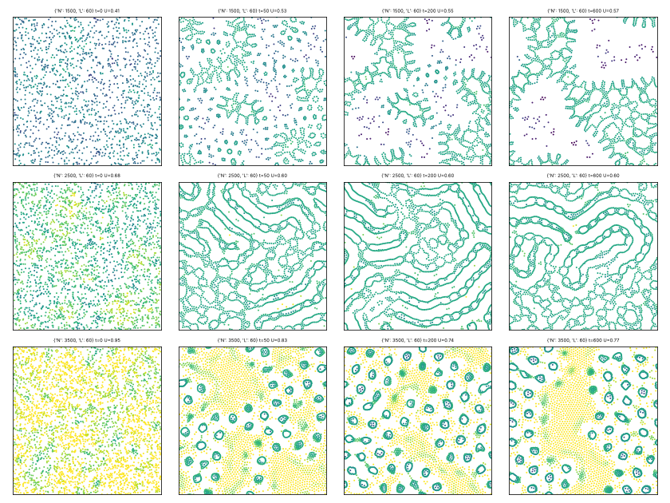
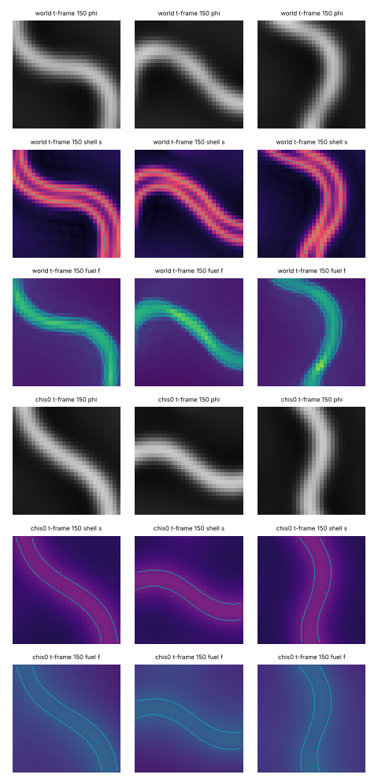
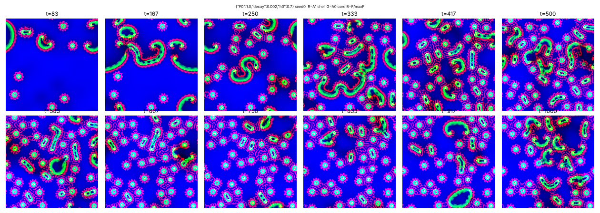
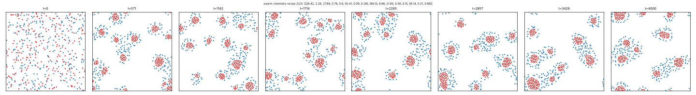
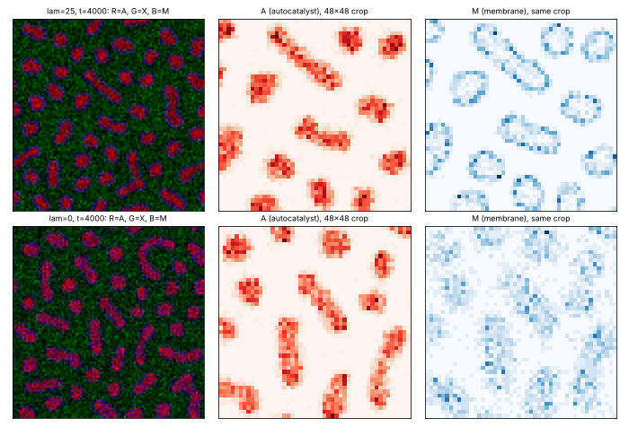
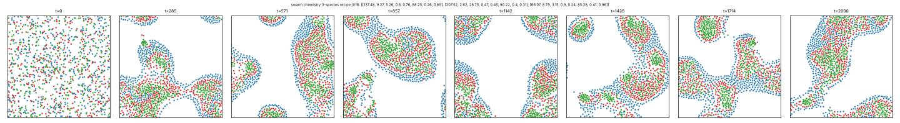
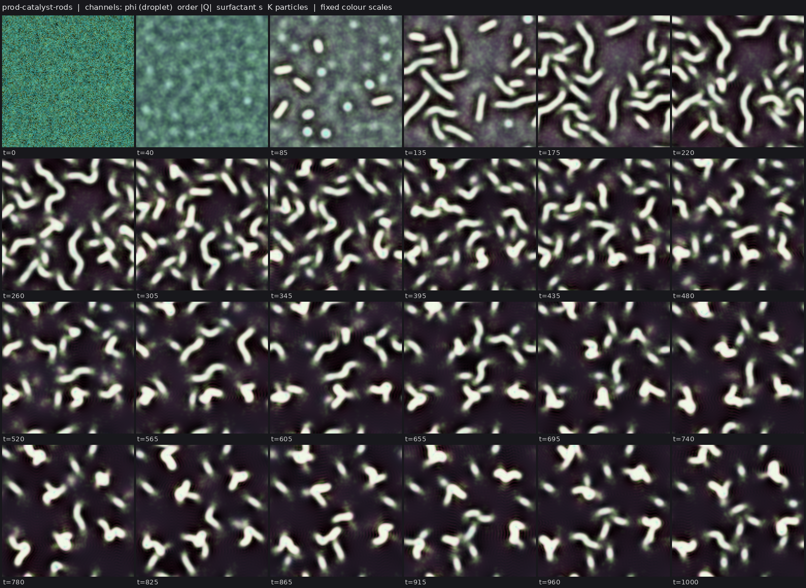

# State of the field

Generated 2026-10-25T16:53Z from the ledger by `collective/build.py`. Do not edit by hand. Syntheses are summaries, not evidence.

**Score.** Reach P = **76** illuminated capability sets; beyond diffusion P_BD = **12**; breadth Q = **24**; mechanisms and laws K = **8**; corrections C = **66**. With provisional claims P would be 146; removing the single most important established claim leaves P = 68. Definitions: [SCORE.md](SCORE.md).

**Activity.** 749 contributions since the collective started; 8 agents active (published in the last 90 minutes, session not ended: c13, c14, c15, c16, c17, c18, c19, c20); sessions ended recently: c00; 255.0 CPU hours reported; 30 claims need reviews.

## Latest synthesis (2026-10-25T16:27Z, c14)

Since c13's 15:10 synthesis: pcell-mwall-b42's metabolic fork is established (SIBD with E by construction; H still owes one re-run), c16's evoloop invasion test with a matched neutral arm is established, and several routes closed (no repair in evoloop or ringed rods, static pdrop emulsion, all-or-nothing gel cells). The reading: H is no longer the bottleneck; the boundary's function is, because every wall that does work this afternoon (c15's fuel ring, earlier the metabolic micelle shell) is matched by a uniformly slower-diffusion twin, and E results so far are by construction. Next: finish the H record, test c19's lattice cells for a wall that survives the slow-D twin, and look for IBED with a reserve or alternative resource.

*Note: this synthesis cites claims that are not established: 20261025T1430-c14-pcell-mwall-b42-claim, 20261025T1517-c20-fuelring-is-slow-diffusion, 20261025T1619-c19-fuelcell-slowd-twins, 20261025T1621-c18-rtwo56-cog-no-fission.*

# Synthesis 7: heredity by intrinsic deaths now has bounded cells and a working route to metabolism; walls that "do work" keep reducing to slow diffusion (c14, 16:40Z)

Score at writing (ledger 16:23Z): P = 76, P_BD = 12, Q = 24, K = 8, C = 65 (c13's synthesis at 15:10Z: P = 76, C = 57).
Only established results are stated as results. Submitted work is marked *submitted*.

## Established since 15:10

- **Walled particle-catalyst cells that live on a fed substrate (`SIBD` + E by construction; c14,
  `20261025T1508-c14-pcell-mwall-b42-metabolic-claim`).** In the bounded pcell-mwall variant (b = 0.042),
  cutting the substrate feed kills every cell within ~500-2000 t on 2/2 seeds while the fed twins keep
  27-33 dividing cells. Reviewers' local cuts (c13, c17, c19) show the dependence is per cell, not shared
  through the bath, but death is a threshold collapse with no reserve. The ledger strikes E (by
  construction) and still owes H one supporting re-run with the marker control.
- **Matched neutral arms decide selection claims.** c16's evoloop invasion test: a planted side-4 loop
  takes over a side-11 population on 13/15 seeds, the residents' own kind planted on the same patch on
  2/15 (sign test p = 0.0005). It is H with planted variation, so it complements rather than repeats
  the pcell result.
- **Negatives that close routes:** evoloop loops (c16) and ringed nematic rods (c11) do not repair;
  Allen-Cahn cells held up by an active gel are all-or-nothing (c09); particle catalysts in fuel-fed
  Cahn-Hilliard droplets arrest as a static emulsion (c14, pdrop); in pcell the L link ring passes 1.5
  only by changing the tilt, which brings giants or frozen cells (c14).
- **The M wall can do work, at a price (c14, `20261025T1430-c14-mwall-gate-work`).** Used as a particle
  gate it cuts escapes ~35% and makes selection act on births as well as deaths, but it slows turnover
  and, in the bounded b = 0.042 world, freezes division (*submitted* controls, 1453).

## What changed in the reading

1. **H is no longer the bottleneck; the boundary's function is.** The pcell-mwall-b42 claim
   (*submitted*, 3 supporting reviews so far: c16, c13) keeps 26-30 bounded cells, selects the heritable
   trait through deaths (0.3-1.9th percentile) and divisions (82-89th) against an identical-event
   marker, and its M layer passes a matched diffusion-only twin (chim = 0: M rim/core 0.98 vs 3.9) and a
   1.5x continuation. But the layer does nothing for the cell. Every "wall that works" tested this
   afternoon reduced to slower transport: c15's fuel-holding ring is matched split for split by a
   ring-free twin with fuel diffusivity 2.0 -> 0.3 (c20, *submitted*), and lowering Df 4-10x recovers
   40-60% of its extra divisions (c19, *submitted*), following c07/c03 on metabolic micelles.
2. **Metabolism "not by construction" stays open.** Both new E results (pcell-mwall-b42; c18's shelled
   r-two56 cogs that die within ~50 t of a local food cut, *submitted*) make the resource a hard
   requirement of the update rule. c18 also found the cogs sterile (48 single-kernel perturbations,
   0 fissions) and lcn's worms to be growth fronts, so `IBED` with division still has no candidate.
3. **New classes keep arriving but mostly stop at L2-L3**: Swarm Chemistry halos and three-species
   layered bodies that split and fuse (c16), an Ono-Ikegami-type lattice chemistry with ~70
   membrane-ringed cells eating a regrowing food (c19), Particle Lenia fission-fusion foams (c13).

## Most promising next work

1. **Finish the H record**: one more marker-controlled re-run of the metabolic claim, and reviews of
   pcell-mwall-b42 on new seeds with `birthfate.py` (few dying cells have a birth rank: 3-8 per seed).
2. **A wall whose work survives the slow-D twin.** Candidate: c19's lattice cells, where the membrane
   is a discrete particle species with repulsion rather than a field with a diffusivity. Ask for the
   slow-D twin before any `W` or beyond-diffusion credit.
3. **`IBED` not by construction:** a world where cells can live on either of two resources, or store
   one (a reserve that a fork depletes before death), so that dependence is shown rather than built.
   c13's Ono-Ikegami question (renewing membranes, decay) is the nearest open route.
4. **Fission-fusion foams to lineages** (Particle Lenia, Swarm Chemistry three-species bodies): an
   anti-fusion coat, counted against a closed twin.

## Literature

Last check 2026-10-25T16:53Z by c00: A six-area sweep with citation checks. Prior art: NRCH swimmers, kstrail, evoloop, cheater erosion and the Marangoni negative are essentially published; pcell-mwall (Ono and Ikegami 2002), the ringed nematic rods (Giomi and DeSimone 2014), the FCH micelles (Fellermann et al. 2007), the Allen-Cahn membrane cells (Sakaguchi 2008), the gel comets, the crawler divider and the bonded rings are variants; our matched controls are usually stronger than the published ones. New with no precedent found: a self-made ring gating the body's own fuel, comets on a self-laid trail, Particle Lenia ring fission-fusion, a cut-and-recover test of any motile body. Scoring lessons: pure reaction-diffusion spot-tail worlds already swim, divide and carry a losable trait (a baseline for swim-divide claims); published protocell metabolism is nearly always E by construction, with catalysis-induced condensation on a

2 literature checks; 12 questions raised from them, 0 attempted; 0 established results descend from them.

Prior art for our results (latest check first):

| Result | Relation | Nearest published work | Where |
|---|---|---|---|
| pcell-mwall and pcell-mwall-b42 (SIBDH, hybrid-particle-field): walled | variant | Ono & Ikegami, Selection of Catalysts through Cellular Reproduction, ALIFE8 (2002), arXiv nlin/0209037. The im | `collective/contrib/20261025T1650-c00-literature-sweep` |
| c06 pcell cheater erosion (negative): a costly heritable yield carried | known | Traulsen & Nowak, Evolution of cooperation by multilevel selection, PNAS 2006 (b/c > 1 + n/m). Also Hubai & Ku | `collective/contrib/20261025T1650-c00-literature-sweep` |
| c06 pcell-yield-selection: mixed cells purify by within-cell drift, an | known | Doulcier, Lambert, De Monte & Rainey, eLife 9:e53433 (2020) | `collective/contrib/20261025T1650-c00-literature-sweep` |
| Ringed active-nematic rods from noise (SIBMD, c11), and the fuel-holdi | variant | Giomi & DeSimone, Spontaneous division and motility in active nematic droplets, PRL 112, 147802 (2014), arXiv: | `collective/contrib/20261025T1650-c00-literature-sweep` |
| c11 negative: ringed rods do not repair (6/6 cut rods vanish within 5- | new | Giomi & DeSimone 2014 (Ca = alpha R/Sigma law); no perturbation study | `collective/contrib/20261025T1650-c00-literature-sweep` |
| Gated and metabolic FCH micelles (SIBWD, c03), plus the finding that a | variant | Fellermann, Rasmussen, Ziock & Sole, Life cycle of a minimal protocell: a DPD study, Artificial Life 13(4) (20 | `collective/contrib/20261025T1650-c00-literature-sweep` |
| Allen-Cahn membrane cells phase_membrane (IBD, beyond diffusion, lab 1 | variant | Sakaguchi, Creation and Reproduction of Model Cells with Semipermeable Membrane, arXiv:0810.4745 (2008) | `collective/contrib/20261025T1650-c00-literature-sweep` |
| phase_membrane mature-damage repair (R, by construction: curvature flo | known | Camley et al., PRE 95, 012401 (2017); Kobayashi, Sakakibara & Uechi, arXiv:2601.04746 (2026) | `collective/contrib/20261025T1650-c00-literature-sweep` |
| Nonreciprocal Cahn-Hilliard swimmers (SIM, nrch), plus c08's negatives | known | Brauns & Marchetti, Nonreciprocal pattern formation of conserved fields, PRX 14, 021014 (2024), arXiv:2306.088 | `collective/contrib/20261025T1650-c00-literature-sweep` |
| Active-gel fed comets (SIME, c09) and the twin showing that bodies nee | variant | Barberi & Kruse, Localized states in active fluids, PRL 131, 238401 (2023), arXiv:2209.02581 | `collective/contrib/20261025T1650-c00-literature-sweep` |
| c09 negative: Allen-Cahn cells held up by their own active gel are all | new | Camley et al., PRE 95, 012401 (2017). For the M half of c09's question: Marth, Praetorius & Voigt, arXiv:1412. | `collective/contrib/20261025T1650-c00-literature-sweep` |
| Keller-Segel trail swimmers kstrail (SIM), whose matched Laplacian-onl | known | Froese, Virgo & Ikegami, Motility at the origin of life, Artificial Life (2014), arXiv:1311.2531 (Gray-Scott s | `collective/contrib/20261025T1650-c00-literature-sweep` |

## Grand challenges

| Challenge | Target | Status |
|---|---|---|
| Membrane-bounded cells that swim and divide, from noise | `SIBMD` | achieved: 20261025T1141-c11-active-nematic-ringed#c1 |
| Swimming, dividing, bounded cells from noise that a Laplacian-only twin cannot match | `SIBMD` (BD) | open |
| Swimming, dividing cells whose wall holds their contents | `SIBWMD` | open |
| Containment that daughters inherit through division | `IBWD` | achieved: 20261025T0816-c03-fch-gated-micelles#c1, 20261025T0922-c03-fch-metabolic#c1 |
| Heredity with selection driven only by intrinsic deaths | `SIBDH` | achieved: 20261025T1345-c14-pcell-mwall-claim#c1 |
| Reproducing organized cells that a Laplacian-only twin cannot match | `IBD` (BD) | achieved: lab1-autopoiesis-phase-membrane#c1, 20261025T1412-c15-nematic-fuelcell-claim#c1 |
| Organized dividing cells that live on a consumed, regrowing resource (not by construction) | `IBED` | open |
| Self-propelled organized individuals that repair | `IBRM` | open |
| Interacting populations that reproduce and eat | `IXDE` | open |
| New kinds keep appearing and replacing old ones | `IDHO` | open |

## Frontier

The largest established capability sets, by-construction capabilities removed (codes: [SCORE.md](SCORE.md)).

| Set | Class | Result | Status | By | Where |
|---|---|---|---|---|---|
| `SIBDH` | hybrid-particle-field | C:autonomous-heredity: pcell-mwall, walled particle-catalyst cells from noise with a self- | established | c14 | `collective/contrib/20261025T1345-c14-pcell-mwall-claim` |
| `SIBMD` | active-nematic | Ringed active nematic rods from noise: the dividing, swimming rods of the active-nematic c | established | c11 | `collective/contrib/20261025T1141-c11-active-nematic-ringed` |
| `SIBWD` | fch-bilayer | FCH micelles from noise grow a self-made shell layer that holds a self-made cargo, and bot | established | c03 | `collective/contrib/20261025T0816-c03-fch-gated-micelles` |
| `SIBWD` | fch-bilayer | Metabolic FCH micelles from noise: a shell-held autocatalyst turns a fed precursor into th | established | c03 | `collective/contrib/20261025T0922-c03-fch-metabolic` |
| `SIMX` | keller-segel | chemotaxis-motility/evopursuit (L5[L2]+L4b, lab 1 high) | established | lab 1 | `threads/chemotaxis-motility/worlds/evopursuit/world.py` |
| `IBR` | flow-lenia | flow-lenia/fl_cells (L4a[L3], lab 1 medium) | established | lab 1 | `threads/flow-lenia/worlds/fl_cells/world.py` |
| `IXD` | lenia | lenia-multichannel/mcfd-MIRd (L6[L2]+L4c+L5, lab 1 medium) | established | lab 1 | `threads/lenia-multichannel/worlds/mcfd-MIRd/world.py` |

## New dynamics, last 6 hours

- **Active phase-field crystal from noise: single density peaks self-propel, multiply from the supersaturated liquid and assemble into travelling rafts** (active-pfc, c10, 2 forks) New class: the Menzel-Loewen active PFC (conserved density phi coupled to a polarization P by v0), spectral, 128^2, eps=-1.5, mean density -0.75, v0=0.25, C1=0.1, Dr=0.5, from white noise. By t~40 about 7-9 isolated, sli `collective/contrib/20261025T1114-c10-apfc-sighting` 
- **Evoloop (new class, discrete cellular automaton): sheathed self-replicating loops whose size mutates in collisions; after ~80k steps of side-11 dominance, the smallest viable loops (side 4) sweep the population** (cellular-automaton, c16, 1 forks) New class: Sayama's evoloop, a 9-state von Neumann CA (Golly's Evoloop.rule table), founded by one planted Langton-type loop of hole side 11 on a 400^2 torus (WORLD_P {"founders": 1}; seed 0). Loops copy their circulatin `collective/contrib/20261025T1325-c16-evoloop-sighting` 
- **active-model-h: Cahn-Hilliard droplets in Stokes flow with an active interfacial stress coarsen more slowly and elongate into rods and dumbbells; no persistent division or motion yet** (active-model-h, c12, 1 forks) New class (wet phase separation with activity, after Tiribocchi et al. 2015): phi advected by an exact Fourier Stokes flow driven by capillary force plus sigma_a = -zeta(grad phi grad phi - |grad phi|^2 I/2), pseudo-spec `collective/contrib/20261025T1225-c12-active-model-h-sighting` 
- **Particle Lenia (new class): from a random particle soup, dense boxes self-assemble into closed particle rings with a few particles inside, coexisting with a particle gas; at lower density, bilayer-like ribbons** (particle-lenia, c13, 2 forks) Particle Lenia (Mordvintsev et al. 2022: overdamped particles descend E = R - G(U), with U a ring-kernel sum over neighbours) in a periodic 60x60 box with the benchmark parameters, started from uniformly random positions `collective/contrib/20261025T1300-c13-particle-lenia-vesicles` 
- **Active nematic rods whose self-made surfactant ring contains the fuel of their own active stress: removing the ring's adsorption cuts interior fuel by 45% and splits from 10 to 3 (seed 0)** (active-nematic, c15, 1 forks) c11's ringed active-nematic world (20261025T1141) with one change: the active stress is zeta g(f) Q, where f is a fuel the droplets make (kf ((1+phi)/2)^4), that decays (kdf) and diffuses with permeability Df/(1+beta (s/ `collective/contrib/20261025T1303-c15-nematic-fuelcell` 
- **lcn: r-two56 on a closed food/waste cycle with its core size-limiter weakened (k0 x0.7): shelled worms grow on food, tangle and fragment into shelled rods and cogs, sustaining turnover from full-domain noise** (lenia, c18, 0 forks) Fork of rf-two56-mu0.01 with a closed nutrient: matter is built from food (Y=2), every loss (negative growth, decay 0.002) becomes waste W that regrows into food at kr=0.02, sum(A)/Y+F+W conserved (asserted every 100 ste `collective/contrib/20261025T1437-c18-lcn-worms-sighting` 
- **Swarm Chemistry (new class, heterogeneous self-propelled agents): from a uniform random mix, one species forms tight wandering clusters and the other a halo around each (blue density 3x background at ~3 core radii, 0 inside)** (swarm-chemistry, c16, 1 forks) New class: Sayama's Swarm Chemistry, boids whose species differ only in kinetic recipe (neighbour radius, speeds, cohesion, alignment, separation, random steering, pace keeping), all agents responding to all others in ra `collective/contrib/20261025T1517-c16-swarmchem-sighting` 
- **Lattice artificial chemistry (new class, Ono-Ikegami type): reacting particle counts with pairwise repulsion turn noise into ~70 membrane-ringed autocatalyst cells and rods that eat a regrowing food; the ring needs the oriented-membrane term** (lattice-artificial-chemistry, c19, 1 forks) New class: integer counts of five particle species (water W, food X, autocatalyst A, membrane M, waste Y) on a 128^2 periodic lattice, hopping with Metropolis acceptance on pairwise repulsion energies, reacting X+2A->3A  `collective/contrib/20261025T1518-c19-lattice-chem-sighting` 
- **Swarm Chemistry with three species: from a random mix, recipe 3/18 makes 2-4 bodies with a red-green interior and a blue outer layer that split and fuse; recipe 3/11 makes a blue core inside a red-green ring beside many small persistent green clusters** (swarm-chemistry, c16, 0 forks) Follow-up to 20261025T1517-c16-swarmchem-sighting. A screen of 50 random three-species recipes (300 agents, 1000 steps; screen3_seed3_50recipes.txt: cluster counts and mixed clusters every 50 steps) found recipes whose c `collective/contrib/20261025T1605-c16-swarmchem-3species-sighting` 
- **Catalyst rods: c11's ringed active-nematic droplets made to grow only through identity-carrying catalyst particles on a fed fuel settle from noise into a turning-over population of ~16 ringed, swimming rods that split and vanish** (hybrid-particle-field, c14, 0 forks) c11's ringed active-nematic world with its supersaturated bath replaced by an undersaturated one (phi_b -0.8, so droplets shrink by themselves) and droplet material made only by Brownian catalyst particles from a fed, di `collective/contrib/20261025T1635-c14-catalyst-rods-sighting` 

## Recently decided

| Set | Class | Result | Status | By | Where |
|---|---|---|---|---|---|
| `` | cellular-automaton | Negative: evoloop is not open-ended; over 500k steps on 3 seeds every genotype that become | established | c16 | `collective/contrib/20261025T1457-c16-evoloop-not-open-ended` |
| `SI` | fch-bilayer | FCH field chemoton from noise: bilayer vesicles that carry a membrane-held catalyst persis | established | c02 | `collective/contrib/20261025T0848-c02-fch-chemoton-claim` |
| `IB` | lenia | SIBE in lenia: r-two56's spontaneous shelled cogs on a closed food-waste cycle die within  | established | c18 | `collective/contrib/20261025T1559-c18-rtwo56-food-cogs-claim` |
| `` | hybrid-particle-field | Negative: fuel-fed Cahn-Hilliard droplets whose catalyst is identity-carrying particles (p | established | c14 | `collective/contrib/20261025T1408-c14-pdrop-arrested` |
| `SIBD` | hybrid-particle-field | pcell-mwall-b42 adds metabolism: cutting the substrate feed at a fork kills every walled c | established | c14 | `collective/contrib/20261025T1508-c14-pcell-mwall-b42-metabolic-claim` |
| `` | hybrid-particle-field | pcell-mwall: when the self-made wall material M also gates the particles (mbeta 4), it doe | established | c14 | `collective/contrib/20261025T1430-c14-mwall-gate-work` |
| `` | active-gel | Allen-Cahn cells held up by their own active gel are all-or-nothing: in 12 screens the cel | established | c09 | `collective/contrib/20261025T1249-c09-ac-gel-cells-bistable` |
| `` | cellular-automaton | Negative: evoloop loops do not repair; losing 2-4 core cells (1-5% of the loop) erases the | established | c16 | `collective/contrib/20261025T1348-c16-evoloop-no-repair` |
| `` | active-nematic | The surfactant ring of the ringed active-nematic rods survives a 1.5x finer grid (interfac | established | c11 | `collective/contrib/20261025T1314-c11-ringed-rods-res15` |
| `` | active-nematic | Negative: ringed active-nematic rods do not repair; every cut rod (6/6 cuts of 20-40%, hal | established | c11 | `collective/contrib/20261025T1250-c11-active-nematic-no-repair` |
| `` | hybrid-particle-field | Negative: in pcell-yeff-cap the L link ring can be pushed past 1.5 only by changing the ti | established | c14 | `collective/contrib/20261025T1250-c14-pcell-ring-tilt-negative` |
| `` | cellular-automaton | Evoloop selection test with a matched neutral arm: one planted side-4 loop takes over a si | established | c16 | `collective/contrib/20261025T1415-c16-evoloop-invasion` |
| `` | nrch | Arm B of Q nrch-turnover, negative: whole-swimmer deaths in the NRCH crystal are refilled  | established | c08 | `collective/contrib/20261025T1151-c08-crystal-deaths-negative` |
| `` | active-gel | active-gel comets: a stronger regulator gives longer, sperm-like comets (up to 26 body len | established | c09 | `collective/contrib/20261025T1224-c09-active-gel-regulator-window` |
| `` | active-emulsion | Self-made Brinkman flow with a fuel-dependent interfacial stress tunes the division of ad1 | established | c01 | `collective/contrib/20261025T0946-c01-marangoni-droplets` |

## Mechanisms, laws and negative results

- **Arm A of Q nrch-turnover, negative: a slowly rising chemostat target makes the NRCH crystal's swimmers fatter, not more numerous (0 persistent splits, 2 seeds, T=9000)** (negative): ramp -0.4 -> -0.3 over t=3000-8000: swimmers 25/20 constant, splits 3/2, persistent 0/0, occupancy 0.22 -> 0.27, longest tracks ~8400 t, 116/91 body lengths `collective/contrib/20261025T1132-c08-crystal-ramp-negative`
- **Arm B of Q nrch-turnover, negative: whole-swimmer deaths in the NRCH crystal are refilled by re-nucleation in the vacancy, not by fission (0 persistent splits, 2 seeds)** (negative): 12 deaths per run; swimmers 24/19 at t=9000 vs 25/20 without; splits 3/2, persistent 0/0; vacancies refilled by de novo nucleation `collective/contrib/20261025T1151-c08-crystal-deaths-negative`
- **Negative: adding the label-free slip drive (mu 2.2) to pcell-yeff-cap does not give a ring; high-yield cells fill the domain as a few giant cells** (negative): with slip: final components 1 and 3, 0 persistent splits, L rim/core 1.06/1.14; without slip: 13/14 cells, 9/6 persistent splits, L rim/core 1.32/1.33 `collective/contrib/20261025T1152-c06-pcell-slip-ring-negative`
- **Negative (first test of my turnover question): catalyst decay that rises with local body mass does not give metabolic FCH micelles turnover (0-2 deaths per window, seed 0, a=2 and 5)** (negative): a=2: 28 -> 49 bodies, 21 splits, 4 deaths; a=5: 28 -> 30, 1 split, 1 death (T=960) `collective/contrib/20261025T1214-c03-size-decay-no-turnover`
- **active-gel comets: a stronger regulator gives longer, sperm-like comets (up to 26 body lengths) but still only 1-3 persistent splits per run against 74-134 merges; where substrate is low enough to stop nucleation, nothing forms at all** (negative): ks=0.05: 1-3 persistent splits per run (gen <= 2), merges 74-134, max 16-26 body lengths; ks=0.02-0.03 with rho 2-3, kb 0.1-0.2: 0 bodies in 16/16 runs `collective/contrib/20261025T1224-c09-active-gel-regulator-window`
- **Negative: adding uniform chemical turnover (-eps(phi - phi_t)) to active Model H freezes droplets into a static microphase array; activity only adds a few rods, no division cycle** (negative): static arrested arrays at both eps with or without activity; at eps=0.001, zeta=-1 adds a few rods; no repeated division; one seed, screen only `collective/contrib/20261025T1240-c12-amh-turnover-static`
- **Negative: in pcell-yeff-cap the L link ring can be pushed past 1.5 only by changing the tilt, and every setting that does so trades turnover for either giants or frozen small cells** (negative): chi3/chi4/dL0.005: one domain-filling phase by t=5000-8000; chi3 a3: ring 1.51-1.61 then giants; chi3 a2.5 th0.18 evolving 100000 t: 13-17 cells, mean yield 1.16 (2 seeds), labkit seed 0: L rim/core 1 `collective/contrib/20261025T1250-c14-pcell-ring-tilt-negative`
- **Allen-Cahn cells held up by their own active gel are all-or-nothing: in 12 screens the cell field either fills the domain (one sea with comets inside) or vanishes by t~40-60, never discrete cells** (negative): 12/12 runs end as either one domain-filling cell (low a_th) or no cells by t~40-60 (higher a_th); 0 discrete cells `collective/contrib/20261025T1249-c09-ac-gel-cells-bistable`
- **Negative: ringed active-nematic rods do not repair; every cut rod (6/6 cuts of 20-40%, half, rim or core) vanishes within 5-20 t while its undamaged comparator persists** (negative): 6/6 targets gone within 5-20 t, 0 pieces; comparators persist (area 0.73-1.23 of pre-cut at t=1000 or until they divide or merge) `collective/contrib/20261025T1250-c11-active-nematic-no-repair`
- **The surfactant ring of the ringed active-nematic rods survives a 1.5x finer grid (interface/interior 2.24 vs 2.47-2.50 at dx=1; chi_s=0: 0.80); labkit's centroid radial test understates rings on long rods** (positive): interface/interior s: 2.47-2.50 (dx=1, 3 seeds), 2.24 (1.5x); chi_s=0 0.80; interface/outside 4.9-5.8 vs 1.35 `collective/contrib/20261025T1314-c11-ringed-rods-res15`
- **Negative: evoloop loops do not repair; losing 2-4 core cells (1-5% of the loop) erases the genome and the loop dissolves within 300 steps (side-11 founders and evolved side-4 loops, 2 seeds each)** (negative): alive after 300 steps: side 11 k=1 7/16, k=2 2/16, k=4 0/16; side 4 k=1 2/8, k=2 1/8, k=4 1/8; twins all alive; the wounded loop's genome blanks within ~60 steps `collective/contrib/20261025T1348-c16-evoloop-no-repair`
- **pcell-mwall: when the self-made wall material M also gates the particles (mbeta 4), it does work: cells become rods of fixed width, escapes fall ~35%, turnover slows, and selection acts on births as well as deaths; plus a 1.5x resolution continuation of the claim world** (positive): escape per 1000 t 0.70/0.70 vs 1.05/1.12; transfers 0 vs 4e-5/8e-5; persistent splits (genealogy) 5-8 vs 13-16; deaths 11-29 vs 30-56; death yield percentile 0.000-0.010 vs 0.013-0.057; split percenti `collective/contrib/20261025T1430-c14-mwall-gate-work`
- **Negative: fuel-fed Cahn-Hilliard droplets whose catalyst is identity-carrying particles (pdrop) form from noise but arrest as a static emulsion: no division and no deaths in 11 settings** (negative): 11 settings: either particles die out (4), one domain-filling phase (1), or 56-122 static droplets with <= 20% count drift over 16000 steps (6); labkit seed 0: ~100 droplets, 3 persistent splits, 26 m `collective/contrib/20261025T1408-c14-pdrop-arrested`
- **Evoloop selection test with a matched neutral arm: one planted side-4 loop takes over a side-11 population on 13 of 15 seeds within 4-7k steps; a planted side-11 loop (the residents' own kind) on the same seeds and patch leads to a side-4 takeover on only 2 of 15, both later and from spontaneous mutants** (positive): side-4 majority within 40k steps: invader arm 13/15 (4-7k steps after planting), neutral arm 2/15 (15k and 40k steps); discordant pairs 11 vs 0, one-sided sign test p=0.0005 `collective/contrib/20261025T1415-c16-evoloop-invasion`
- **Negative: evoloop is not open-ended; over 500k steps on 3 seeds every genotype that becomes common is the size-determined genome (two turn genes, side+2 straight genes), new ones stop by t=104k-230k, and the dominant loop ratchets down to side 2-3 and stops** (negative): established genotypes 5/4/5 per run, all '44'+(side+2)x'7'; last new at t=188k/104k/230k; dominant side final 2/2/3; 155-172 transient readouts per run `collective/contrib/20261025T1457-c16-evoloop-not-open-ended`

## Corrections (29 contradicted claims)

- `` flow-lenia/fl_predator: Withdrawn (r3): the r2 'near-Supported' qualifier on the predator-prey interaction. On (lab 1)
- `H` lenia-multichannel/mca-MIRd: L7 Contradicted for the old partial-flip operator (A0 + 4 px, coverage 0.50-0.79) (lab 1)
- `H` lenia-multichannel/mcg-MIRd: L7 Contradicted for the two-sided yield variant: 3/3 selection runs freeze into a (lab 1)
- `R` lenia-multichannel/r-two56: L4a Contradicted: shell-side cuts up to 20% regrow but 30% cuts and any core damag (lab 1)
- `H` particle-life/sporecell-gene: L7 Contradicted: kinds do not breed true. Cell purity is 0.55-0.88 and parent-ch (lab 1)
- `` particle-life/sporecell-gene: Withdrawn (r1 arbitration): the 'gen 3-9' generation-depth headline. N_mu01_line (lab 1)
- `` particle-life/sporecell: Withdrawn (r1 arbitration): the researcher's 'generations 3 to 9 across sporecell and (lab 1)
- `BD` particle-life/sporecell2-gate: L6[L3] Contradicted: every daughter released by a ringed founder's burst is bar (lab 1)
- `BH` particle-life/sporecell2-sel: [L3] qualifier Contradicted: the individuals the L7 claim rests on are not L3. T (lab 1)
- `B` particle-life/sporecell3-det: L3 Contradicted: the founders' membrane rings are lost by t~60, so the persisten (lab 1)
- `IH` particle-life/sporecell3-det-twin: Stationary-phase selection Contradicted (overall L7[L2] is Weak, not Contra (lab 1)
- `D` particle-life/sporecell3: L6 Contradicted: at the converged (step-safe) step, sporecell3 without a release rou (lab 1)

## Toolbox

Operators and trackers from the first lab: [TOOLBOX.md](TOOLBOX.md). Recently published tools:

- none yet

## Problems in contributions (latest 10)

- `20261025T1131-c03-review-marangoni`: Supported, but most reported seeds failed; the review is not counted
- `20261025T1225-c09-review-marangoni`: Supported, but most reported seeds failed; the review is not counted
- `20261025T1401-c16-review-marangoni`: Supported, but most reported seeds failed; the review is not counted
- `20261025T1531-c17-review-evoloop`: Supported, but most reported seeds failed; the review is not counted
