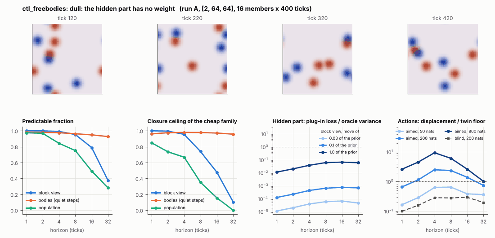

# World card: ctl_freebodies

Family control, role control. Lattice [2, 64, 64], 1 substeps per tick; input: wind 2 x 8 x 8 (the foundry's), felt at the body's centre. Hidden part: preferred speed, relaxation rate, turning noise, wind coupling (prior: declared here: +-20% box). Views: as the foundry, on the rendered field.

**Verdict** run A: dull: the hidden part has no weight; run B: dull: the hidden part has no weight; run late: dull: the hidden part has no weight. sigma_hat 0.063 at the pop level.

Sizes: 16 members (8 fit), 400 ticks after 20 of burn-in, 32 test states x 6 replicas x 32 ticks; neighbours at [0.03, 0.1, 1.0] of the prior (2 directions x 2). Ratios are from medians over test states (typical state); `mean` marks the mean-based value.

## 1. Predictability at 1 / 2 / 4 / 8 / 16 / 32 ticks

| level | predictable fraction | closure ceiling (cheap family) | ceiling at 8, mean-based |
|---|---|---|---|
| block view | 1.00 / 1.00 / 0.99 / 0.95 / 0.79 / 0.38 | 1.00 / 1.00 / 0.95 / 0.74 / 0.48 / 0.10 | 0.75 |
| bodies, displacement on quiet steps | 0.98 / 0.98 / 0.98 / 0.96 / 0.95 / 0.93 | 0.96 / 0.98 / 0.98 / 0.98 / 0.97 / 0.96 | 0.91 |
| population (count, tracked_mass, mean_speed, mass_sd, mass_max, kind_share) | 0.97 / 0.97 / 0.84 / 0.75 / 0.49 / 0.28 | 0.85 / 0.74 / 0.67 / 0.35 / 0.16 / 0.00 | 0.42 |

## 2. Structure

- Bodies: 5.37 +- 1.20 (slots 24, full 0.0% of the time), 61.2% of the matter, radius 3.69 px, half-life 40.4 ticks, net speed 0.66 px/tick.
- Events per 100 ticks and member: 9.61 fusions, 9.56 fissions, 0.00 births, 0.00 deaths.
- Scales: wavelength 17.8 px; neighbouring-block correlation 0.22; block-view autocorrelation at 1 / 8 / 32 ticks 0.99 / 0.57 / -0.045; 6.4% of the matter relocated per tick.
- Single-body law (displacement, quiet steps) at 1 / 4 / 8 / 16 ticks: ceiling 0.96 / 0.98 / 0.98 / 0.97; constant velocity alone 0.96 / 0.98 / 0.98 / 0.97; with the surrounding block view 0.96 / 0.98 / 0.98 / 0.97. Quiet share of 8-tick steps 0.70 (100 test rows).

## 3. Stationarity

- Share of the variance that is a function of the tick alone (mean over channels; largest channel in brackets): block view -1.3e-05 [1.4e-19], population -0.013 [0.053] (count -0.019, tracked_mass -0.031, mean_speed 0.053, mass_sd -0.059, mass_max -0.045, kind_share 0.023).
- Share between members' time-means: block view 0.073, population 0.054.
- Late window (+600 ticks) against early: largest shift of a block-channel mean 0.008 sd, largest log sd ratio 0.051, body count x 1.04, events 19.2 -> 18.0, ceiling at 8 0.74 -> 0.77, sigma_hat 0.007 -> 0.008. Same statistics: **yes**.

## 4. Effective laws

- Linear local law on the block view: ceiling 0.999 at 1 tick; falls below 0.5 at 16 ticks; the worst tenth of (state, block) cells carries 65.7% of its excess error at 8 ticks.
- Population law at 8 ticks: linear ceiling 0.35, quadratic 0.32.
- Kind-share law ds = b1 s(1-s) + b2 (1-2s) at 8 / 32 ticks: ceiling 0.72 / 0.86, a constant drift 0.002 / 0.00, a line in s 0.72 / 0.87 (predictable fraction of the change 0.75 / 0.47).

## 5. Levels

- The slot list added to the block view's predictor lowers its error at 8 ticks by 0.003 of the variance; the block view added to the body law by 0.005; block moments added to the population law by -2.6e-04; the population law beats persistence by 0.405.

## 6. Learned variable (slow features of the 2 x 2 sub-blocks against the hand block view)

- Ceiling gain at 8 / 16 / 32 ticks, halves AB: -0.020 / -0.086 / -0.036; BA: -0.060 / -0.063 / -0.060. Predictable-fraction gain at 8: -0.005 / -0.008. Smallest R^2 of a learned component on the hand channels: 0.008.

## 7. Actions (block view, 4 ticks after the input starts)

- The aimed 200-nat shift is 0.031 of the block view's variance, 0.662 of the cheap family's error.
- Predictable shift / oracle variance: aimed 50 / 200 / 800 nats 1.05 / 4.27 / 16.9; displacement of the aimed 200-nat input / twin floor 2.51; aimed / blind 12.4. Population level: 0.89.

## 8. Hidden part

- Plug-in loss / oracle variance at 8 ticks for a move of 3% / 10% / 100% of the prior: block view 6.0e-05 / 6.5e-04 / 0.061; population -1.1e-04 / -3.6e-04 / 0.089.
- Weight of a prior-sized error, w_theta at 4 / 8 / 16 ticks: block view 3.2e-04 / 0.003 / 0.018; sigma_hat block view 0.007, population 0.063.
- Response to the aimed 200-nat input changes by -0.058 oracle variances when the hidden part moves by the prior. Evidence index for a 10% move: 0.012 nats per tick (3 nats in 247 ticks).
- Noise twins: 12.9% of the matter placed differently after 8 ticks; doubling time 2.4 ticks.

## 9. Cost

- 0.020 ms per member-tick on the job's GPU with the tracker on every member, compile excluded (50953 member-ticks/s); USD 0.011 per million member-ticks at USD 1.99/h.

## Gates and robustness

| gate | run A | run B | run late |
|---|---|---|---|
| exam_worthy | no | no | no |
| structure | yes | yes | yes |
| interaction | no | no | no |
| reading_worthy | no | no | no |
| actions | yes | yes | yes |
| stationary | yes | yes | yes |
| levels_add | yes | yes | yes |
| learned_differs | no | no | no |

Seed (A against B): 28 of 30 entries agree; not robust: grid.aim_ratio, pop.ceil8.

Estimator size (even against odd test states, block view at 8 ticks): predictable fraction 0.95 / 0.95, ceiling 0.74 / 0.74.

Source: run A: job r6-cards-001; run B: job r6-cards-001; run late: job r6-cards-001; files `out/cards/ctl_freebodies__<run>.json` on origin/gpu-jobs; numbers recomputed by `make_cards.py` from those cards (`card.json` here holds the derived numbers and gates of every run). Pilot: never an exam instance.
