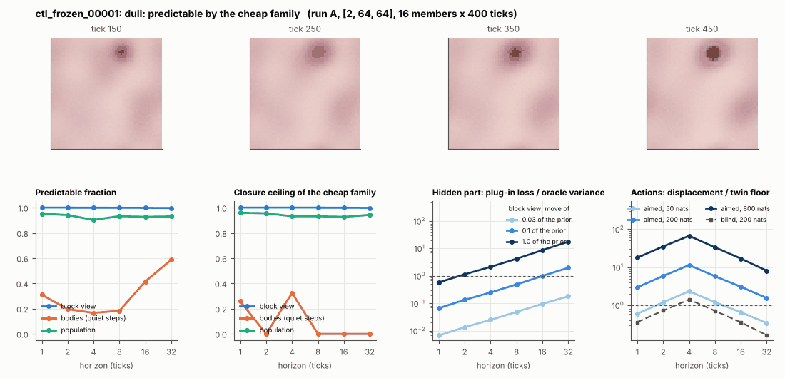

# World card: ctl_frozen_00001

Family foundry, role control. Lattice [2, 64, 64], 4 substeps per tick; input: wind 2 x 8 x 8, noise std 0.25. Hidden part: 240 weights of the law net (+ 10 scalars, kept by the neighbours) (prior: round5/foundry/tnca.py draw_theta; neighbour = round 5's weight neighbour). Views: block means of each kind and of S^2 on 8 px blocks; blob tracker on S / mean(S) > 2.

**Verdict** run A: dull: predictable by the cheap family; run B: dull: predictable by the cheap family; run late: dull: the hidden part has no weight. sigma_hat 0.026 at the pop level.

Sizes: 16 members (8 fit), 400 ticks after 50 of burn-in, 32 test states x 6 replicas x 32 ticks; neighbours at [0.03, 0.1, 1.0] of the prior (2 directions x 2). Ratios are from medians over test states (typical state); `mean` marks the mean-based value.

## 1. Predictability at 1 / 2 / 4 / 8 / 16 / 32 ticks

| level | predictable fraction | closure ceiling (cheap family) | ceiling at 8, mean-based |
|---|---|---|---|
| block view | 1.00 / 1.00 / 1.00 / 1.00 / 1.00 / 1.00 | 1.00 / 1.00 / 1.00 / 1.00 / 1.00 / 1.00 | 1.00 |
| bodies, displacement on quiet steps | 0.31 / 0.20 / 0.17 / 0.18 / 0.42 / 0.59 | 0.26 / 0.00 / 0.32 / 0.00 / 0.00 / 0.00 | 0.00 |
| population (count, tracked_mass, mean_speed, mass_sd, mass_max, kind_share) | 0.95 / 0.94 / 0.90 / 0.93 / 0.93 / 0.93 | 0.96 / 0.96 / 0.93 / 0.93 / 0.93 / 0.94 | 0.97 |

## 2. Structure

- Bodies: 0.68 +- 0.62 (slots 24, full 0.0% of the time), 3% of the matter, radius 3.14 px, half-life 220 ticks, net speed 0.025 px/tick.
- Events per 100 ticks and member: 0.016 fusions, 0.00 fissions, 0.50 births, 0.58 deaths.
- Scales: wavelength 23.5 px; neighbouring-block correlation 0.35; block-view autocorrelation at 1 / 8 / 32 ticks 1.00 / 0.99 / 0.96; 1.0% of the matter relocated per tick.
- Single-body law (displacement, quiet steps) at 1 / 4 / 8 / 16 ticks: ceiling 0.26 / 0.32 / 0.00 / 0.00; constant velocity alone 0.00 / 0.00 / 0.00 / 0.00; with the surrounding block view 0.00 / 0.00 / 0.00 / 0.00. Quiet share of 8-tick steps 0.94 (22.0 test rows).

## 3. Stationarity

- Share of the variance that is a function of the tick alone (mean over channels; largest channel in brackets): block view 1.3e-04 [3.9e-04], population 0.026 [0.055] (count 0.053, tracked_mass 0.055, mean_speed -0.003, mass_sd 0.015, mass_max 0.035, kind_share 0.002).
- Share between members' time-means: block view 0.779, population 0.575.
- Late window (+1950 ticks) against early: largest shift of a block-channel mean 3.82 sd, largest log sd ratio 2.58, body count x 2.79, events 0.016 -> 0.34, ceiling at 8 1.00 -> 1.00, sigma_hat 2.9e-04 -> 0.001. Same statistics: **no**.

## 4. Effective laws

- Linear local law on the block view: ceiling 1.000 at 1 tick; falls below 0.5 at no horizon up to 32 ticks; the worst tenth of (state, block) cells carries 72.8% of its excess error at 8 ticks.
- Population law at 8 ticks: linear ceiling 0.93, quadratic 0.97.
- Kind-share law ds = b1 s(1-s) + b2 (1-2s) at 8 / 32 ticks: ceiling n/a / 0.060, a constant drift n/a / 3.1e-04, a line in s n/a / 0.065 (predictable fraction of the change -2.2e-16 / 0.91).

## 5. Levels

- The slot list added to the block view's predictor lowers its error at 8 ticks by -4.8e-05 of the variance; the block view added to the body law by -1.415; block moments added to the population law by -9.9e-04; the population law beats persistence by 0.165.

## 6. Learned variable (slow features of the 2 x 2 sub-blocks against the hand block view)

- Ceiling gain at 8 / 16 / 32 ticks, halves AB: -4.8e-05 / -1.4e-04 / -6.4e-04; BA: -1.5e-04 / -4.0e-04 / -7.8e-04. Predictable-fraction gain at 8: 2.1e-04 / -5.3e-04. Smallest R^2 of a learned component on the hand channels: 0.54.

## 7. Actions (block view, 4 ticks after the input starts)

- The aimed 200-nat shift is 0.004 of the block view's variance, 13.1 of the cheap family's error.
- Predictable shift / oracle variance: aimed 50 / 200 / 800 nats 2.95 / 14.1 / 77.6; displacement of the aimed 200-nat input / twin floor 11.4; aimed / blind 5.33. Population level: 17.7.

## 8. Hidden part

- Plug-in loss / oracle variance at 8 ticks for a move of 3% / 10% / 100% of the prior: block view 0.049 / 0.49 / 4.18; population 0.00 / 0.00 / 0.79.
- Weight of a prior-sized error, w_theta at 4 / 8 / 16 ticks: block view 0.001 / 0.004 / 0.015; sigma_hat block view 2.9e-04, population 0.026.
- Response to the aimed 200-nat input changes by 0.46 oracle variances when the hidden part moves by the prior. Evidence index for a 10% move: 6.41 nats per tick (3 nats in 0.468 ticks).
- Noise twins: 2.0% of the matter placed differently after 8 ticks; doubling time 17.8 ticks.

## 9. Cost

- 0.048 ms per member-tick on the job's GPU with the tracker on every member, compile excluded (20893 member-ticks/s); USD 0.026 per million member-ticks at USD 1.99/h.

## Gates and robustness

| gate | run A | run B | run late |
|---|---|---|---|
| exam_worthy | no | no | no |
| structure | no | no | no |
| interaction | no | yes | yes |
| reading_worthy | no | no | no |
| actions | yes | yes | yes |
| stationary | no | no | no |
| levels_add | no | no | yes |
| learned_differs | no | no | no |

Seed (A against B): 28 of 30 entries agree; not robust: s.half_life_ticks, b.pf_disp8.

Estimator size (even against odd test states, block view at 8 ticks): predictable fraction 1.00 / 1.00, ceiling 1.00 / 1.00.

Source: run A: job r6-cards-001; run B: job r6-cards-001; run late: job r6-cards-001; files `out/cards/ctl_frozen_00001__<run>.json` on origin/gpu-jobs; numbers recomputed by `make_cards.py` from those cards (`card.json` here holds the derived numbers and gates of every run). Pilot: never an exam instance.
