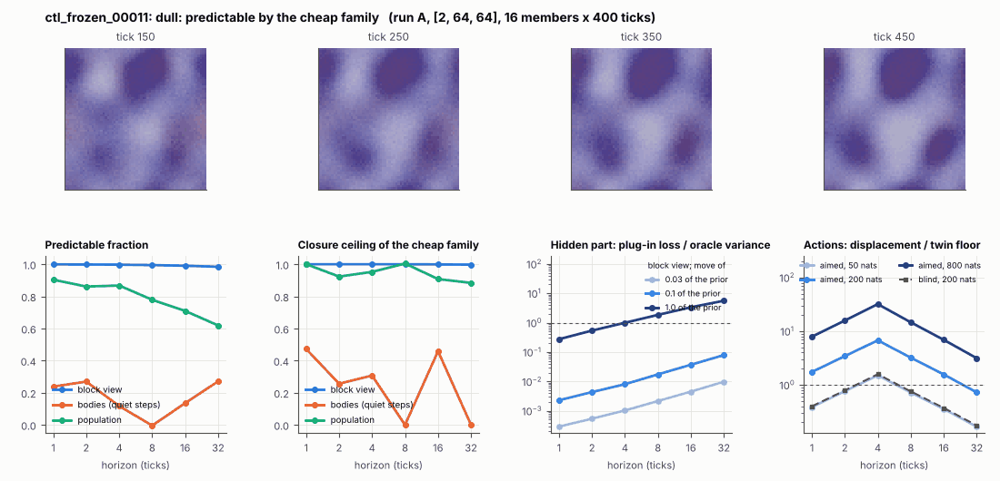

# World card: ctl_frozen_00011

Family foundry, role control. Lattice [2, 64, 64], 4 substeps per tick; input: wind 2 x 8 x 8, noise std 0.25. Hidden part: 240 weights of the law net (+ 10 scalars, kept by the neighbours) (prior: round5/foundry/tnca.py draw_theta; neighbour = round 5's weight neighbour). Views: block means of each kind and of S^2 on 8 px blocks; blob tracker on S / mean(S) > 2.

**Verdict** run A: dull: predictable by the cheap family; run B: dull: predictable by the cheap family; run late: dull: predictable by the cheap family. sigma_hat 0.032 at the pop level.

Sizes: 16 members (8 fit), 400 ticks after 50 of burn-in, 32 test states x 6 replicas x 32 ticks; neighbours at [0.03, 0.1, 1.0] of the prior (2 directions x 2). Ratios are from medians over test states (typical state); `mean` marks the mean-based value.

## 1. Predictability at 1 / 2 / 4 / 8 / 16 / 32 ticks

| level | predictable fraction | closure ceiling (cheap family) | ceiling at 8, mean-based |
|---|---|---|---|
| block view | 1.00 / 1.00 / 1.00 / 0.99 / 0.99 / 0.98 | 1.00 / 1.00 / 1.00 / 1.00 / 1.00 / 1.00 | 1.00 |
| bodies, displacement on quiet steps | 0.24 / 0.27 / 0.12 / -0.004 / 0.14 / 0.27 | 0.47 / 0.26 / 0.31 / -0.00 / 0.46 / 0.00 | 0.00 |
| population (count, tracked_mass, mean_speed, mass_sd, mass_max) | 0.90 / 0.86 / 0.87 / 0.78 / 0.71 / 0.62 | 1.00 / 0.92 / 0.95 / 1.00 / 0.91 / 0.88 | 0.93 |

## 2. Structure

- Bodies: 0.55 +- 0.75 (slots 24, full 0.0% of the time), 2% of the matter, radius 3.10 px, half-life 76.7 ticks, net speed 0.091 px/tick.
- Events per 100 ticks and member: 0.016 fusions, 0.016 fissions, 1.91 births, 1.59 deaths.
- Scales: wavelength 34.8 px; neighbouring-block correlation 0.52; block-view autocorrelation at 1 / 8 / 32 ticks 1.00 / 0.99 / 0.97; 2.3% of the matter relocated per tick.
- Single-body law (displacement, quiet steps) at 1 / 4 / 8 / 16 ticks: ceiling 0.47 / 0.31 / -0.00 / 0.46; constant velocity alone 0.00 / 0.00 / -0.00 / 0.00; with the surrounding block view 0.00 / 0.00 / -0.00 / 0.00. Quiet share of 8-tick steps 0.76 (11.0 test rows).

## 3. Stationarity

- Share of the variance that is a function of the tick alone (mean over channels; largest channel in brackets): block view 9.2e-04 [0.003], population 0.164 [0.260] (count 0.17, tracked_mass 0.26, mean_speed 0.085, mass_sd 0.093, mass_max 0.21).
- Share between members' time-means: block view 0.284, population 0.292.
- Late window (+1950 ticks) against early: largest shift of a block-channel mean 1.00 sd, largest log sd ratio 1.05, body count x 2.24, events 0.031 -> 2.23, ceiling at 8 1.00 -> 1.00, sigma_hat 3.0e-04 -> 2.3e-04. Same statistics: **no**.

## 4. Effective laws

- Linear local law on the block view: ceiling 1.000 at 1 tick; falls below 0.5 at no horizon up to 32 ticks; the worst tenth of (state, block) cells carries 69.1% of its excess error at 8 ticks.
- Population law at 8 ticks: linear ceiling 1.00, quadratic 1.00.

## 5. Levels

- The slot list added to the block view's predictor lowers its error at 8 ticks by -3.4e-07 of the variance; the block view added to the body law by -2.614; block moments added to the population law by 0.009; the population law beats persistence by 0.050.

## 6. Learned variable (slow features of the 2 x 2 sub-blocks against the hand block view)

- Ceiling gain at 8 / 16 / 32 ticks, halves AB: -0.001 / -0.002 / -0.005; BA: -0.001 / -0.002 / -0.004. Predictable-fraction gain at 8: 0.002 / 0.002. Smallest R^2 of a learned component on the hand channels: 0.002.

## 7. Actions (block view, 4 ticks after the input starts)

- The aimed 200-nat shift is 0.037 of the block view's variance, 12.0 of the cheap family's error.
- Predictable shift / oracle variance: aimed 50 / 200 / 800 nats 2.77 / 11.9 / 58.7; displacement of the aimed 200-nat input / twin floor 6.75; aimed / blind 4.68. Population level: 7.92.

## 8. Hidden part

- Plug-in loss / oracle variance at 8 ticks for a move of 3% / 10% / 100% of the prior: block view 0.002 / 0.017 / 1.85; population 0.00 / 0.00 / 4.08.
- Weight of a prior-sized error, w_theta at 4 / 8 / 16 ticks: block view 0.003 / 0.010 / 0.031; sigma_hat block view 3.0e-04, population 0.032.
- Response to the aimed 200-nat input changes by 0.048 oracle variances when the hidden part moves by the prior. Evidence index for a 10% move: 0.22 nats per tick (3 nats in 13.7 ticks).
- Noise twins: 3.7% of the matter placed differently after 8 ticks; doubling time 23.8 ticks.

## 9. Cost

- 0.048 ms per member-tick on the job's GPU with the tracker on every member, compile excluded (20783 member-ticks/s); USD 0.027 per million member-ticks at USD 1.99/h.

## Gates and robustness

| gate | run A | run B | run late |
|---|---|---|---|
| exam_worthy | no | no | no |
| structure | no | no | no |
| interaction | no | no | yes |
| reading_worthy | no | no | no |
| actions | yes | yes | yes |
| stationary | yes | yes | no |
| levels_add | no | no | no |
| learned_differs | no | no | no |

Seed (A against B): 23 of 30 entries agree; not robust: grid.aim_ratio, pop.pf8, pop.ceil8, pop.sigma_hat, pop.tick_share, pop.act_ms, s.events100.

Estimator size (even against odd test states, block view at 8 ticks): predictable fraction 1.00 / 0.99, ceiling 1.00 / 1.00.

Source: run A: job r6-cards-001; run B: job r6-cards-001; run late: job r6-cards-001; files `out/cards/ctl_frozen_00011__<run>.json` on origin/gpu-jobs; numbers recomputed by `make_cards.py` from those cards (`card.json` here holds the derived numbers and gates of every run). Pilot: never an exam instance.
