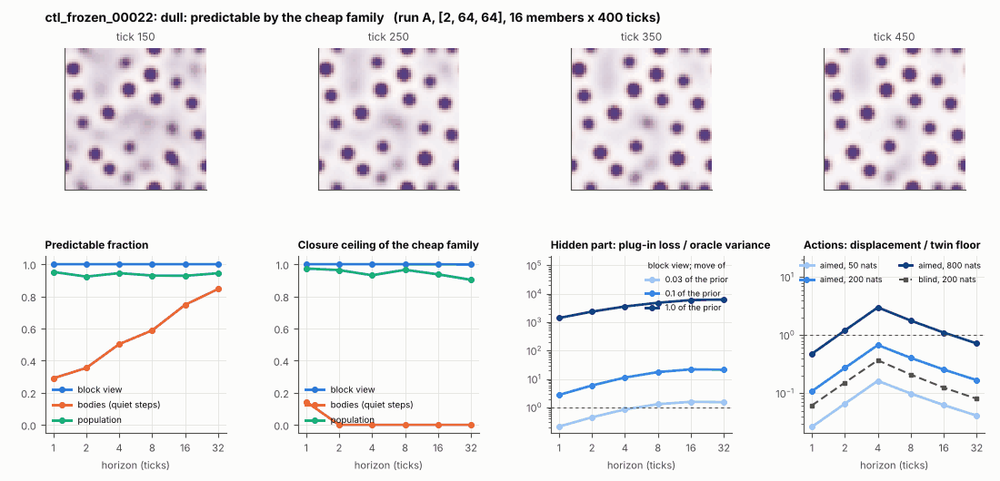

# World card: ctl_frozen_00022

Family foundry, role control. Lattice [2, 64, 64], 4 substeps per tick; input: wind 2 x 8 x 8, noise std 0.25. Hidden part: 240 weights of the law net (+ 10 scalars, kept by the neighbours) (prior: round5/foundry/tnca.py draw_theta; neighbour = round 5's weight neighbour). Views: block means of each kind and of S^2 on 8 px blocks; blob tracker on S / mean(S) > 2.

**Verdict** run A: dull: predictable by the cheap family; run B: dull: predictable by the cheap family; run late: dull: predictable by the cheap family. sigma_hat 0.055 at the pop level.

Sizes: 16 members (8 fit), 400 ticks after 50 of burn-in, 32 test states x 6 replicas x 32 ticks; neighbours at [0.03, 0.1, 1.0] of the prior (2 directions x 2). Ratios are from medians over test states (typical state); `mean` marks the mean-based value.

## 1. Predictability at 1 / 2 / 4 / 8 / 16 / 32 ticks

| level | predictable fraction | closure ceiling (cheap family) | ceiling at 8, mean-based |
|---|---|---|---|
| block view | 1.00 / 1.00 / 1.00 / 1.00 / 1.00 / 1.00 | 1.00 / 1.00 / 1.00 / 1.00 / 1.00 / 1.00 | 1.00 |
| bodies, displacement on quiet steps | 0.29 / 0.35 / 0.50 / 0.59 / 0.75 / 0.85 | 0.14 / 0.00 / 0.00 / 0.00 / 0.00 / 0.00 | 0.00 |
| population (count, tracked_mass, mean_speed, mass_sd, mass_max) | 0.95 / 0.92 / 0.94 / 0.93 / 0.93 / 0.94 | 0.97 / 0.96 / 0.93 / 0.97 / 0.94 / 0.90 | 0.95 |

## 2. Structure

- Bodies: 18.5 +- 1.89 (slots 24, full 0.0% of the time), 65.8% of the matter, radius 1.93 px, half-life 5299 ticks, net speed 0.004 px/tick.
- Events per 100 ticks and member: 0.14 fusions, 0.078 fissions, 1.53 births, 0.48 deaths.
- Scales: wavelength 10.7 px; neighbouring-block correlation -0.15; block-view autocorrelation at 1 / 8 / 32 ticks 1.00 / 1.00 / 1.00; 1.0% of the matter relocated per tick.
- Single-body law (displacement, quiet steps) at 1 / 4 / 8 / 16 ticks: ceiling 0.14 / 0.00 / 0.00 / 0.00; constant velocity alone 0.00 / 0.00 / 0.00 / 0.00; with the surrounding block view 0.098 / 0.00 / 0.021 / 0.11. Quiet share of 8-tick steps 1.00 (616 test rows).

## 3. Stationarity

- Share of the variance that is a function of the tick alone (mean over channels; largest channel in brackets): block view 0.005 [0.015], population 0.312 [0.923] (count 0.26, tracked_mass 0.92, mean_speed 0.26, mass_sd 0.044, mass_max 0.068).
- Share between members' time-means: block view 0.046, population 0.456.
- Late window (+1950 ticks) against early: largest shift of a block-channel mean 0.27 sd, largest log sd ratio 0.32, body count x 0.95, events 0.22 -> 0.00, ceiling at 8 1.00 -> 1.00, sigma_hat 1.8e-04 -> 1.5e-05. Same statistics: **yes**.

## 4. Effective laws

- Linear local law on the block view: ceiling 1.000 at 1 tick; falls below 0.5 at no horizon up to 32 ticks; the worst tenth of (state, block) cells carries 51.6% of its excess error at 8 ticks.
- Population law at 8 ticks: linear ceiling 0.97, quadratic 0.91.

## 5. Levels

- The slot list added to the block view's predictor lowers its error at 8 ticks by 6.5e-07 of the variance; the block view added to the body law by 0.014; block moments added to the population law by -4.9e-04; the population law beats persistence by 0.059.

## 6. Learned variable (slow features of the 2 x 2 sub-blocks against the hand block view)

- Ceiling gain at 8 / 16 / 32 ticks, halves AB: 1.8e-05 / 3.4e-05 / 1.1e-04; BA: 1.1e-05 / 2.3e-05 / 8.7e-05. Predictable-fraction gain at 8: 1.2e-05 / 1.2e-05. Smallest R^2 of a learned component on the hand channels: 0.006.

## 7. Actions (block view, 4 ticks after the input starts)

- The aimed 200-nat shift is 4.5e-05 of the block view's variance, 0.636 of the cheap family's error.
- Predictable shift / oracle variance: aimed 50 / 200 / 800 nats 0.32 / 1.34 / 6.23; displacement of the aimed 200-nat input / twin floor 0.68; aimed / blind 1.93. Population level: 0.052.

## 8. Hidden part

- Plug-in loss / oracle variance at 8 ticks for a move of 3% / 10% / 100% of the prior: block view 1.30 / 17.6 / 4855; population 0.059 / -0.071 / 657.
- Weight of a prior-sized error, w_theta at 4 / 8 / 16 ticks: block view 0.12 / 0.24 / 0.42; sigma_hat block view 1.8e-04, population 0.055.
- Response to the aimed 200-nat input changes by 3.24 oracle variances when the hidden part moves by the prior. Evidence index for a 10% move: 264 nats per tick (3 nats in 0.011 ticks).
- Noise twins: 1.9% of the matter placed differently after 8 ticks; doubling time 25.7 ticks.

## 9. Cost

- 0.047 ms per member-tick on the job's GPU with the tracker on every member, compile excluded (21101 member-ticks/s); USD 0.026 per million member-ticks at USD 1.99/h.

## Gates and robustness

| gate | run A | run B | run late |
|---|---|---|---|
| exam_worthy | no | no | no |
| structure | no | no | no |
| interaction | yes | yes | no |
| reading_worthy | no | no | no |
| actions | yes | yes | yes |
| stationary | yes | yes | no |
| levels_add | no | no | no |
| learned_differs | no | no | no |

Seed (A against B): 29 of 30 entries agree; not robust: pop.act_ms.

Estimator size (even against odd test states, block view at 8 ticks): predictable fraction 1.00 / 1.00, ceiling 1.00 / 1.00.

Source: run A: job r6-cards-001; run B: job r6-cards-001; run late: job r6-cards-001; files `out/cards/ctl_frozen_00022__<run>.json` on origin/gpu-jobs; numbers recomputed by `make_cards.py` from those cards (`card.json` here holds the derived numbers and gates of every run). Pilot: never an exam instance.
