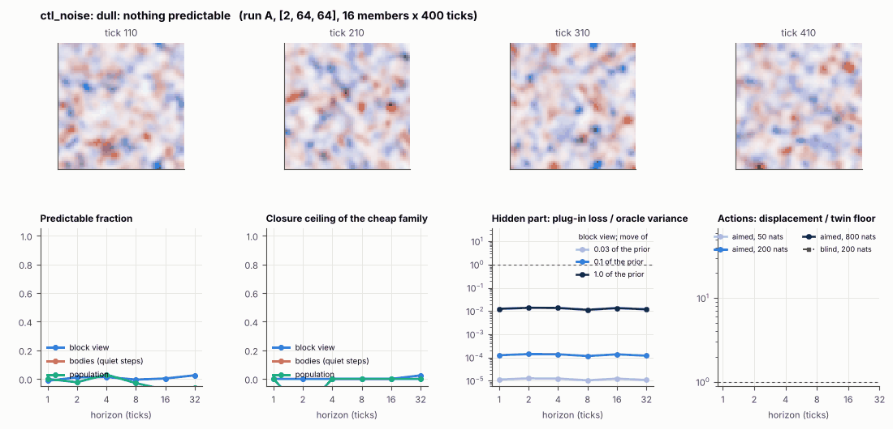

# World card: ctl_noise

Family control, role control. Lattice [2, 64, 64], 1 substeps per tick; input: ignored by the law. Hidden part: densities and contrast of the noise (prior: declared here: +-20% box). Views: as the foundry.

**Verdict** run A: dull: nothing predictable; run B: dull: nothing predictable. sigma_hat n/a at the None level.

Sizes: 16 members (8 fit), 400 ticks after 10 of burn-in, 32 test states x 6 replicas x 32 ticks; neighbours at [0.03, 0.1, 1.0] of the prior (2 directions x 2). Ratios are from medians over test states (typical state); `mean` marks the mean-based value.

## 1. Predictability at 1 / 2 / 4 / 8 / 16 / 32 ticks

| level | predictable fraction | closure ceiling (cheap family) | ceiling at 8, mean-based |
|---|---|---|---|
| block view | -0.013 / 0.011 / 0.013 / -0.005 / 0.003 / 0.025 | -0.00 / 0.00 / 0.00 / -0.00 / 0.00 / 0.025 | -0.00 |
| bodies, displacement on quiet steps | n/a / n/a / n/a / n/a / n/a / n/a | n/a / n/a / n/a / n/a / n/a / n/a | n/a |
| population (count, tracked_mass, mean_speed, mass_sd, mass_max, kind_share) | 6.9e-05 / -0.023 / 0.030 / -0.029 / -0.075 / -0.060 | 0.00 / -0.22 / 0.00 / -0.00 / -0.00 / -0.00 | 0.00 |

## 2. Structure

- Bodies: 11.6 +- 2.04 (slots 24, full 0.0% of the time), 25.3% of the matter, radius 2.11 px, half-life 1 ticks, net speed 2.60 px/tick.
- Events per 100 ticks and member: 16.4 fusions, 15.2 fissions, 736 births, 735 deaths.
- Scales: wavelength 10.5 px; neighbouring-block correlation 0.11; block-view autocorrelation at 1 / 8 / 32 ticks 0.002 / 0.005 / 6.3e-04; 51.8% of the matter relocated per tick.
- Single-body law (displacement, quiet steps) at 1 / 4 / 8 / 16 ticks: ceiling n/a / n/a / n/a / n/a; constant velocity alone n/a / n/a / n/a / n/a; with the surrounding block view n/a / n/a / n/a / n/a. Quiet share of 8-tick steps 2.9e-04 (0 test rows).

## 3. Stationarity

- Share of the variance that is a function of the tick alone (mean over channels; largest channel in brackets): block view -5.8e-06 [-4.2e-20], population 0.009 [0.014] (count -4.8e-05, tracked_mass 0.013, mean_speed 0.014, mass_sd 0.011, mass_max 0.010, kind_share 0.008).
- Share between members' time-means: block view 0.005, population 0.004.

## 4. Effective laws

- Linear local law on the block view: ceiling -0.000 at 1 tick; falls below 0.5 at 1 ticks; the worst tenth of (state, block) cells carries 57.0% of its excess error at 8 ticks.
- Population law at 8 ticks: linear ceiling -0.00, quadratic -0.00.
- Kind-share law ds = b1 s(1-s) + b2 (1-2s) at 8 / 32 ticks: ceiling 1.03 / 1.06, a constant drift 0.00 / 0.002, a line in s 1.03 / 1.06 (predictable fraction of the change 0.42 / 0.48).

## 5. Levels

- The slot list added to the block view's predictor lowers its error at 8 ticks by -2.6e-04 of the variance; the block view added to the body law by n/a; block moments added to the population law by -0.002; the population law beats persistence by 0.895.

## 6. Learned variable (slow features of the 2 x 2 sub-blocks against the hand block view)

- Ceiling gain at 8 / 16 / 32 ticks, halves AB: 0.00 / 0.22 / -0.004; BA: 0.00 / 0.12 / -0.029. Predictable-fraction gain at 8: -0.018 / 0.004. Smallest R^2 of a learned component on the hand channels: 0.089.

## 7. Actions (block view, 4 ticks after the input starts)

- The aimed 200-nat shift is 0.000 of the block view's variance, 0.000 of the cheap family's error.
- Predictable shift / oracle variance: aimed 50 / 200 / 800 nats 0.00 / 0.00 / 0.00; displacement of the aimed 200-nat input / twin floor 0.00; aimed / blind 0.00. Population level: 0.00.

## 8. Hidden part

- Plug-in loss / oracle variance at 8 ticks for a move of 3% / 10% / 100% of the prior: block view 1.0e-05 / 1.2e-04 / 0.011; population 9.2e-04 / 0.012 / 1.44.
- Weight of a prior-sized error, w_theta at 4 / 8 / 16 ticks: block view 0.99 / n/a / 4.27; sigma_hat block view 1.00, population 1.00.
- Response to the aimed 200-nat input changes by 0.00 oracle variances when the hidden part moves by the prior. Evidence index for a 10% move: 0.012 nats per tick (3 nats in 249 ticks).
- Noise twins: 51.6% of the matter placed differently after 8 ticks; doubling time n/a ticks.

## 9. Cost

- 0.021 ms per member-tick on the job's GPU with the tracker on every member, compile excluded (47288 member-ticks/s); USD 0.012 per million member-ticks at USD 1.99/h.

## Gates and robustness

| gate | run A | run B |
|---|---|---|
| exam_worthy | no | no |
| structure | no | no |
| interaction | no | no |
| reading_worthy | no | no |
| actions | no | no |
| stationary | yes | yes |
| levels_add | no | no |
| learned_differs | no | no |

Seed (A against B): 29 of 30 entries agree; not robust: l.dceil16_AB.

Estimator size (even against odd test states, block view at 8 ticks): predictable fraction -0.004 / -0.007, ceiling -0.00 / -0.00.

Source: run A: job r6-cards-001; run B: job r6-cards-001; files `out/cards/ctl_noise__<run>.json` on origin/gpu-jobs; numbers recomputed by `make_cards.py` from those cards (`card.json` here holds the derived numbers and gates of every run). Pilot: never an exam instance.
