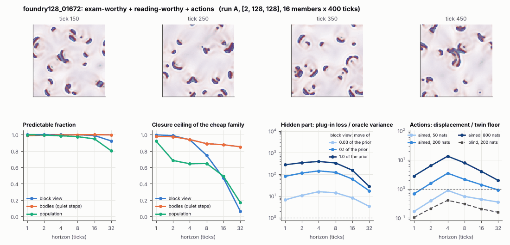

# World card: foundry128_01672

Family foundry, role size. Lattice [2, 128, 128], 4 substeps per tick; input: wind 2 x 16 x 16, noise std 0.25. Hidden part: 240 weights of the law net (+ 10 scalars, kept by the neighbours) (prior: round5/foundry/tnca.py draw_theta; neighbour = round 5's weight neighbour). Views: block means of each kind and of S^2 on 8 px blocks; blob tracker on S / mean(S) > 2.

**Verdict** run A: exam-worthy + reading-worthy + actions. sigma_hat 0.41 at the pop level.

Sizes: 16 members (8 fit), 400 ticks after 50 of burn-in, 32 test states x 6 replicas x 32 ticks; neighbours at [0.03, 0.1, 1.0] of the prior (2 directions x 2). Ratios are from medians over test states (typical state); `mean` marks the mean-based value.

## 1. Predictability at 1 / 2 / 4 / 8 / 16 / 32 ticks

| level | predictable fraction | closure ceiling (cheap family) | ceiling at 8, mean-based |
|---|---|---|---|
| block view | 1.00 / 1.00 / 1.00 / 1.00 / 0.99 / 0.92 | 1.00 / 0.99 / 0.94 / 0.75 / 0.47 / 0.065 | 0.75 |
| bodies, displacement on quiet steps | 0.99 / 0.99 / 1.00 / 1.00 / 1.00 / 1.00 | 0.98 / 0.97 / 0.94 / 0.89 / 0.88 / 0.85 | 0.80 |
| population (count, tracked_mass, mean_speed, mass_sd, mass_max, kind_share) | 1.00 / 0.99 / 0.99 / 0.97 / 0.95 / 0.80 | 0.92 / 0.68 / 0.64 / 0.65 / 0.49 / 0.17 | 0.55 |

## 2. Structure

- Bodies: 14.9 +- 2.48 (slots 96, full 0.0% of the time), 65.0% of the matter, radius 4.45 px, half-life 36.9 ticks, net speed 0.61 px/tick.
- Events per 100 ticks and member: 43.5 fusions, 39.5 fissions, 3.53 births, 0.67 deaths.
- Scales: wavelength 11.8 px; neighbouring-block correlation 0.33; block-view autocorrelation at 1 / 8 / 32 ticks 0.99 / 0.53 / 0.061; 14.9% of the matter relocated per tick.
- Single-body law (displacement, quiet steps) at 1 / 4 / 8 / 16 ticks: ceiling 0.98 / 0.94 / 0.89 / 0.88; constant velocity alone 0.98 / 0.94 / 0.89 / 0.88; with the surrounding block view 0.98 / 0.94 / 0.89 / 0.88. Quiet share of 8-tick steps 0.67 (291 test rows).

## 3. Stationarity

- Share of the variance that is a function of the tick alone (mean over channels; largest channel in brackets): block view 2.6e-06 [7.7e-06], population 0.046 [0.106] (count 0.11, tracked_mass 0.043, mean_speed 0.038, mass_sd 0.027, mass_max 0.016, kind_share 0.043).
- Share between members' time-means: block view 0.111, population 0.136.

## 4. Effective laws

- Linear local law on the block view: ceiling 0.998 at 1 tick; falls below 0.5 at 16 ticks; the worst tenth of (state, block) cells carries 70.0% of its excess error at 8 ticks.
- Population law at 8 ticks: linear ceiling 0.65, quadratic 0.60.
- Kind-share law ds = b1 s(1-s) + b2 (1-2s) at 8 / 32 ticks: ceiling 0.18 / 0.49, a constant drift 3.2e-04 / 0.017, a line in s 0.19 / 0.49 (predictable fraction of the change 0.89 / 0.67).

## 5. Levels

- The slot list added to the block view's predictor lowers its error at 8 ticks by 0.004 of the variance; the block view added to the body law by 0.034; block moments added to the population law by 0.006; the population law beats persistence by 0.150.

## 6. Learned variable (slow features of the 2 x 2 sub-blocks against the hand block view)

- Ceiling gain at 8 / 16 / 32 ticks, halves AB: -0.37 / -0.22 / 0.026; BA: -0.37 / -0.25 / 0.016. Predictable-fraction gain at 8: -0.014 / -0.016. Smallest R^2 of a learned component on the hand channels: 0.001.

## 7. Actions (block view, 4 ticks after the input starts)

- The aimed 200-nat shift is 0.008 of the block view's variance, 0.116 of the cheap family's error.
- Predictable shift / oracle variance: aimed 50 / 200 / 800 nats 1.77 / 7.00 / 27.5; displacement of the aimed 200-nat input / twin floor 3.47; aimed / blind 9.03. Population level: 0.36.

## 8. Hidden part

- Plug-in loss / oracle variance at 8 ticks for a move of 3% / 10% / 100% of the prior: block view 14.1 / 124 / 339; population 29.5 / 327 / 1637.
- Weight of a prior-sized error, w_theta at 4 / 8 / 16 ticks: block view 0.42 / 0.93 / 1.71; sigma_hat block view 0.28, population 0.41.
- Response to the aimed 200-nat input changes by 18.1 oracle variances when the hidden part moves by the prior. Evidence index for a 10% move: 31258 nats per tick (3 nats in 9.6e-05 ticks).
- Noise twins: 6.9% of the matter placed differently after 8 ticks; doubling time 8.2 ticks.

## 9. Cost

- 0.192 ms per member-tick on the job's GPU with the tracker on every member, compile excluded (5219 member-ticks/s); USD 0.11 per million member-ticks at USD 1.99/h.

## Gates and robustness

| gate | run A |
|---|---|
| exam_worthy | yes |
| structure | yes |
| interaction | yes |
| reading_worthy | yes |
| actions | yes |
| stationary | yes |
| levels_add | yes |
| learned_differs | no |

Estimator size (even against odd test states, block view at 8 ticks): predictable fraction 1.00 / 1.00, ceiling 0.75 / 0.74.

Source: run A: job r6-cards-001; files `out/cards/foundry128_01672__<run>.json` on origin/gpu-jobs; numbers recomputed by `make_cards.py` from those cards (`card.json` here holds the derived numbers and gates of every run). Pilot: never an exam instance.
