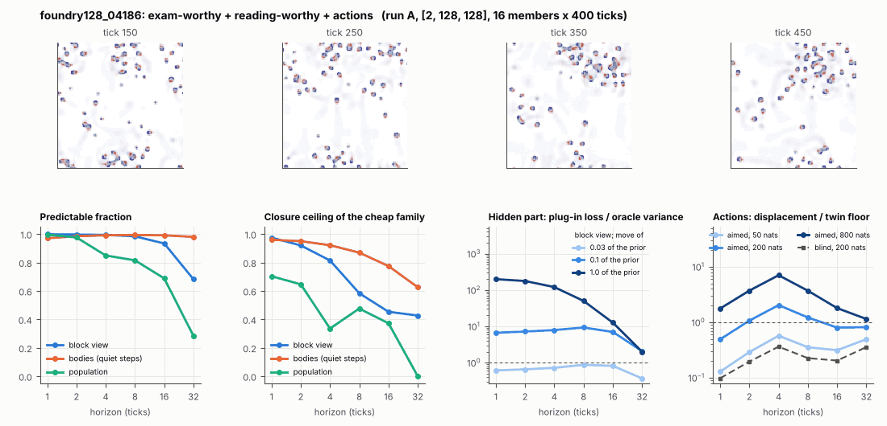

# World card: foundry128_04186

Family foundry, role size. Lattice [2, 128, 128], 4 substeps per tick; input: wind 2 x 16 x 16, noise std 0.25. Hidden part: 240 weights of the law net (+ 10 scalars, kept by the neighbours) (prior: round5/foundry/tnca.py draw_theta; neighbour = round 5's weight neighbour). Views: block means of each kind and of S^2 on 8 px blocks; blob tracker on S / mean(S) > 2.

**Verdict** run A: exam-worthy + reading-worthy + actions. sigma_hat 0.61 at the pop level.

Sizes: 16 members (8 fit), 400 ticks after 50 of burn-in, 32 test states x 6 replicas x 32 ticks; neighbours at [0.03, 0.1, 1.0] of the prior (2 directions x 2). Ratios are from medians over test states (typical state); `mean` marks the mean-based value.

## 1. Predictability at 1 / 2 / 4 / 8 / 16 / 32 ticks

| level | predictable fraction | closure ceiling (cheap family) | ceiling at 8, mean-based |
|---|---|---|---|
| block view | 1.00 / 1.00 / 0.99 / 0.98 / 0.93 / 0.68 | 0.97 / 0.92 / 0.81 / 0.58 / 0.45 / 0.43 | 0.58 |
| bodies, displacement on quiet steps | 0.97 / 0.98 / 0.99 / 0.99 / 0.99 / 0.98 | 0.96 / 0.95 / 0.92 / 0.87 / 0.77 / 0.63 | 0.72 |
| population (count, tracked_mass, mean_speed, mass_sd, mass_max) | 0.99 / 0.98 / 0.85 / 0.82 / 0.69 / 0.28 | 0.70 / 0.65 / 0.34 / 0.48 / 0.37 / 0.00 | 0.56 |

## 2. Structure

- Bodies: 37.5 +- 10.1 (slots 96, full 0.0% of the time), 86.4% of the matter, radius 2.40 px, half-life 20.5 ticks, net speed 0.65 px/tick.
- Events per 100 ticks and member: 192 fusions, 171 fissions, 13.4 births, 3.72 deaths.
- Scales: wavelength 6.01 px; neighbouring-block correlation 0.34; block-view autocorrelation at 1 / 8 / 32 ticks 0.97 / 0.47 / 0.36; 33.6% of the matter relocated per tick.
- Single-body law (displacement, quiet steps) at 1 / 4 / 8 / 16 ticks: ceiling 0.96 / 0.92 / 0.87 / 0.77; constant velocity alone 0.96 / 0.92 / 0.87 / 0.77; with the surrounding block view 0.96 / 0.92 / 0.87 / 0.77. Quiet share of 8-tick steps 0.54 (457 test rows).

## 3. Stationarity

- Share of the variance that is a function of the tick alone (mean over channels; largest channel in brackets): block view 5.6e-05 [7.9e-05], population 0.485 [0.817] (count 0.82, tracked_mass 0.75, mean_speed 0.17, mass_sd 0.40, mass_max 0.29).
- Share between members' time-means: block view 0.065, population 0.036.

## 4. Effective laws

- Linear local law on the block view: ceiling 0.975 at 1 tick; falls below 0.5 at 16 ticks; the worst tenth of (state, block) cells carries 63.9% of its excess error at 8 ticks.
- Population law at 8 ticks: linear ceiling 0.48, quadratic 0.34.

## 5. Levels

- The slot list added to the block view's predictor lowers its error at 8 ticks by 0.002 of the variance; the block view added to the body law by -5.0e-05; block moments added to the population law by 0.020; the population law beats persistence by 0.074.

## 6. Learned variable (slow features of the 2 x 2 sub-blocks against the hand block view)

- Ceiling gain at 8 / 16 / 32 ticks, halves AB: -0.33 / -0.24 / -0.099; BA: -0.33 / -0.21 / -0.11. Predictable-fraction gain at 8: -0.082 / -0.082. Smallest R^2 of a learned component on the hand channels: 1.9e-04.

## 7. Actions (block view, 4 ticks after the input starts)

- The aimed 200-nat shift is 0.024 of the block view's variance, 0.127 of the cheap family's error.
- Predictable shift / oracle variance: aimed 50 / 200 / 800 nats 0.99 / 3.89 / 13.5; displacement of the aimed 200-nat input / twin floor 2.03; aimed / blind 7.52. Population level: 0.063.

## 8. Hidden part

- Plug-in loss / oracle variance at 8 ticks for a move of 3% / 10% / 100% of the prior: block view 0.87 / 9.26 / 49.9; population 0.54 / 7.28 / 962.
- Weight of a prior-sized error, w_theta at 4 / 8 / 16 ticks: block view 0.75 / 0.81 / 0.90; sigma_hat block view 0.38, population 0.61.
- Response to the aimed 200-nat input changes by 3.47 oracle variances when the hidden part moves by the prior. Evidence index for a 10% move: 2548 nats per tick (3 nats in 0.001 ticks).
- Noise twins: 20.6% of the matter placed differently after 8 ticks; doubling time 5.4 ticks.

## 9. Cost

- 0.196 ms per member-tick on the job's GPU with the tracker on every member, compile excluded (5098 member-ticks/s); USD 0.11 per million member-ticks at USD 1.99/h.

## Gates and robustness

| gate | run A |
|---|---|
| exam_worthy | yes |
| structure | yes |
| interaction | yes |
| reading_worthy | yes |
| actions | yes |
| stationary | yes |
| levels_add | yes |
| learned_differs | no |

Estimator size (even against odd test states, block view at 8 ticks): predictable fraction 0.98 / 0.98, ceiling 0.60 / 0.56.

Source: run A: job r6-cards-001; files `out/cards/foundry128_04186__<run>.json` on origin/gpu-jobs; numbers recomputed by `make_cards.py` from those cards (`card.json` here holds the derived numbers and gates of every run). Pilot: never an exam instance.
