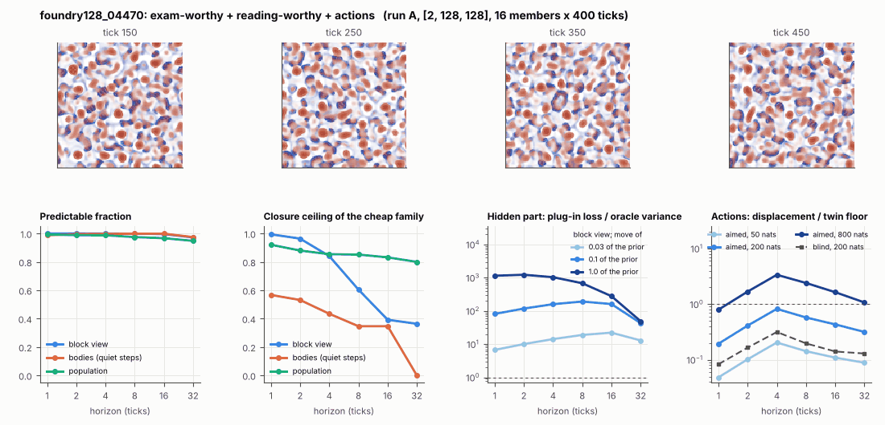

# World card: foundry128_04470

Family foundry, role size. Lattice [2, 128, 128], 4 substeps per tick; input: wind 2 x 16 x 16, noise std 0.25. Hidden part: 240 weights of the law net (+ 10 scalars, kept by the neighbours) (prior: round5/foundry/tnca.py draw_theta; neighbour = round 5's weight neighbour). Views: block means of each kind and of S^2 on 8 px blocks; blob tracker on S / mean(S) > 2.

**Verdict** run A: exam-worthy + reading-worthy + actions. sigma_hat 0.39 at the grid level.

Sizes: 16 members (8 fit), 400 ticks after 50 of burn-in, 32 test states x 6 replicas x 32 ticks; neighbours at [0.03, 0.1, 1.0] of the prior (2 directions x 2). Ratios are from medians over test states (typical state); `mean` marks the mean-based value.

## 1. Predictability at 1 / 2 / 4 / 8 / 16 / 32 ticks

| level | predictable fraction | closure ceiling (cheap family) | ceiling at 8, mean-based |
|---|---|---|---|
| block view | 1.00 / 1.00 / 1.00 / 1.00 / 1.00 / 0.97 | 0.99 / 0.96 / 0.84 / 0.60 / 0.39 / 0.36 | 0.65 |
| bodies, displacement on quiet steps | 0.99 / 1.00 / 1.00 / 1.00 / 1.00 / 0.97 | 0.57 / 0.53 / 0.43 / 0.35 / 0.35 / 0.00 | 0.23 |
| population (count, tracked_mass, mean_speed, mass_sd, mass_max, kind_share) | 0.99 / 0.99 / 0.99 / 0.97 / 0.97 / 0.95 | 0.92 / 0.88 / 0.85 / 0.85 / 0.83 / 0.80 | 0.91 |

## 2. Structure

- Bodies: 71.6 +- 5.97 (slots 96, full 0.0% of the time), 39.1% of the matter, radius 2.20 px, half-life 25.5 ticks, net speed 0.47 px/tick.
- Events per 100 ticks and member: 98.2 fusions, 169 fissions, 235 births, 304 deaths.
- Scales: wavelength 9.58 px; neighbouring-block correlation 0.063; block-view autocorrelation at 1 / 8 / 32 ticks 0.98 / 0.57 / 0.50; 12.3% of the matter relocated per tick.
- Single-body law (displacement, quiet steps) at 1 / 4 / 8 / 16 ticks: ceiling 0.57 / 0.43 / 0.35 / 0.35; constant velocity alone 0.45 / 0.35 / 0.095 / 0.00; with the surrounding block view 0.56 / 0.44 / 0.35 / 0.31. Quiet share of 8-tick steps 0.43 (959 test rows).

## 3. Stationarity

- Share of the variance that is a function of the tick alone (mean over channels; largest channel in brackets): block view 3.2e-05 [9.6e-05], population 0.052 [0.107] (count 0.008, tracked_mass 0.036, mean_speed 0.11, mass_sd 0.035, mass_max 0.039, kind_share 0.085).
- Share between members' time-means: block view 0.808, population 0.676.

## 4. Effective laws

- Linear local law on the block view: ceiling 0.994 at 1 tick; falls below 0.5 at 16 ticks; the worst tenth of (state, block) cells carries 50.2% of its excess error at 8 ticks.
- Population law at 8 ticks: linear ceiling 0.85, quadratic 0.86.
- Kind-share law ds = b1 s(1-s) + b2 (1-2s) at 8 / 32 ticks: ceiling 0.036 / 0.00, a constant drift 0.001 / 0.00, a line in s 0.038 / 0.00 (predictable fraction of the change 0.91 / 0.79).

## 5. Levels

- The slot list added to the block view's predictor lowers its error at 8 ticks by 0.010 of the variance; the block view added to the body law by 7.1e-04; block moments added to the population law by 0.007; the population law beats persistence by 0.120.

## 6. Learned variable (slow features of the 2 x 2 sub-blocks against the hand block view)

- Ceiling gain at 8 / 16 / 32 ticks, halves AB: -0.016 / 0.14 / 0.096; BA: -0.011 / 0.14 / 0.11. Predictable-fraction gain at 8: -9.4e-04 / -9.1e-04. Smallest R^2 of a learned component on the hand channels: 1.6e-04.

## 7. Actions (block view, 4 ticks after the input starts)

- The aimed 200-nat shift is 8.0e-04 of the block view's variance, 0.005 of the cheap family's error.
- Predictable shift / oracle variance: aimed 50 / 200 / 800 nats 0.39 / 1.57 / 6.46; displacement of the aimed 200-nat input / twin floor 0.82; aimed / blind 2.56. Population level: 0.032.

## 8. Hidden part

- Plug-in loss / oracle variance at 8 ticks for a move of 3% / 10% / 100% of the prior: block view 18.9 / 191 / 681; population 7.41 / 107 / 1434.
- Weight of a prior-sized error, w_theta at 4 / 8 / 16 ticks: block view 0.54 / 0.84 / 1.18; sigma_hat block view 0.39, population 0.15.
- Response to the aimed 200-nat input changes by 0.98 oracle variances when the hidden part moves by the prior. Evidence index for a 10% move: 31155 nats per tick (3 nats in 9.6e-05 ticks).
- Noise twins: 4.4% of the matter placed differently after 8 ticks; doubling time 9.4 ticks.

## 9. Cost

- 1.059 ms per member-tick on the job's GPU with the tracker on every member, COMPILE INCLUDED (this world's only run was the first call of its program) (944 member-ticks/s); USD 0.59 per million member-ticks at USD 1.99/h.

## Gates and robustness

| gate | run A |
|---|---|
| exam_worthy | yes |
| structure | yes |
| interaction | yes |
| reading_worthy | yes |
| actions | yes |
| stationary | no |
| levels_add | yes |
| learned_differs | no |

Estimator size (even against odd test states, block view at 8 ticks): predictable fraction 1.00 / 1.00, ceiling 0.61 / 0.60.

Source: run A: job r6-cards-001; files `out/cards/foundry128_04470__<run>.json` on origin/gpu-jobs; numbers recomputed by `make_cards.py` from those cards (`card.json` here holds the derived numbers and gates of every run). Pilot: never an exam instance.
