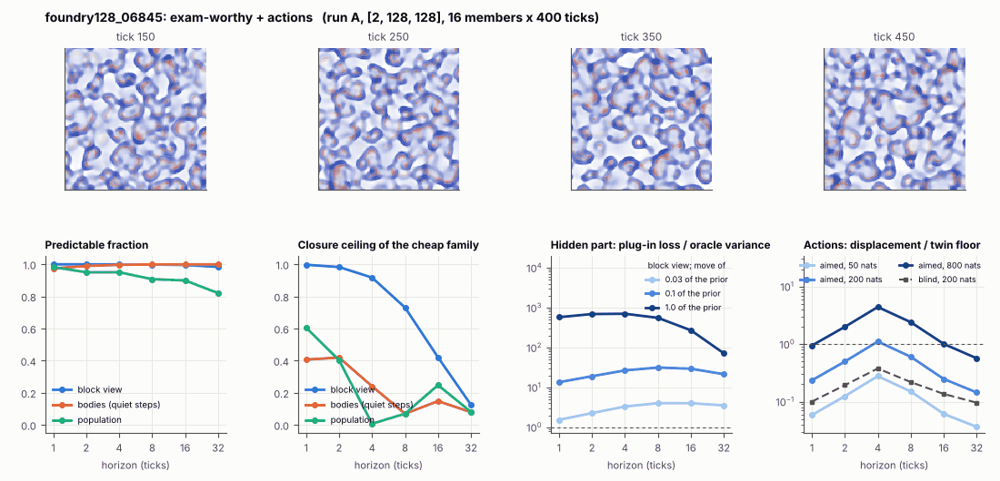

# World card: foundry128_06845

Family foundry, role size. Lattice [2, 128, 128], 4 substeps per tick; input: wind 2 x 16 x 16, noise std 0.25. Hidden part: 240 weights of the law net (+ 10 scalars, kept by the neighbours) (prior: round5/foundry/tnca.py draw_theta; neighbour = round 5's weight neighbour). Views: block means of each kind and of S^2 on 8 px blocks; blob tracker on S / mean(S) > 2.

**Verdict** run A: exam-worthy + actions. sigma_hat 0.89 at the pop level.

Sizes: 16 members (8 fit), 400 ticks after 50 of burn-in, 32 test states x 6 replicas x 32 ticks; neighbours at [0.03, 0.1, 1.0] of the prior (2 directions x 2). Ratios are from medians over test states (typical state); `mean` marks the mean-based value.

## 1. Predictability at 1 / 2 / 4 / 8 / 16 / 32 ticks

| level | predictable fraction | closure ceiling (cheap family) | ceiling at 8, mean-based |
|---|---|---|---|
| block view | 1.00 / 1.00 / 1.00 / 1.00 / 1.00 / 0.98 | 1.00 / 0.98 / 0.92 / 0.73 / 0.42 / 0.12 | 0.74 |
| bodies, displacement on quiet steps | 0.97 / 0.99 / 1.00 / 1.00 / 1.00 / 1.00 | 0.41 / 0.42 / 0.24 / 0.069 / 0.15 / 0.079 | 0.068 |
| population (count, tracked_mass, mean_speed, mass_sd, mass_max) | 0.98 / 0.95 / 0.95 / 0.91 / 0.90 / 0.82 | 0.61 / 0.40 / 0.007 / 0.070 / 0.25 / 0.080 | 0.16 |

## 2. Structure

- Bodies: 48.4 +- 3.75 (slots 96, full 0.0% of the time), 30.1% of the matter, radius 2.81 px, half-life 14.4 ticks, net speed 0.60 px/tick.
- Events per 100 ticks and member: 120 fusions, 198 fissions, 140 births, 218 deaths.
- Scales: wavelength 10.4 px; neighbouring-block correlation 0.016; block-view autocorrelation at 1 / 8 / 32 ticks 0.99 / 0.45 / 0.12; 9.0% of the matter relocated per tick.
- Single-body law (displacement, quiet steps) at 1 / 4 / 8 / 16 ticks: ceiling 0.41 / 0.24 / 0.069 / 0.15; constant velocity alone 0.19 / 0.00 / 0.00 / 0.00; with the surrounding block view 0.42 / 0.26 / 0.18 / 0.23. Quiet share of 8-tick steps 0.28 (287 test rows).

## 3. Stationarity

- Share of the variance that is a function of the tick alone (mean over channels; largest channel in brackets): block view -3.2e-06 [-4.3e-21], population 0.011 [0.075] (count 0.010, tracked_mass -0.015, mean_speed 0.075, mass_sd -0.011, mass_max -0.003).
- Share between members' time-means: block view 0.132, population 0.064.

## 4. Effective laws

- Linear local law on the block view: ceiling 0.997 at 1 tick; falls below 0.5 at 16 ticks; the worst tenth of (state, block) cells carries 48.6% of its excess error at 8 ticks.
- Population law at 8 ticks: linear ceiling 0.070, quadratic 0.055.

## 5. Levels

- The slot list added to the block view's predictor lowers its error at 8 ticks by 0.003 of the variance; the block view added to the body law by 0.090; block moments added to the population law by 0.041; the population law beats persistence by 0.187.

## 6. Learned variable (slow features of the 2 x 2 sub-blocks against the hand block view)

- Ceiling gain at 8 / 16 / 32 ticks, halves AB: -0.32 / -0.28 / -0.094; BA: -0.33 / -0.28 / -0.092. Predictable-fraction gain at 8: -0.002 / -0.002. Smallest R^2 of a learned component on the hand channels: 1.2e-04.

## 7. Actions (block view, 4 ticks after the input starts)

- The aimed 200-nat shift is 0.002 of the block view's variance, 0.023 of the cheap family's error.
- Predictable shift / oracle variance: aimed 50 / 200 / 800 nats 0.55 / 2.25 / 8.78; displacement of the aimed 200-nat input / twin floor 1.11; aimed / blind 3.28. Population level: 0.18.

## 8. Hidden part

- Plug-in loss / oracle variance at 8 ticks for a move of 3% / 10% / 100% of the prior: block view 4.02 / 31.5 / 556; population 12.5 / 115 / 1208.
- Weight of a prior-sized error, w_theta at 4 / 8 / 16 ticks: block view 0.61 / 1.05 / 1.27; sigma_hat block view 0.31, population 0.89.
- Response to the aimed 200-nat input changes by 1.68 oracle variances when the hidden part moves by the prior. Evidence index for a 10% move: 5177 nats per tick (3 nats in 5.8e-04 ticks).
- Noise twins: 4.0% of the matter placed differently after 8 ticks; doubling time 9.4 ticks.

## 9. Cost

- 0.191 ms per member-tick on the job's GPU with the tracker on every member, compile excluded (5227 member-ticks/s); USD 0.11 per million member-ticks at USD 1.99/h.

## Gates and robustness

| gate | run A |
|---|---|
| exam_worthy | yes |
| structure | no |
| interaction | yes |
| reading_worthy | no |
| actions | yes |
| stationary | yes |
| levels_add | yes |
| learned_differs | no |

Estimator size (even against odd test states, block view at 8 ticks): predictable fraction 1.00 / 1.00, ceiling 0.74 / 0.73.

Source: run A: job r6-cards-001; files `out/cards/foundry128_06845__<run>.json` on origin/gpu-jobs; numbers recomputed by `make_cards.py` from those cards (`card.json` here holds the derived numbers and gates of every run). Pilot: never an exam instance.
