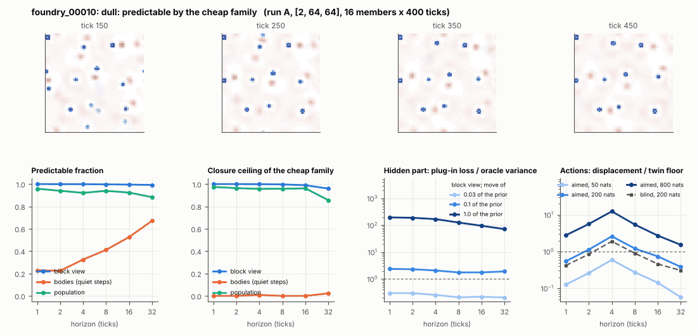

# World card: foundry_00010

Family foundry, role prior. Lattice [2, 64, 64], 4 substeps per tick; input: wind 2 x 8 x 8, noise std 0.25. Hidden part: 240 weights of the law net (+ 10 scalars, kept by the neighbours) (prior: round5/foundry/tnca.py draw_theta; neighbour = round 5's weight neighbour). Views: block means of each kind and of S^2 on 8 px blocks; blob tracker on S / mean(S) > 2.

**Verdict** run A: dull: predictable by the cheap family. sigma_hat 0.041 at the pop level.

Sizes: 16 members (8 fit), 400 ticks after 50 of burn-in, 32 test states x 6 replicas x 32 ticks; neighbours at [0.03, 0.1, 1.0] of the prior (2 directions x 2). Ratios are from medians over test states (typical state); `mean` marks the mean-based value.

## 1. Predictability at 1 / 2 / 4 / 8 / 16 / 32 ticks

| level | predictable fraction | closure ceiling (cheap family) | ceiling at 8, mean-based |
|---|---|---|---|
| block view | 1.00 / 1.00 / 1.00 / 1.00 / 1.00 / 0.99 | 1.00 / 1.00 / 1.00 / 1.00 / 0.99 / 0.96 | 0.99 |
| bodies, displacement on quiet steps | 0.23 / 0.22 / 0.33 / 0.41 / 0.53 / 0.67 | 0.00 / 0.00 / 0.009 / 0.00 / 0.00 / 0.023 | 0.003 |
| population (count, tracked_mass, mean_speed, mass_sd, mass_max, kind_share) | 0.96 / 0.94 / 0.92 / 0.94 / 0.92 / 0.88 | 0.97 / 0.96 / 0.96 / 0.96 / 0.96 / 0.86 | 0.94 |

## 2. Structure

- Bodies: 17.9 +- 2.61 (slots 24, full 5.7% of the time), 63.0% of the matter, radius 1.25 px, half-life 239 ticks, net speed 0.027 px/tick.
- Events per 100 ticks and member: 5.56 fusions, 4.53 fissions, 4.27 births, 4.66 deaths.
- Scales: wavelength 4.59 px; neighbouring-block correlation -0.15; block-view autocorrelation at 1 / 8 / 32 ticks 1.00 / 1.00 / 0.96; 2.4% of the matter relocated per tick.
- Single-body law (displacement, quiet steps) at 1 / 4 / 8 / 16 ticks: ceiling 0.00 / 0.009 / 0.00 / 0.00; constant velocity alone 0.00 / 0.00 / 0.00 / 0.00; with the surrounding block view 0.00 / 0.054 / 0.00 / 0.00. Quiet share of 8-tick steps 0.95 (545 test rows).

## 3. Stationarity

- Share of the variance that is a function of the tick alone (mean over channels; largest channel in brackets): block view 0.004 [0.008], population 0.171 [0.375] (count 0.27, tracked_mass 0.38, mean_speed 0.10, mass_sd 0.077, mass_max -0.039, kind_share 0.25).
- Share between members' time-means: block view 0.011, population 0.283.

## 4. Effective laws

- Linear local law on the block view: ceiling 1.000 at 1 tick; falls below 0.5 at no horizon up to 32 ticks; the worst tenth of (state, block) cells carries 89.2% of its excess error at 8 ticks.
- Population law at 8 ticks: linear ceiling 0.96, quadratic 0.96.
- Kind-share law ds = b1 s(1-s) + b2 (1-2s) at 8 / 32 ticks: ceiling 0.00 / 0.094, a constant drift 0.029 / 0.00, a line in s 0.00 / 0.086 (predictable fraction of the change 0.72 / 0.80).

## 5. Levels

- The slot list added to the block view's predictor lowers its error at 8 ticks by -2.1e-04 of the variance; the block view added to the body law by -0.012; block moments added to the population law by 2.9e-04; the population law beats persistence by 0.033.

## 6. Learned variable (slow features of the 2 x 2 sub-blocks against the hand block view)

- Ceiling gain at 8 / 16 / 32 ticks, halves AB: -6.2e-04 / -0.004 / -0.004; BA: 4.7e-04 / -9.7e-04 / -0.003. Predictable-fraction gain at 8: -5.9e-04 / 2.0e-04. Smallest R^2 of a learned component on the hand channels: 0.35.

## 7. Actions (block view, 4 ticks after the input starts)

- The aimed 200-nat shift is 0.005 of the block view's variance, 1.896 of the cheap family's error.
- Predictable shift / oracle variance: aimed 50 / 200 / 800 nats 0.84 / 3.46 / 15.4; displacement of the aimed 200-nat input / twin floor 2.61; aimed / blind 1.57. Population level: 1.94.

## 8. Hidden part

- Plug-in loss / oracle variance at 8 ticks for a move of 3% / 10% / 100% of the prior: block view 0.21 / 1.76 / 127; population 0.031 / 0.44 / 140.
- Weight of a prior-sized error, w_theta at 4 / 8 / 16 ticks: block view 0.23 / 0.33 / 0.45; sigma_hat block view 0.005, population 0.041.
- Response to the aimed 200-nat input changes by 1.35 oracle variances when the hidden part moves by the prior. Evidence index for a 10% move: 227 nats per tick (3 nats in 0.013 ticks).
- Noise twins: 5.3% of the matter placed differently after 8 ticks; doubling time 10.6 ticks.

## 9. Cost

- 0.047 ms per member-tick on the job's GPU with the tracker on every member, compile excluded (21308 member-ticks/s); USD 0.026 per million member-ticks at USD 1.99/h.

## Gates and robustness

| gate | run A |
|---|---|
| exam_worthy | no |
| structure | no |
| interaction | yes |
| reading_worthy | no |
| actions | yes |
| stationary | yes |
| levels_add | no |
| learned_differs | no |

Estimator size (even against odd test states, block view at 8 ticks): predictable fraction 1.00 / 1.00, ceiling 1.00 / 1.00.

Source: run A: job r6-cards-001; files `out/cards/foundry_00010__<run>.json` on origin/gpu-jobs; numbers recomputed by `make_cards.py` from those cards (`card.json` here holds the derived numbers and gates of every run). Pilot: never an exam instance.
