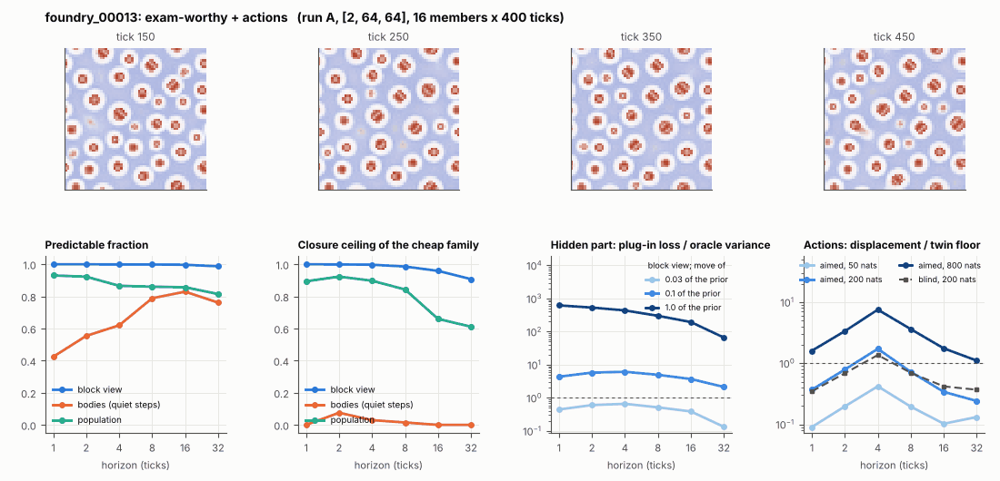

# World card: foundry_00013

Family foundry, role prior. Lattice [2, 64, 64], 4 substeps per tick; input: wind 2 x 8 x 8, noise std 0.25. Hidden part: 240 weights of the law net (+ 10 scalars, kept by the neighbours) (prior: round5/foundry/tnca.py draw_theta; neighbour = round 5's weight neighbour). Views: block means of each kind and of S^2 on 8 px blocks; blob tracker on S / mean(S) > 2.

**Verdict** run A: exam-worthy + actions. sigma_hat 0.20 at the pop level.

Sizes: 16 members (8 fit), 400 ticks after 50 of burn-in, 32 test states x 6 replicas x 32 ticks; neighbours at [0.03, 0.1, 1.0] of the prior (2 directions x 2). Ratios are from medians over test states (typical state); `mean` marks the mean-based value.

## 1. Predictability at 1 / 2 / 4 / 8 / 16 / 32 ticks

| level | predictable fraction | closure ceiling (cheap family) | ceiling at 8, mean-based |
|---|---|---|---|
| block view | 1.00 / 1.00 / 1.00 / 1.00 / 1.00 / 0.99 | 1.00 / 1.00 / 1.00 / 0.99 / 0.96 / 0.91 | 0.98 |
| bodies, displacement on quiet steps | 0.42 / 0.55 / 0.62 / 0.79 / 0.83 / 0.76 | 0.00 / 0.076 / 0.029 / 0.015 / 0.00 / 0.00 | 0.00 |
| population (count, tracked_mass, mean_speed, mass_sd, mass_max) | 0.93 / 0.92 / 0.87 / 0.86 / 0.86 / 0.81 | 0.89 / 0.92 / 0.90 / 0.84 / 0.66 / 0.61 | 0.80 |

## 2. Structure

- Bodies: 21.3 +- 1.80 (slots 24, full 16.9% of the time), 35.4% of the matter, radius 1.62 px, half-life 416 ticks, net speed 0.025 px/tick.
- Events per 100 ticks and member: 1.97 fusions, 0.00 fissions, 9.30 births, 7.77 deaths.
- Scales: wavelength 4.92 px; neighbouring-block correlation -0.34; block-view autocorrelation at 1 / 8 / 32 ticks 1.00 / 0.99 / 0.95; 2.4% of the matter relocated per tick.
- Single-body law (displacement, quiet steps) at 1 / 4 / 8 / 16 ticks: ceiling 0.00 / 0.029 / 0.015 / 0.00; constant velocity alone 0.00 / 0.00 / 0.00 / 0.00; with the surrounding block view 0.00 / 0.057 / 0.075 / 0.054. Quiet share of 8-tick steps 0.96 (628 test rows).

## 3. Stationarity

- Share of the variance that is a function of the tick alone (mean over channels; largest channel in brackets): block view 0.002 [0.004], population 0.256 [0.713] (count 0.32, tracked_mass 0.71, mean_speed 0.13, mass_sd 0.031, mass_max 0.081).
- Share between members' time-means: block view 0.015, population 0.213.

## 4. Effective laws

- Linear local law on the block view: ceiling 1.000 at 1 tick; falls below 0.5 at no horizon up to 32 ticks; the worst tenth of (state, block) cells carries 78.6% of its excess error at 8 ticks.
- Population law at 8 ticks: linear ceiling 0.84, quadratic 0.86.

## 5. Levels

- The slot list added to the block view's predictor lowers its error at 8 ticks by -2.2e-05 of the variance; the block view added to the body law by 0.008; block moments added to the population law by -0.001; the population law beats persistence by 0.100.

## 6. Learned variable (slow features of the 2 x 2 sub-blocks against the hand block view)

- Ceiling gain at 8 / 16 / 32 ticks, halves AB: -0.005 / -0.011 / -0.013; BA: -0.004 / -0.006 / -0.017. Predictable-fraction gain at 8: -1.9e-04 / -5.5e-05. Smallest R^2 of a learned component on the hand channels: 2.6e-04.

## 7. Actions (block view, 4 ticks after the input starts)

- The aimed 200-nat shift is 0.003 of the block view's variance, 0.776 of the cheap family's error.
- Predictable shift / oracle variance: aimed 50 / 200 / 800 nats 0.82 / 3.43 / 13.8; displacement of the aimed 200-nat input / twin floor 1.72; aimed / blind 1.44. Population level: 0.48.

## 8. Hidden part

- Plug-in loss / oracle variance at 8 ticks for a move of 3% / 10% / 100% of the prior: block view 0.52 / 4.97 / 301; population 0.037 / 0.52 / 519.
- Weight of a prior-sized error, w_theta at 4 / 8 / 16 ticks: block view 0.39 / 0.48 / 0.64; sigma_hat block view 0.019, population 0.20.
- Response to the aimed 200-nat input changes by 4.61 oracle variances when the hidden part moves by the prior. Evidence index for a 10% move: 419 nats per tick (3 nats in 0.007 ticks).
- Noise twins: 3.9% of the matter placed differently after 8 ticks; doubling time 12.5 ticks.

## 9. Cost

- 0.047 ms per member-tick on the job's GPU with the tracker on every member, compile excluded (21181 member-ticks/s); USD 0.026 per million member-ticks at USD 1.99/h.

## Gates and robustness

| gate | run A |
|---|---|
| exam_worthy | yes |
| structure | no |
| interaction | yes |
| reading_worthy | no |
| actions | yes |
| stationary | yes |
| levels_add | yes |
| learned_differs | no |

Estimator size (even against odd test states, block view at 8 ticks): predictable fraction 1.00 / 1.00, ceiling 0.98 / 0.99.

Source: run A: job r6-cards-001; files `out/cards/foundry_00013__<run>.json` on origin/gpu-jobs; numbers recomputed by `make_cards.py` from those cards (`card.json` here holds the derived numbers and gates of every run). Pilot: never an exam instance.
