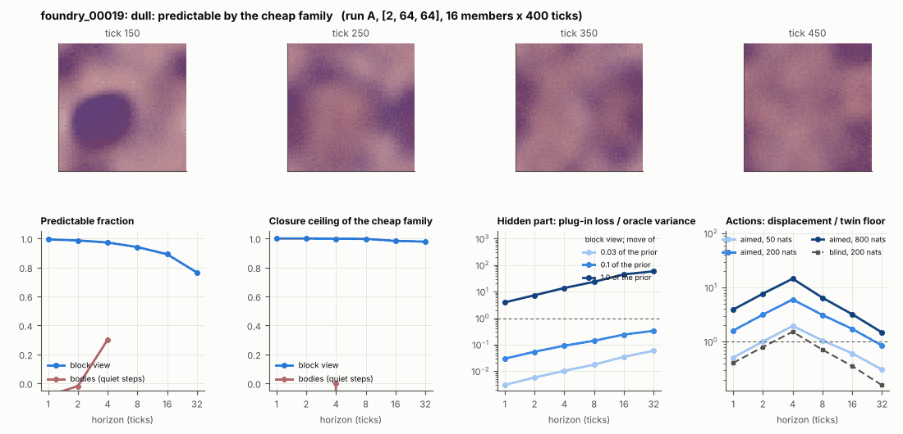

# World card: foundry_00019

Family foundry, role prior. Lattice [2, 64, 64], 4 substeps per tick; input: wind 2 x 8 x 8, noise std 0.25. Hidden part: 240 weights of the law net (+ 10 scalars, kept by the neighbours) (prior: round5/foundry/tnca.py draw_theta; neighbour = round 5's weight neighbour). Views: block means of each kind and of S^2 on 8 px blocks; blob tracker on S / mean(S) > 2.

**Verdict** run A: dull: predictable by the cheap family. sigma_hat 0.007 at the grid level.

Sizes: 16 members (8 fit), 400 ticks after 50 of burn-in, 32 test states x 6 replicas x 32 ticks; neighbours at [0.03, 0.1, 1.0] of the prior (2 directions x 2). Ratios are from medians over test states (typical state); `mean` marks the mean-based value.

## 1. Predictability at 1 / 2 / 4 / 8 / 16 / 32 ticks

| level | predictable fraction | closure ceiling (cheap family) | ceiling at 8, mean-based |
|---|---|---|---|
| block view | 0.99 / 0.99 / 0.97 / 0.94 / 0.89 / 0.76 | 1.00 / 1.00 / 1.00 / 1.00 / 0.98 / 0.98 | 0.99 |
| bodies, displacement on quiet steps | -0.085 / -0.019 / 0.30 / n/a / n/a / n/a | -0.21 / -6.47 / 0.00 / n/a / n/a / n/a | n/a |

## 2. Structure

- Bodies: 0.37 +- 0.61 (slots 24, full 0.0% of the time), 2% of the matter, radius 4.12 px, half-life 24.4 ticks, net speed 0.27 px/tick.
- Events per 100 ticks and member: 0.078 fusions, 0.078 fissions, 1.98 births, 2.38 deaths.
- Scales: wavelength 24.6 px; neighbouring-block correlation 0.65; block-view autocorrelation at 1 / 8 / 32 ticks 1.00 / 0.96 / 0.72; 2.8% of the matter relocated per tick.
- Single-body law (displacement, quiet steps) at 1 / 4 / 8 / 16 ticks: ceiling -0.21 / 0.00 / n/a / n/a; constant velocity alone -0.00 / 0.00 / n/a / n/a; with the surrounding block view -0.00 / 0.00 / n/a / n/a. Quiet share of 8-tick steps 0.46 (2 test rows).

## 3. Stationarity

- Share of the variance that is a function of the tick alone (mean over channels; largest channel in brackets): block view 0.026 [0.058], population n/a [n/a].
- Share between members' time-means: block view 0.021, population n/a.

## 4. Effective laws

- Linear local law on the block view: ceiling 1.000 at 1 tick; falls below 0.5 at no horizon up to 32 ticks; the worst tenth of (state, block) cells carries 76.4% of its excess error at 8 ticks.

## 5. Levels

- The slot list added to the block view's predictor lowers its error at 8 ticks by 9.0e-05 of the variance; the block view added to the body law by n/a; block moments added to the population law by n/a; the population law beats persistence by n/a.

## 6. Learned variable (slow features of the 2 x 2 sub-blocks against the hand block view)

- Ceiling gain at 8 / 16 / 32 ticks, halves AB: -0.010 / -0.015 / -0.032; BA: -0.005 / -0.008 / -0.023. Predictable-fraction gain at 8: 0.001 / -0.002. Smallest R^2 of a learned component on the hand channels: 0.006.

## 7. Actions (block view, 4 ticks after the input starts)

- The aimed 200-nat shift is 0.133 of the block view's variance, 8.489 of the cheap family's error.
- Predictable shift / oracle variance: aimed 50 / 200 / 800 nats 2.78 / 9.04 / 23.5; displacement of the aimed 200-nat input / twin floor 6.03; aimed / blind 3.45. Population level: n/a.

## 8. Hidden part

- Plug-in loss / oracle variance at 8 ticks for a move of 3% / 10% / 100% of the prior: block view 0.018 / 0.14 / 23.5; population n/a / n/a / n/a.
- Weight of a prior-sized error, w_theta at 4 / 8 / 16 ticks: block view 0.40 / 1.48 / 5.50; sigma_hat block view 0.007, population n/a.
- Response to the aimed 200-nat input changes by 1.64 oracle variances when the hidden part moves by the prior. Evidence index for a 10% move: 2.84 nats per tick (3 nats in 1.058 ticks).
- Noise twins: 5.0% of the matter placed differently after 8 ticks; doubling time 14.1 ticks.

## 9. Cost

- 0.048 ms per member-tick on the job's GPU with the tracker on every member, compile excluded (21042 member-ticks/s); USD 0.026 per million member-ticks at USD 1.99/h.

## Gates and robustness

| gate | run A |
|---|---|
| exam_worthy | no |
| structure | no |
| interaction | no |
| reading_worthy | no |
| actions | yes |
| stationary | yes |
| levels_add | no |
| learned_differs | no |

Estimator size (even against odd test states, block view at 8 ticks): predictable fraction 0.94 / 0.94, ceiling 1.00 / 1.00.

Source: run A: job r6-cards-001; files `out/cards/foundry_00019__<run>.json` on origin/gpu-jobs; numbers recomputed by `make_cards.py` from those cards (`card.json` here holds the derived numbers and gates of every run). Pilot: never an exam instance.
