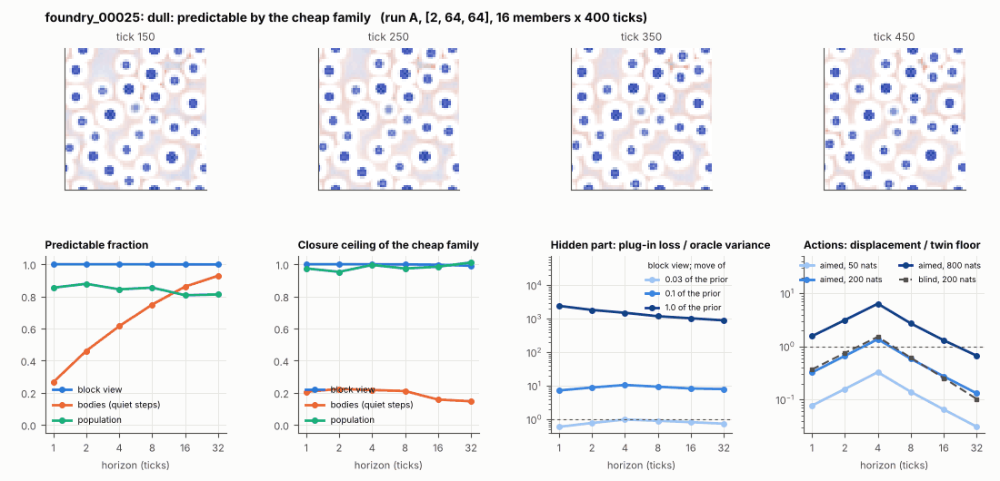

# World card: foundry_00025

Family foundry, role prior. Lattice [2, 64, 64], 4 substeps per tick; input: wind 2 x 8 x 8, noise std 0.25. Hidden part: 240 weights of the law net (+ 10 scalars, kept by the neighbours) (prior: round5/foundry/tnca.py draw_theta; neighbour = round 5's weight neighbour). Views: block means of each kind and of S^2 on 8 px blocks; blob tracker on S / mean(S) > 2.

**Verdict** run A: dull: predictable by the cheap family. sigma_hat 0.015 at the pop level.

Sizes: 16 members (8 fit), 400 ticks after 50 of burn-in, 32 test states x 6 replicas x 32 ticks; neighbours at [0.03, 0.1, 1.0] of the prior (2 directions x 2). Ratios are from medians over test states (typical state); `mean` marks the mean-based value.

## 1. Predictability at 1 / 2 / 4 / 8 / 16 / 32 ticks

| level | predictable fraction | closure ceiling (cheap family) | ceiling at 8, mean-based |
|---|---|---|---|
| block view | 1.00 / 1.00 / 1.00 / 1.00 / 1.00 / 1.00 | 1.00 / 1.00 / 1.00 / 1.00 / 1.00 / 0.99 | 1.00 |
| bodies, displacement on quiet steps | 0.27 / 0.46 / 0.61 / 0.75 / 0.86 / 0.93 | 0.21 / 0.22 / 0.22 / 0.21 / 0.16 / 0.15 | 0.19 |
| population (tracked_mass, mean_speed, mass_sd, mass_max) | 0.85 / 0.88 / 0.84 / 0.85 / 0.81 / 0.81 | 0.97 / 0.95 / 1.00 / 0.97 / 0.98 / 1.01 | 0.97 |

## 2. Structure

- Bodies: 24.0 +- 0.16 (slots 24, full 99.3% of the time), 69.0% of the matter, radius 1.48 px, half-life 18358 ticks, net speed 0.006 px/tick.
- Events per 100 ticks and member: 0.094 fusions, 0.00 fissions, 0.22 births, 0.016 deaths.
- Scales: wavelength 5.85 px; neighbouring-block correlation -0.11; block-view autocorrelation at 1 / 8 / 32 ticks 1.00 / 1.00 / 0.99; 0.9% of the matter relocated per tick.
- Single-body law (displacement, quiet steps) at 1 / 4 / 8 / 16 ticks: ceiling 0.21 / 0.22 / 0.21 / 0.16; constant velocity alone 0.00 / 0.00 / 0.00 / 0.00; with the surrounding block view 0.48 / 0.28 / 0.25 / 0.30. Quiet share of 8-tick steps 1.00 (768 test rows).

## 3. Stationarity

- Share of the variance that is a function of the tick alone (mean over channels; largest channel in brackets): block view 8.2e-04 [0.002], population 0.224 [0.585] (tracked_mass 0.58, mean_speed 0.31, mass_sd 0.003, mass_max 0.002).
- Share between members' time-means: block view 0.114, population 0.528.

## 4. Effective laws

- Linear local law on the block view: ceiling 1.000 at 1 tick; falls below 0.5 at no horizon up to 32 ticks; the worst tenth of (state, block) cells carries 52.1% of its excess error at 8 ticks.
- Population law at 8 ticks: linear ceiling 0.97, quadratic 0.95.

## 5. Levels

- The slot list added to the block view's predictor lowers its error at 8 ticks by 6.6e-06 of the variance; the block view added to the body law by 0.077; block moments added to the population law by 0.002; the population law beats persistence by 0.047.

## 6. Learned variable (slow features of the 2 x 2 sub-blocks against the hand block view)

- Ceiling gain at 8 / 16 / 32 ticks, halves AB: 3.6e-04 / 0.001 / 0.004; BA: 2.5e-04 / 8.5e-04 / 0.003. Predictable-fraction gain at 8: 4.2e-04 / 3.5e-04. Smallest R^2 of a learned component on the hand channels: 0.021.

## 7. Actions (block view, 4 ticks after the input starts)

- The aimed 200-nat shift is 8.8e-04 of the block view's variance, 1.452 of the cheap family's error.
- Predictable shift / oracle variance: aimed 50 / 200 / 800 nats 0.61 / 2.58 / 12.0; displacement of the aimed 200-nat input / twin floor 1.38; aimed / blind 0.88. Population level: 6.45.

## 8. Hidden part

- Plug-in loss / oracle variance at 8 ticks for a move of 3% / 10% / 100% of the prior: block view 0.91 / 9.49 / 1202; population 0.21 / 3.34 / 13634.
- Weight of a prior-sized error, w_theta at 4 / 8 / 16 ticks: block view 0.47 / 0.64 / 0.85; sigma_hat block view 0.001, population 0.015.
- Response to the aimed 200-nat input changes by 4.84 oracle variances when the hidden part moves by the prior. Evidence index for a 10% move: 703 nats per tick (3 nats in 0.004 ticks).
- Noise twins: 2.1% of the matter placed differently after 8 ticks; doubling time 10.7 ticks.

## 9. Cost

- 0.047 ms per member-tick on the job's GPU with the tracker on every member, compile excluded (21215 member-ticks/s); USD 0.026 per million member-ticks at USD 1.99/h.

## Gates and robustness

| gate | run A |
|---|---|
| exam_worthy | no |
| structure | no |
| interaction | yes |
| reading_worthy | no |
| actions | yes |
| stationary | yes |
| levels_add | no |
| learned_differs | no |

Estimator size (even against odd test states, block view at 8 ticks): predictable fraction 1.00 / 1.00, ceiling 1.00 / 1.00.

Source: run A: job r6-cards-001; files `out/cards/foundry_00025__<run>.json` on origin/gpu-jobs; numbers recomputed by `make_cards.py` from those cards (`card.json` here holds the derived numbers and gates of every run). Pilot: never an exam instance.
