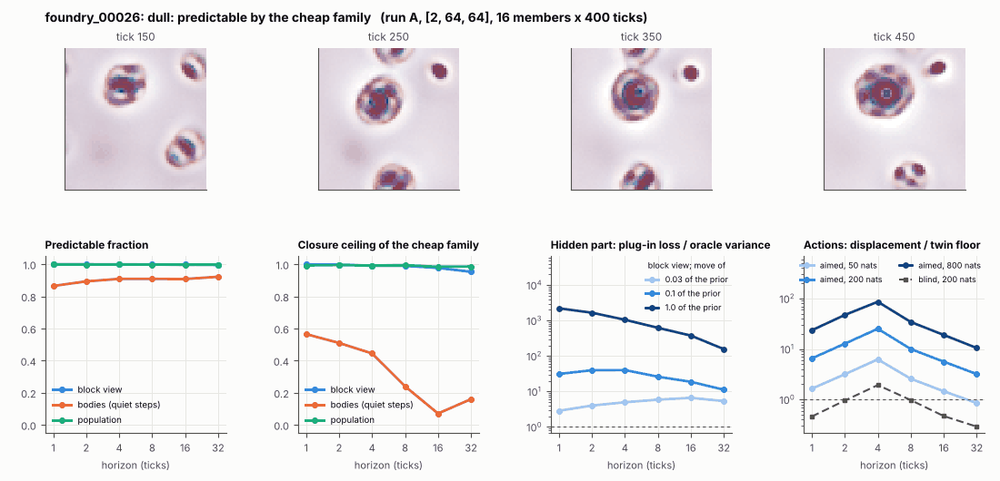

# World card: foundry_00026

Family foundry, role prior. Lattice [2, 64, 64], 4 substeps per tick; input: wind 2 x 8 x 8, noise std 0.25. Hidden part: 240 weights of the law net (+ 10 scalars, kept by the neighbours) (prior: round5/foundry/tnca.py draw_theta; neighbour = round 5's weight neighbour). Views: block means of each kind and of S^2 on 8 px blocks; blob tracker on S / mean(S) > 2.

**Verdict** run A: dull: predictable by the cheap family. sigma_hat 0.014 at the grid level.

Sizes: 16 members (8 fit), 400 ticks after 50 of burn-in, 32 test states x 6 replicas x 32 ticks; neighbours at [0.03, 0.1, 1.0] of the prior (2 directions x 2). Ratios are from medians over test states (typical state); `mean` marks the mean-based value.

## 1. Predictability at 1 / 2 / 4 / 8 / 16 / 32 ticks

| level | predictable fraction | closure ceiling (cheap family) | ceiling at 8, mean-based |
|---|---|---|---|
| block view | 1.00 / 1.00 / 1.00 / 1.00 / 1.00 / 1.00 | 1.00 / 1.00 / 0.99 / 0.99 / 0.98 / 0.95 | 0.98 |
| bodies, displacement on quiet steps | 0.86 / 0.89 / 0.91 / 0.91 / 0.91 / 0.92 | 0.57 / 0.51 / 0.44 / 0.24 / 0.071 / 0.16 | 0.57 |
| population (count, tracked_mass, mean_speed, mass_sd, mass_max, kind_share) | 1.00 / 1.00 / 1.00 / 1.00 / 1.00 / 1.00 | 0.99 / 1.00 / 0.99 / 0.99 / 0.98 / 0.99 | 0.87 |

## 2. Structure

- Bodies: 2.71 +- 1.16 (slots 24, full 0.0% of the time), 50.9% of the matter, radius 4.62 px, half-life 84.2 ticks, net speed 0.19 px/tick.
- Events per 100 ticks and member: 5.25 fusions, 5.75 fissions, 2.28 births, 2.91 deaths.
- Scales: wavelength 18.8 px; neighbouring-block correlation 0.45; block-view autocorrelation at 1 / 8 / 32 ticks 1.00 / 0.98 / 0.89; 7.2% of the matter relocated per tick.
- Single-body law (displacement, quiet steps) at 1 / 4 / 8 / 16 ticks: ceiling 0.57 / 0.44 / 0.24 / 0.071; constant velocity alone 0.40 / 0.00 / 0.00 / 0.00; with the surrounding block view 0.40 / 0.00 / 0.00 / 0.00. Quiet share of 8-tick steps 0.72 (68.0 test rows).

## 3. Stationarity

- Share of the variance that is a function of the tick alone (mean over channels; largest channel in brackets): block view 0.004 [0.013], population 0.418 [0.940] (count 0.40, tracked_mass 0.94, mean_speed 0.39, mass_sd 0.12, mass_max 0.63, kind_share 0.018).
- Share between members' time-means: block view 0.054, population 0.207.

## 4. Effective laws

- Linear local law on the block view: ceiling 1.000 at 1 tick; falls below 0.5 at no horizon up to 32 ticks; the worst tenth of (state, block) cells carries 80.9% of its excess error at 8 ticks.
- Population law at 8 ticks: linear ceiling 0.99, quadratic 0.99.
- Kind-share law ds = b1 s(1-s) + b2 (1-2s) at 8 / 32 ticks: ceiling 0.00 / 0.17, a constant drift 0.00 / 0.00, a line in s 0.00 / 0.18 (predictable fraction of the change 0.40 / 0.13).

## 5. Levels

- The slot list added to the block view's predictor lowers its error at 8 ticks by 6.1e-04 of the variance; the block view added to the body law by -0.104; block moments added to the population law by -0.001; the population law beats persistence by -0.014.

## 6. Learned variable (slow features of the 2 x 2 sub-blocks against the hand block view)

- Ceiling gain at 8 / 16 / 32 ticks, halves AB: -0.046 / -0.076 / -0.12; BA: -0.040 / -0.079 / -0.13. Predictable-fraction gain at 8: -0.004 / -0.003. Smallest R^2 of a learned component on the hand channels: 0.010.

## 7. Actions (block view, 4 ticks after the input starts)

- The aimed 200-nat shift is 0.027 of the block view's variance, 2.095 of the cheap family's error.
- Predictable shift / oracle variance: aimed 50 / 200 / 800 nats 12.9 / 50.6 / 178; displacement of the aimed 200-nat input / twin floor 25.2; aimed / blind 33.9. Population level: 20.4.

## 8. Hidden part

- Plug-in loss / oracle variance at 8 ticks for a move of 3% / 10% / 100% of the prior: block view 5.89 / 26.1 / 624; population 0.40 / 5450 / 343.
- Weight of a prior-sized error, w_theta at 4 / 8 / 16 ticks: block view 0.45 / 0.52 / 0.61; sigma_hat block view 0.014, population 0.009.
- Response to the aimed 200-nat input changes by 31.0 oracle variances when the hidden part moves by the prior. Evidence index for a 10% move: 2999 nats per tick (3 nats in 0.001 ticks).
- Noise twins: 4.0% of the matter placed differently after 8 ticks; doubling time 9.1 ticks.

## 9. Cost

- 0.049 ms per member-tick on the job's GPU with the tracker on every member, compile excluded (20341 member-ticks/s); USD 0.027 per million member-ticks at USD 1.99/h.

## Gates and robustness

| gate | run A |
|---|---|
| exam_worthy | no |
| structure | yes |
| interaction | yes |
| reading_worthy | yes |
| actions | yes |
| stationary | yes |
| levels_add | no |
| learned_differs | no |

Estimator size (even against odd test states, block view at 8 ticks): predictable fraction 1.00 / 1.00, ceiling 0.99 / 0.98.

Source: run A: job r6-cards-001; files `out/cards/foundry_00026__<run>.json` on origin/gpu-jobs; numbers recomputed by `make_cards.py` from those cards (`card.json` here holds the derived numbers and gates of every run). Pilot: never an exam instance.
