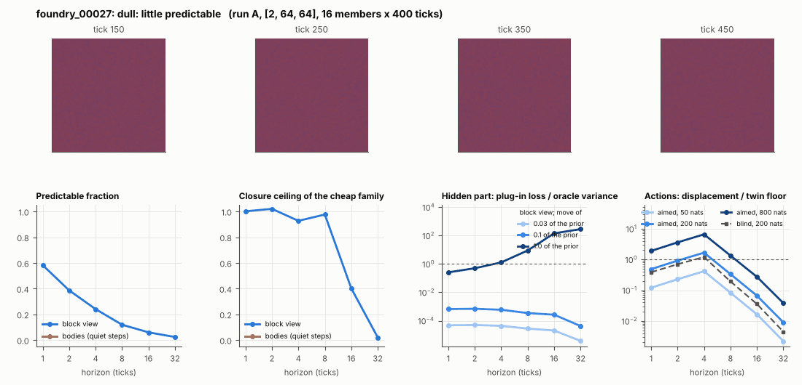

# World card: foundry_00027

Family foundry, role prior. Lattice [2, 64, 64], 4 substeps per tick; input: wind 2 x 8 x 8, noise std 0.25. Hidden part: 240 weights of the law net (+ 10 scalars, kept by the neighbours) (prior: round5/foundry/tnca.py draw_theta; neighbour = round 5's weight neighbour). Views: block means of each kind and of S^2 on 8 px blocks; blob tracker on S / mean(S) > 2.

**Verdict** run A: dull: little predictable. sigma_hat n/a at the None level.

Sizes: 16 members (8 fit), 400 ticks after 50 of burn-in, 32 test states x 6 replicas x 32 ticks; neighbours at [0.03, 0.1, 1.0] of the prior (2 directions x 2). Ratios are from medians over test states (typical state); `mean` marks the mean-based value.

## 1. Predictability at 1 / 2 / 4 / 8 / 16 / 32 ticks

| level | predictable fraction | closure ceiling (cheap family) | ceiling at 8, mean-based |
|---|---|---|---|
| block view | 0.58 / 0.39 / 0.24 / 0.12 / 0.060 / 0.024 | 1.00 / 1.02 / 0.93 / 0.98 / 0.40 / 0.021 | 0.90 |
| bodies, displacement on quiet steps | n/a / n/a / n/a / n/a / n/a / n/a | n/a / n/a / n/a / n/a / n/a / n/a | n/a |

## 2. Structure

- Bodies: 0.00 +- 0.00 (slots 24, full 0.0% of the time), 0% of the matter, radius 0.00 px, half-life n/a ticks, net speed 0.00 px/tick.
- Events per 100 ticks and member: 0.00 fusions, 0.00 fissions, 0.00 births, 0.00 deaths.
- Scales: wavelength 3.01 px; neighbouring-block correlation 0.50; block-view autocorrelation at 1 / 8 / 32 ticks 0.77 / 0.29 / 0.059; 2.9% of the matter relocated per tick.
- Single-body law (displacement, quiet steps) at 1 / 4 / 8 / 16 ticks: ceiling n/a / n/a / n/a / n/a; constant velocity alone n/a / n/a / n/a / n/a; with the surrounding block view n/a / n/a / n/a / n/a. Quiet share of 8-tick steps n/a (0 test rows).

## 3. Stationarity

- Share of the variance that is a function of the tick alone (mean over channels; largest channel in brackets): block view -3.0e-08 [1.9e-16], population n/a [n/a].
- Share between members' time-means: block view 0.012, population n/a.

## 4. Effective laws

- Linear local law on the block view: ceiling 1.002 at 1 tick; falls below 0.5 at 16 ticks; the worst tenth of (state, block) cells carries 63.7% of its excess error at 8 ticks.

## 5. Levels

- The slot list added to the block view's predictor lowers its error at 8 ticks by 0.000 of the variance; the block view added to the body law by n/a; block moments added to the population law by n/a; the population law beats persistence by n/a.

## 6. Learned variable (slow features of the 2 x 2 sub-blocks against the hand block view)

- Ceiling gain at 8 / 16 / 32 ticks, halves AB: 0.018 / 0.39 / 0.63; BA: 0.037 / 0.39 / 0.39. Predictable-fraction gain at 8: 0.034 / 0.039. Smallest R^2 of a learned component on the hand channels: 1.6e-04.

## 7. Actions (block view, 4 ticks after the input starts)

- The aimed 200-nat shift is 2.120 of the block view's variance, 2.949 of the cheap family's error.
- Predictable shift / oracle variance: aimed 50 / 200 / 800 nats 0.75 / 3.02 / 12.0; displacement of the aimed 200-nat input / twin floor 1.67; aimed / blind 1.31. Population level: n/a.

## 8. Hidden part

- Plug-in loss / oracle variance at 8 ticks for a move of 3% / 10% / 100% of the prior: block view 2.8e-05 / 3.5e-04 / 8.90; population n/a / n/a / n/a.
- Weight of a prior-sized error, w_theta at 4 / 8 / 16 ticks: block view 4.05 / 65.6 / 2231; sigma_hat block view 0.23, population n/a.
- Response to the aimed 200-nat input changes by 8.66 oracle variances when the hidden part moves by the prior. Evidence index for a 10% move: 0.064 nats per tick (3 nats in 47.2 ticks).
- Noise twins: 3.5% of the matter placed differently after 8 ticks; doubling time 141 ticks.

## 9. Cost

- 0.046 ms per member-tick on the job's GPU with the tracker on every member, compile excluded (21594 member-ticks/s); USD 0.026 per million member-ticks at USD 1.99/h.

## Gates and robustness

| gate | run A |
|---|---|
| exam_worthy | no |
| structure | no |
| interaction | no |
| reading_worthy | no |
| actions | yes |
| stationary | yes |
| levels_add | no |
| learned_differs | no |

Estimator size (even against odd test states, block view at 8 ticks): predictable fraction 0.11 / 0.13, ceiling 0.96 / 0.75.

Source: run A: job r6-cards-001; files `out/cards/foundry_00027__<run>.json` on origin/gpu-jobs; numbers recomputed by `make_cards.py` from those cards (`card.json` here holds the derived numbers and gates of every run). Pilot: never an exam instance.
