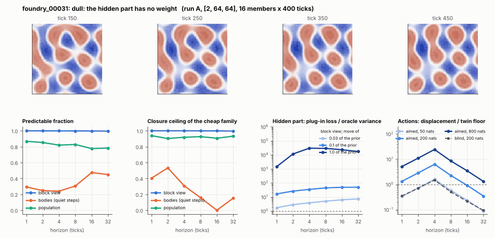

# World card: foundry_00031

Family foundry, role prior. Lattice [2, 64, 64], 4 substeps per tick; input: wind 2 x 8 x 8, noise std 0.25. Hidden part: 240 weights of the law net (+ 10 scalars, kept by the neighbours) (prior: round5/foundry/tnca.py draw_theta; neighbour = round 5's weight neighbour). Views: block means of each kind and of S^2 on 8 px blocks; blob tracker on S / mean(S) > 2.

**Verdict** run A: dull: the hidden part has no weight. sigma_hat 0.083 at the pop level.

Sizes: 16 members (8 fit), 400 ticks after 50 of burn-in, 32 test states x 6 replicas x 32 ticks; neighbours at [0.03, 0.1, 1.0] of the prior (2 directions x 2). Ratios are from medians over test states (typical state); `mean` marks the mean-based value.

## 1. Predictability at 1 / 2 / 4 / 8 / 16 / 32 ticks

| level | predictable fraction | closure ceiling (cheap family) | ceiling at 8, mean-based |
|---|---|---|---|
| block view | 1.00 / 1.00 / 1.00 / 1.00 / 1.00 / 1.00 | 1.00 / 1.00 / 1.00 / 1.00 / 1.00 / 1.00 | 1.00 |
| bodies, displacement on quiet steps | 0.29 / 0.25 / 0.24 / 0.30 / 0.47 / 0.45 | 0.40 / 0.53 / 0.31 / 0.16 / 0.00 / 0.15 | 0.16 |
| population (count, tracked_mass, mean_speed, mass_sd, mass_max) | 0.87 / 0.85 / 0.82 / 0.83 / 0.78 / 0.78 | 0.94 / 0.90 / 0.92 / 0.93 / 0.91 / 0.93 | 0.91 |

## 2. Structure

- Bodies: 5.12 +- 1.00 (slots 24, full 0.0% of the time), 12.4% of the matter, radius 2.54 px, half-life 181 ticks, net speed 0.046 px/tick.
- Events per 100 ticks and member: 0.12 fusions, 0.14 fissions, 9.09 births, 9.14 deaths.
- Scales: wavelength 10.7 px; neighbouring-block correlation 0.033; block-view autocorrelation at 1 / 8 / 32 ticks 1.00 / 1.00 / 1.00; 3.0% of the matter relocated per tick.
- Single-body law (displacement, quiet steps) at 1 / 4 / 8 / 16 ticks: ceiling 0.40 / 0.31 / 0.16 / 0.00; constant velocity alone 0.00 / 0.00 / 0.00 / 0.00; with the surrounding block view 0.33 / 0.15 / 0.043 / 0.00. Quiet share of 8-tick steps 0.93 (129 test rows).

## 3. Stationarity

- Share of the variance that is a function of the tick alone (mean over channels; largest channel in brackets): block view 1.3e-04 [3.9e-04], population 0.017 [0.042] (count 0.042, tracked_mass 0.039, mean_speed 0.035, mass_sd -0.040, mass_max 0.009).
- Share between members' time-means: block view 0.601, population 0.461.

## 4. Effective laws

- Linear local law on the block view: ceiling 1.000 at 1 tick; falls below 0.5 at no horizon up to 32 ticks; the worst tenth of (state, block) cells carries 67.6% of its excess error at 8 ticks.
- Population law at 8 ticks: linear ceiling 0.93, quadratic 0.92.

## 5. Levels

- The slot list added to the block view's predictor lowers its error at 8 ticks by -4.9e-06 of the variance; the block view added to the body law by -0.069; block moments added to the population law by -0.004; the population law beats persistence by 0.121.

## 6. Learned variable (slow features of the 2 x 2 sub-blocks against the hand block view)

- Ceiling gain at 8 / 16 / 32 ticks, halves AB: 6.2e-04 / 0.001 / 0.002; BA: 5.5e-04 / 0.001 / 0.002. Predictable-fraction gain at 8: 0.002 / 0.002. Smallest R^2 of a learned component on the hand channels: 6.2e-04.

## 7. Actions (block view, 4 ticks after the input starts)

- The aimed 200-nat shift is 0.014 of the block view's variance, 8.289 of the cheap family's error.
- Predictable shift / oracle variance: aimed 50 / 200 / 800 nats 2.37 / 9.62 / 38.9; displacement of the aimed 200-nat input / twin floor 6.29; aimed / blind 4.89. Population level: 1.00.

## 8. Hidden part

- Plug-in loss / oracle variance at 8 ticks for a move of 3% / 10% / 100% of the prior: block view 5.08 / 44.7 / 29214; population 8.73 / 60.5 / 724.
- Weight of a prior-sized error, w_theta at 4 / 8 / 16 ticks: block view 48.8 / 66.5 / 71.3; sigma_hat block view 9.6e-04, population 0.083.
- Response to the aimed 200-nat input changes by 2.47 oracle variances when the hidden part moves by the prior. Evidence index for a 10% move: 1597 nats per tick (3 nats in 0.002 ticks).
- Noise twins: 4.2% of the matter placed differently after 8 ticks; doubling time 38.3 ticks.

## 9. Cost

- 0.047 ms per member-tick on the job's GPU with the tracker on every member, compile excluded (21066 member-ticks/s); USD 0.026 per million member-ticks at USD 1.99/h.

## Gates and robustness

| gate | run A |
|---|---|
| exam_worthy | no |
| structure | no |
| interaction | yes |
| reading_worthy | no |
| actions | yes |
| stationary | no |
| levels_add | yes |
| learned_differs | no |

Estimator size (even against odd test states, block view at 8 ticks): predictable fraction 1.00 / 1.00, ceiling 1.00 / 1.00.

Source: run A: job r6-cards-001; files `out/cards/foundry_00031__<run>.json` on origin/gpu-jobs; numbers recomputed by `make_cards.py` from those cards (`card.json` here holds the derived numbers and gates of every run). Pilot: never an exam instance.
