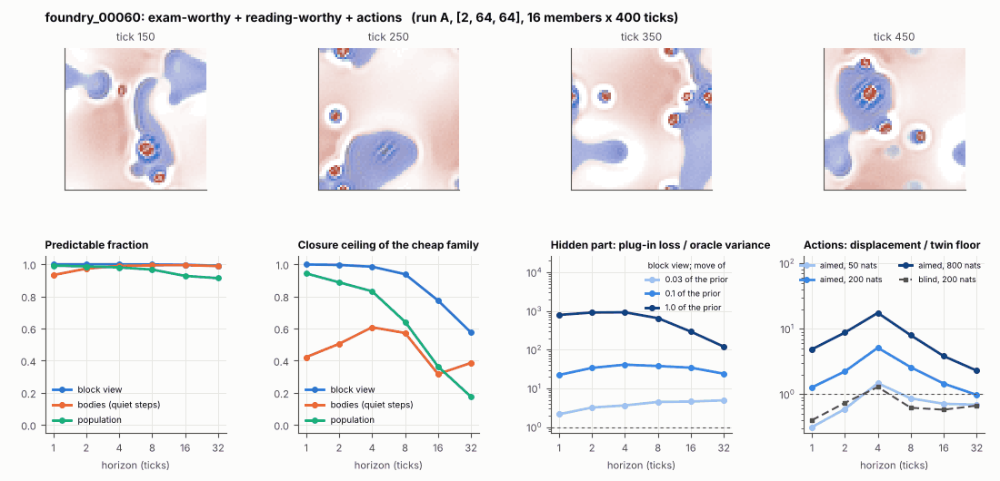

# World card: foundry_00060

Family foundry, role candidate. Lattice [2, 64, 64], 4 substeps per tick; input: wind 2 x 8 x 8, noise std 0.25. Hidden part: 240 weights of the law net (+ 10 scalars, kept by the neighbours) (prior: round5/foundry/tnca.py draw_theta; neighbour = round 5's weight neighbour). Views: block means of each kind and of S^2 on 8 px blocks; blob tracker on S / mean(S) > 2.

**Verdict** run A: exam-worthy + reading-worthy + actions; run late: exam-worthy + reading-worthy + actions. sigma_hat 0.39 at the pop level.

Sizes: 16 members (8 fit), 400 ticks after 50 of burn-in, 32 test states x 6 replicas x 32 ticks; neighbours at [0.03, 0.1, 1.0] of the prior (2 directions x 2). Ratios are from medians over test states (typical state); `mean` marks the mean-based value.

## 1. Predictability at 1 / 2 / 4 / 8 / 16 / 32 ticks

| level | predictable fraction | closure ceiling (cheap family) | ceiling at 8, mean-based |
|---|---|---|---|
| block view | 1.00 / 1.00 / 1.00 / 1.00 / 1.00 / 0.99 | 1.00 / 1.00 / 0.98 / 0.94 / 0.77 / 0.58 | 0.92 |
| bodies, displacement on quiet steps | 0.93 / 0.97 / 0.99 / 0.99 / 0.99 / 0.99 | 0.42 / 0.50 / 0.61 / 0.57 / 0.32 / 0.39 | 0.11 |
| population (count, tracked_mass, mean_speed, mass_sd, mass_max, kind_share) | 0.99 / 0.99 / 0.98 / 0.97 / 0.93 / 0.91 | 0.94 / 0.89 / 0.83 / 0.64 / 0.36 / 0.17 | 0.66 |

## 2. Structure

- Bodies: 5.22 +- 2.07 (slots 24, full 0.0% of the time), 50.1% of the matter, radius 4.53 px, half-life 29.6 ticks, net speed 0.36 px/tick.
- Events per 100 ticks and member: 15.5 fusions, 11.9 fissions, 7.78 births, 4.92 deaths.
- Scales: wavelength 8.87 px; neighbouring-block correlation 0.53; block-view autocorrelation at 1 / 8 / 32 ticks 1.00 / 0.93 / 0.49; 6.4% of the matter relocated per tick.
- Single-body law (displacement, quiet steps) at 1 / 4 / 8 / 16 ticks: ceiling 0.42 / 0.61 / 0.57 / 0.32; constant velocity alone 0.42 / 0.61 / 0.57 / 0.00; with the surrounding block view 0.55 / 0.61 / 0.57 / 0.43. Quiet share of 8-tick steps 0.62 (85.0 test rows).

## 3. Stationarity

- Share of the variance that is a function of the tick alone (mean over channels; largest channel in brackets): block view 0.001 [0.004], population 0.145 [0.337] (count 0.15, tracked_mass 0.34, mean_speed -0.002, mass_sd 0.095, mass_max 0.17, kind_share 0.12).
- Share between members' time-means: block view 0.061, population 0.052.
- Late window (+1950 ticks) against early: largest shift of a block-channel mean 0.084 sd, largest log sd ratio 0.12, body count x 1.00, events 27.4 -> 24.0, ceiling at 8 0.94 -> 0.93, sigma_hat 0.10 -> 0.094. Same statistics: **yes**.

## 4. Effective laws

- Linear local law on the block view: ceiling 0.999 at 1 tick; falls below 0.5 at no horizon up to 32 ticks; the worst tenth of (state, block) cells carries 72.3% of its excess error at 8 ticks.
- Population law at 8 ticks: linear ceiling 0.64, quadratic 0.59.
- Kind-share law ds = b1 s(1-s) + b2 (1-2s) at 8 / 32 ticks: ceiling 0.16 / 0.40, a constant drift 0.007 / 0.027, a line in s 0.18 / 0.43 (predictable fraction of the change 0.93 / 0.94).

## 5. Levels

- The slot list added to the block view's predictor lowers its error at 8 ticks by -1.4e-04 of the variance; the block view added to the body law by 0.108; block moments added to the population law by 0.008; the population law beats persistence by 0.271.

## 6. Learned variable (slow features of the 2 x 2 sub-blocks against the hand block view)

- Ceiling gain at 8 / 16 / 32 ticks, halves AB: -0.016 / -0.046 / -0.11; BA: -0.025 / -0.026 / -0.084. Predictable-fraction gain at 8: -5.3e-04 / -5.7e-04. Smallest R^2 of a learned component on the hand channels: 0.99.

## 7. Actions (block view, 4 ticks after the input starts)

- The aimed 200-nat shift is 0.005 of the block view's variance, 0.297 of the cheap family's error.
- Predictable shift / oracle variance: aimed 50 / 200 / 800 nats 2.46 / 9.32 / 37.4; displacement of the aimed 200-nat input / twin floor 5.15; aimed / blind 5.11. Population level: 0.31.

## 8. Hidden part

- Plug-in loss / oracle variance at 8 ticks for a move of 3% / 10% / 100% of the prior: block view 4.48 / 38.0 / 657; population 3.39 / 22.6 / 330.
- Weight of a prior-sized error, w_theta at 4 / 8 / 16 ticks: block view 0.47 / 0.70 / 0.89; sigma_hat block view 0.10, population 0.39.
- Response to the aimed 200-nat input changes by 6.54 oracle variances when the hidden part moves by the prior. Evidence index for a 10% move: 2143 nats per tick (3 nats in 0.001 ticks).
- Noise twins: 5.3% of the matter placed differently after 8 ticks; doubling time 10.0 ticks.

## 9. Cost

- 0.047 ms per member-tick on the job's GPU with the tracker on every member, compile excluded (21285 member-ticks/s); USD 0.026 per million member-ticks at USD 1.99/h.

## Gates and robustness

| gate | run A | run late |
|---|---|---|
| exam_worthy | yes | yes |
| structure | yes | yes |
| interaction | yes | yes |
| reading_worthy | yes | yes |
| actions | yes | yes |
| stationary | yes | yes |
| levels_add | yes | yes |
| learned_differs | no | no |

Estimator size (even against odd test states, block view at 8 ticks): predictable fraction 1.00 / 1.00, ceiling 0.94 / 0.93.

Source: run A: job r6-cards-001; run late: job r6-cards-001; files `out/cards/foundry_00060__<run>.json` on origin/gpu-jobs; numbers recomputed by `make_cards.py` from those cards (`card.json` here holds the derived numbers and gates of every run). Pilot: never an exam instance.
