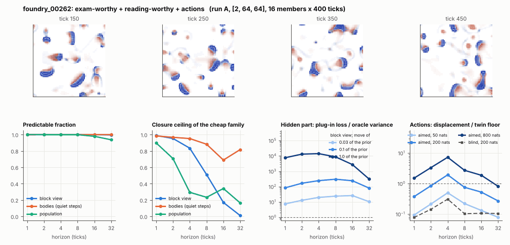

# World card: foundry_00262

Family foundry, role shortlist. Lattice [2, 64, 64], 4 substeps per tick; input: wind 2 x 8 x 8, noise std 0.25. Hidden part: 240 weights of the law net (+ 10 scalars, kept by the neighbours) (prior: round5/foundry/tnca.py draw_theta; neighbour = round 5's weight neighbour). Views: block means of each kind and of S^2 on 8 px blocks; blob tracker on S / mean(S) > 2.

**Verdict** run A: exam-worthy + reading-worthy + actions; run B: exam-worthy + actions; run late: exam-worthy + actions. sigma_hat 0.71 at the pop level.

Sizes: 16 members (8 fit), 400 ticks after 50 of burn-in, 32 test states x 6 replicas x 32 ticks; neighbours at [0.03, 0.1, 1.0] of the prior (2 directions x 2). Ratios are from medians over test states (typical state); `mean` marks the mean-based value.

## 1. Predictability at 1 / 2 / 4 / 8 / 16 / 32 ticks

| level | predictable fraction | closure ceiling (cheap family) | ceiling at 8, mean-based |
|---|---|---|---|
| block view | 1.00 / 1.00 / 1.00 / 1.00 / 1.00 / 1.00 | 0.99 / 0.95 / 0.83 / 0.51 / 0.17 / 0.010 | 0.50 |
| bodies, displacement on quiet steps | 1.00 / 1.00 / 1.00 / 1.00 / 1.00 / 1.00 | 0.98 / 0.97 / 0.95 / 0.88 / 0.69 / 0.82 | 0.38 |
| population (count, tracked_mass, mean_speed, mass_sd, mass_max, kind_share) | 1.00 / 1.00 / 1.00 / 1.00 / 0.98 / 0.94 | 0.90 / 0.71 / 0.29 / 0.23 / 0.34 / 0.16 | 0.35 |

## 2. Structure

- Bodies: 12.0 +- 1.95 (slots 24, full 0.0% of the time), 91.3% of the matter, radius 2.73 px, half-life 20.1 ticks, net speed 0.75 px/tick.
- Events per 100 ticks and member: 43.7 fusions, 42.2 fissions, 6.25 births, 5.39 deaths.
- Scales: wavelength 8.30 px; neighbouring-block correlation 0.11; block-view autocorrelation at 1 / 8 / 32 ticks 0.97 / 0.23 / 0.016; 31.1% of the matter relocated per tick.
- Single-body law (displacement, quiet steps) at 1 / 4 / 8 / 16 ticks: ceiling 0.98 / 0.95 / 0.88 / 0.69; constant velocity alone 0.98 / 0.95 / 0.88 / 0.69; with the surrounding block view 0.98 / 0.95 / 0.88 / 0.70. Quiet share of 8-tick steps 0.56 (185 test rows).

## 3. Stationarity

- Share of the variance that is a function of the tick alone (mean over channels; largest channel in brackets): block view -7.2e-06 [-6.9e-20], population 0.035 [0.078] (count 0.078, tracked_mass 0.036, mean_speed 0.014, mass_sd 0.038, mass_max 0.019, kind_share 0.029).
- Share between members' time-means: block view 0.191, population 0.127.
- Late window (+1950 ticks) against early: largest shift of a block-channel mean 0.17 sd, largest log sd ratio 0.73, body count x 0.89, events 85.9 -> 61.6, ceiling at 8 0.51 -> 0.52, sigma_hat 0.49 -> 0.51. Same statistics: **no**.

## 4. Effective laws

- Linear local law on the block view: ceiling 0.989 at 1 tick; falls below 0.5 at 16 ticks; the worst tenth of (state, block) cells carries 56.3% of its excess error at 8 ticks.
- Population law at 8 ticks: linear ceiling 0.23, quadratic 0.27.
- Kind-share law ds = b1 s(1-s) + b2 (1-2s) at 8 / 32 ticks: ceiling 0.00 / 0.073, a constant drift 0.014 / 0.012, a line in s 0.00 / 0.028 (predictable fraction of the change 0.97 / 0.90).

## 5. Levels

- The slot list added to the block view's predictor lowers its error at 8 ticks by 0.023 of the variance; the block view added to the body law by 0.034; block moments added to the population law by 0.033; the population law beats persistence by 0.045.

## 6. Learned variable (slow features of the 2 x 2 sub-blocks against the hand block view)

- Ceiling gain at 8 / 16 / 32 ticks, halves AB: -0.34 / -0.12 / -0.013; BA: -0.46 / -0.14 / -0.008. Predictable-fraction gain at 8: -0.003 / -0.003. Smallest R^2 of a learned component on the hand channels: 0.026.

## 7. Actions (block view, 4 ticks after the input starts)

- The aimed 200-nat shift is 1.5e-04 of the block view's variance, 0.001 of the cheap family's error.
- Predictable shift / oracle variance: aimed 50 / 200 / 800 nats 0.95 / 3.78 / 13.4; displacement of the aimed 200-nat input / twin floor 1.94; aimed / blind 8.21. Population level: 0.058.

## 8. Hidden part

- Plug-in loss / oracle variance at 8 ticks for a move of 3% / 10% / 100% of the prior: block view 24.0 / 304 / 8732; population 4.40 / 104 / 181520.
- Weight of a prior-sized error, w_theta at 4 / 8 / 16 ticks: block view 0.63 / 0.84 / 1.27; sigma_hat block view 0.49, population 0.71.
- Response to the aimed 200-nat input changes by 3.70 oracle variances when the hidden part moves by the prior. Evidence index for a 10% move: 8024 nats per tick (3 nats in 3.7e-04 ticks).
- Noise twins: 2.3% of the matter placed differently after 8 ticks; doubling time 10.5 ticks.

## 9. Cost

- 0.049 ms per member-tick on the job's GPU with the tracker on every member, compile excluded (20443 member-ticks/s); USD 0.027 per million member-ticks at USD 1.99/h.

## Gates and robustness

| gate | run A | run B | run late |
|---|---|---|---|
| exam_worthy | yes | yes | yes |
| structure | yes | yes | yes |
| interaction | yes | no | no |
| reading_worthy | yes | no | no |
| actions | yes | yes | yes |
| stationary | yes | no | no |
| levels_add | yes | yes | yes |
| learned_differs | no | no | no |

Seed (A against B): 25 of 30 entries agree; not robust: grid.member_share, pop.ceil8, pop.act_ms, l.dceil8_AB, k.law32.

Size (64 px against foundry128_00262; counts per area, action entries left out): 22 of 26 entries agree; not robust: grid.member_share, pop.ceil8, pop.tick_share, k.law32.

Estimator size (even against odd test states, block view at 8 ticks): predictable fraction 1.00 / 1.00, ceiling 0.53 / 0.49.

Source: run A: job r6-cards-001; run B: job r6-cards-001; run late: job r6-cards-001; files `out/cards/foundry_00262__<run>.json` on origin/gpu-jobs; numbers recomputed by `make_cards.py` from those cards (`card.json` here holds the derived numbers and gates of every run). Pilot: never an exam instance.
