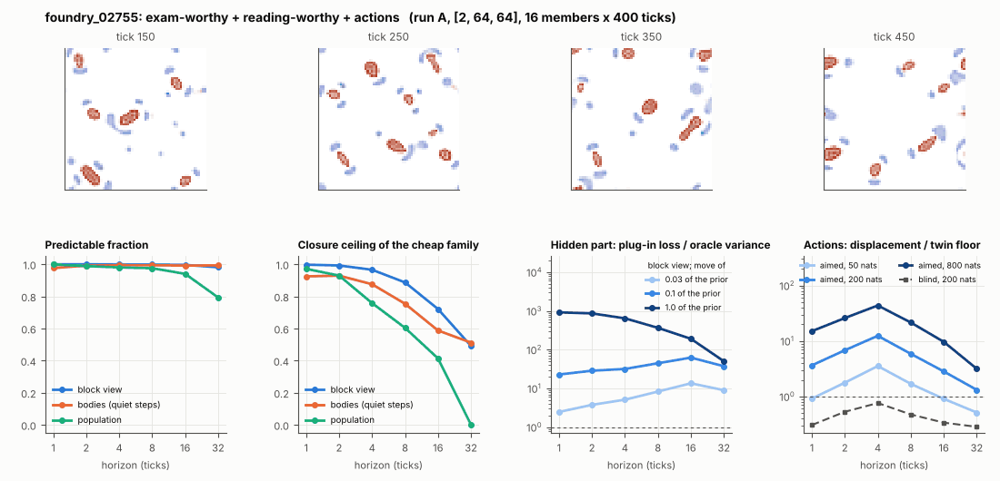

# World card: foundry_02755

Family foundry, role candidate. Lattice [2, 64, 64], 4 substeps per tick; input: wind 2 x 8 x 8, noise std 0.25. Hidden part: 240 weights of the law net (+ 10 scalars, kept by the neighbours) (prior: round5/foundry/tnca.py draw_theta; neighbour = round 5's weight neighbour). Views: block means of each kind and of S^2 on 8 px blocks; blob tracker on S / mean(S) > 2.

**Verdict** run A: exam-worthy + reading-worthy + actions; run late: dull: the hidden part has no weight. sigma_hat 0.41 at the pop level.

Sizes: 16 members (8 fit), 400 ticks after 50 of burn-in, 32 test states x 6 replicas x 32 ticks; neighbours at [0.03, 0.1, 1.0] of the prior (2 directions x 2). Ratios are from medians over test states (typical state); `mean` marks the mean-based value.

## 1. Predictability at 1 / 2 / 4 / 8 / 16 / 32 ticks

| level | predictable fraction | closure ceiling (cheap family) | ceiling at 8, mean-based |
|---|---|---|---|
| block view | 1.00 / 1.00 / 1.00 / 1.00 / 1.00 / 0.98 | 1.00 / 0.99 / 0.97 / 0.89 / 0.72 / 0.49 | 0.85 |
| bodies, displacement on quiet steps | 0.98 / 0.99 / 0.99 / 0.99 / 0.99 / 0.99 | 0.92 / 0.93 / 0.88 / 0.75 / 0.59 / 0.51 | 0.53 |
| population (count, mean_speed, mass_sd, mass_max, kind_share) | 1.00 / 0.99 / 0.98 / 0.98 / 0.94 / 0.79 | 0.97 / 0.93 / 0.76 / 0.60 / 0.41 / 0.00 | 0.57 |

## 2. Structure

- Bodies: 10.8 +- 2.72 (slots 24, full 0.047% of the time), 98.5% of the matter, radius 2.61 px, half-life 44.2 ticks, net speed 0.19 px/tick.
- Events per 100 ticks and member: 34.3 fusions, 32.3 fissions, 0.95 births, 1.03 deaths.
- Scales: wavelength 5.24 px; neighbouring-block correlation 0.084; block-view autocorrelation at 1 / 8 / 32 ticks 1.00 / 0.89 / 0.56; 9.7% of the matter relocated per tick.
- Single-body law (displacement, quiet steps) at 1 / 4 / 8 / 16 ticks: ceiling 0.92 / 0.88 / 0.75 / 0.59; constant velocity alone 0.92 / 0.88 / 0.75 / 0.57; with the surrounding block view 0.92 / 0.88 / 0.75 / 0.57. Quiet share of 8-tick steps 0.74 (209 test rows).

## 3. Stationarity

- Share of the variance that is a function of the tick alone (mean over channels; largest channel in brackets): block view 9.3e-06 [2.8e-05], population 0.055 [0.338] (count 0.34, mean_speed -0.014, mass_sd 0.008, mass_max -0.008, kind_share -0.049).
- Share between members' time-means: block view 0.187, population 0.149.
- Late window (+1950 ticks) against early: largest shift of a block-channel mean 0.074 sd, largest log sd ratio 0.60, body count x 0.59, events 66.6 -> 27.9, ceiling at 8 0.89 -> 0.99, sigma_hat 0.14 -> 0.021. Same statistics: **no**.

## 4. Effective laws

- Linear local law on the block view: ceiling 0.997 at 1 tick; falls below 0.5 at 32 ticks; the worst tenth of (state, block) cells carries 79.7% of its excess error at 8 ticks.
- Population law at 8 ticks: linear ceiling 0.60, quadratic 0.57.
- Kind-share law ds = b1 s(1-s) + b2 (1-2s) at 8 / 32 ticks: ceiling 0.19 / 0.23, a constant drift 0.00 / 0.00, a line in s 0.20 / 0.21 (predictable fraction of the change 0.89 / 0.79).

## 5. Levels

- The slot list added to the block view's predictor lowers its error at 8 ticks by 0.003 of the variance; the block view added to the body law by -0.016; block moments added to the population law by 0.016; the population law beats persistence by 0.120.

## 6. Learned variable (slow features of the 2 x 2 sub-blocks against the hand block view)

- Ceiling gain at 8 / 16 / 32 ticks, halves AB: -0.084 / -0.14 / -0.078; BA: -0.070 / -0.12 / -0.097. Predictable-fraction gain at 8: -0.003 / -0.002. Smallest R^2 of a learned component on the hand channels: 0.016.

## 7. Actions (block view, 4 ticks after the input starts)

- The aimed 200-nat shift is 0.019 of the block view's variance, 0.494 of the cheap family's error.
- Predictable shift / oracle variance: aimed 50 / 200 / 800 nats 6.44 / 22.3 / 71.2; displacement of the aimed 200-nat input / twin floor 12.4; aimed / blind 26.0. Population level: 0.89.

## 8. Hidden part

- Plug-in loss / oracle variance at 8 ticks for a move of 3% / 10% / 100% of the prior: block view 8.29 / 44.7 / 367; population 10.3 / 70.3 / 304.
- Weight of a prior-sized error, w_theta at 4 / 8 / 16 ticks: block view 0.50 / 0.63 / 0.80; sigma_hat block view 0.14, population 0.41.
- Response to the aimed 200-nat input changes by 12.1 oracle variances when the hidden part moves by the prior. Evidence index for a 10% move: 2194 nats per tick (3 nats in 0.001 ticks).
- Noise twins: 8.4% of the matter placed differently after 8 ticks; doubling time 5.6 ticks.

## 9. Cost

- 0.046 ms per member-tick on the job's GPU with the tracker on every member, compile excluded (21527 member-ticks/s); USD 0.026 per million member-ticks at USD 1.99/h.

## Gates and robustness

| gate | run A | run late |
|---|---|---|
| exam_worthy | yes | no |
| structure | yes | yes |
| interaction | yes | yes |
| reading_worthy | yes | yes |
| actions | yes | yes |
| stationary | yes | no |
| levels_add | yes | yes |
| learned_differs | no | no |

Estimator size (even against odd test states, block view at 8 ticks): predictable fraction 1.00 / 1.00, ceiling 0.88 / 0.90.

Source: run A: job r6-cards-001; run late: job r6-cards-001; files `out/cards/foundry_02755__<run>.json` on origin/gpu-jobs; numbers recomputed by `make_cards.py` from those cards (`card.json` here holds the derived numbers and gates of every run). Pilot: never an exam instance.
