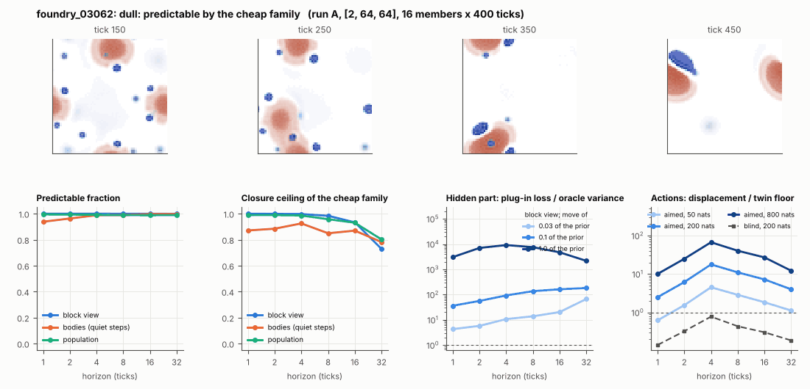

# World card: foundry_03062

Family foundry, role candidate. Lattice [2, 64, 64], 4 substeps per tick; input: wind 2 x 8 x 8, noise std 0.25. Hidden part: 240 weights of the law net (+ 10 scalars, kept by the neighbours) (prior: round5/foundry/tnca.py draw_theta; neighbour = round 5's weight neighbour). Views: block means of each kind and of S^2 on 8 px blocks; blob tracker on S / mean(S) > 2.

**Verdict** run A: dull: predictable by the cheap family; run late: dull: predictable by the cheap family. sigma_hat 0.042 at the pop level.

Sizes: 16 members (8 fit), 400 ticks after 50 of burn-in, 32 test states x 6 replicas x 32 ticks; neighbours at [0.03, 0.1, 1.0] of the prior (2 directions x 2). Ratios are from medians over test states (typical state); `mean` marks the mean-based value.

## 1. Predictability at 1 / 2 / 4 / 8 / 16 / 32 ticks

| level | predictable fraction | closure ceiling (cheap family) | ceiling at 8, mean-based |
|---|---|---|---|
| block view | 1.00 / 1.00 / 1.00 / 1.00 / 1.00 / 1.00 | 1.00 / 1.00 / 1.00 / 0.98 / 0.93 / 0.73 | 0.96 |
| bodies, displacement on quiet steps | 0.94 / 0.96 / 0.99 / 0.99 / 1.00 / 1.00 | 0.87 / 0.88 / 0.93 / 0.85 / 0.87 / 0.78 | 0.94 |
| population (count, tracked_mass, mean_speed, mass_sd, mass_max, kind_share) | 0.99 / 0.99 / 0.99 / 0.99 / 0.99 / 0.99 | 0.99 / 0.99 / 0.99 / 0.96 / 0.93 / 0.80 | 0.96 |

## 2. Structure

- Bodies: 6.63 +- 4.19 (slots 24, full 0.0% of the time), 87.3% of the matter, radius 2.38 px, half-life 89.8 ticks, net speed 0.075 px/tick.
- Events per 100 ticks and member: 6.09 fusions, 2.56 fissions, 1.81 births, 1.91 deaths.
- Scales: wavelength 14.5 px; neighbouring-block correlation 0.42; block-view autocorrelation at 1 / 8 / 32 ticks 1.00 / 0.97 / 0.76; 5.1% of the matter relocated per tick.
- Single-body law (displacement, quiet steps) at 1 / 4 / 8 / 16 ticks: ceiling 0.87 / 0.93 / 0.85 / 0.87; constant velocity alone 0.87 / 0.93 / 0.85 / 0.87; with the surrounding block view 0.87 / 0.93 / 0.85 / 0.87. Quiet share of 8-tick steps 0.91 (146 test rows).

## 3. Stationarity

- Share of the variance that is a function of the tick alone (mean over channels; largest channel in brackets): block view 0.001 [0.004], population 0.588 [0.909] (count 0.84, tracked_mass 0.91, mean_speed 0.26, mass_sd 0.36, mass_max 0.78, kind_share 0.38).
- Share between members' time-means: block view 0.027, population 0.098.
- Late window (+1950 ticks) against early: largest shift of a block-channel mean 0.078 sd, largest log sd ratio 0.58, body count x 0.15, events 8.66 -> 0.00, ceiling at 8 0.98 -> 0.97, sigma_hat 0.028 -> 0.033. Same statistics: **no**.

## 4. Effective laws

- Linear local law on the block view: ceiling 1.000 at 1 tick; falls below 0.5 at no horizon up to 32 ticks; the worst tenth of (state, block) cells carries 93.5% of its excess error at 8 ticks.
- Population law at 8 ticks: linear ceiling 0.96, quadratic 0.96.
- Kind-share law ds = b1 s(1-s) + b2 (1-2s) at 8 / 32 ticks: ceiling 0.00 / 0.00, a constant drift 0.00 / 0.00, a line in s 0.00 / 0.00 (predictable fraction of the change 0.92 / 0.66).

## 5. Levels

- The slot list added to the block view's predictor lowers its error at 8 ticks by -0.004 of the variance; the block view added to the body law by -0.097; block moments added to the population law by 0.004; the population law beats persistence by -0.017.

## 6. Learned variable (slow features of the 2 x 2 sub-blocks against the hand block view)

- Ceiling gain at 8 / 16 / 32 ticks, halves AB: -0.028 / -0.12 / -0.27; BA: -0.026 / -0.089 / -0.22. Predictable-fraction gain at 8: -5.6e-04 / -3.6e-04. Smallest R^2 of a learned component on the hand channels: 0.008.

## 7. Actions (block view, 4 ticks after the input starts)

- The aimed 200-nat shift is 0.004 of the block view's variance, 1.289 of the cheap family's error.
- Predictable shift / oracle variance: aimed 50 / 200 / 800 nats 7.15 / 28.9 / 109; displacement of the aimed 200-nat input / twin floor 17.7; aimed / blind 48.5. Population level: 2.54.

## 8. Hidden part

- Plug-in loss / oracle variance at 8 ticks for a move of 3% / 10% / 100% of the prior: block view 13.8 / 137 / 7549; population 3.05 / 23.0 / 790.
- Weight of a prior-sized error, w_theta at 4 / 8 / 16 ticks: block view 1.27 / 1.64 / 1.73; sigma_hat block view 0.028, population 0.042.
- Response to the aimed 200-nat input changes by 25.8 oracle variances when the hidden part moves by the prior. Evidence index for a 10% move: 3477 nats per tick (3 nats in 8.6e-04 ticks).
- Noise twins: 3.7% of the matter placed differently after 8 ticks; doubling time 32.1 ticks.

## 9. Cost

- 0.046 ms per member-tick on the job's GPU with the tracker on every member, compile excluded (21675 member-ticks/s); USD 0.026 per million member-ticks at USD 1.99/h.

## Gates and robustness

| gate | run A | run late |
|---|---|---|
| exam_worthy | no | no |
| structure | yes | no |
| interaction | yes | no |
| reading_worthy | yes | no |
| actions | yes | yes |
| stationary | yes | yes |
| levels_add | no | no |
| learned_differs | no | no |

Estimator size (even against odd test states, block view at 8 ticks): predictable fraction 1.00 / 1.00, ceiling 0.97 / 0.99.

Source: run A: job r6-cards-001; run late: job r6-cards-001; files `out/cards/foundry_03062__<run>.json` on origin/gpu-jobs; numbers recomputed by `make_cards.py` from those cards (`card.json` here holds the derived numbers and gates of every run). Pilot: never an exam instance.
