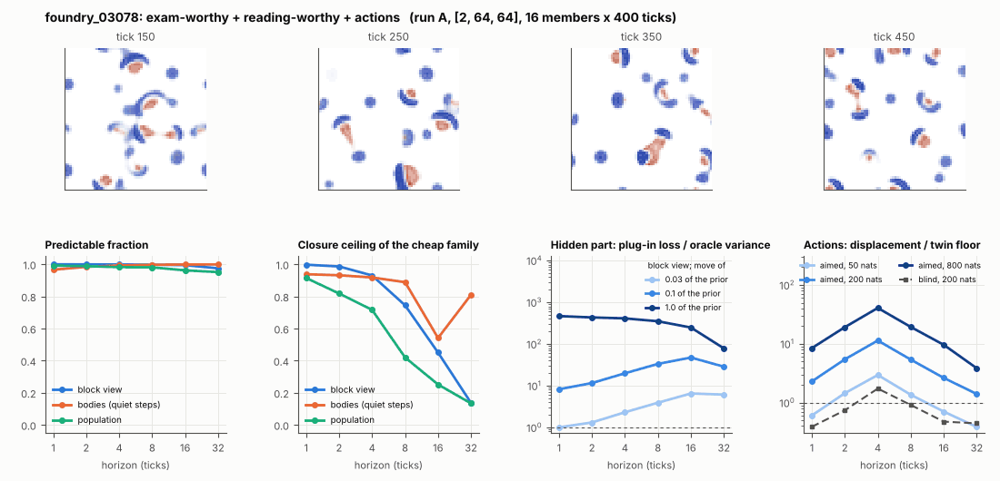

# World card: foundry_03078

Family foundry, role shortlist. Lattice [2, 64, 64], 4 substeps per tick; input: wind 2 x 8 x 8, noise std 0.25. Hidden part: 240 weights of the law net (+ 10 scalars, kept by the neighbours) (prior: round5/foundry/tnca.py draw_theta; neighbour = round 5's weight neighbour). Views: block means of each kind and of S^2 on 8 px blocks; blob tracker on S / mean(S) > 2.

**Verdict** run A: exam-worthy + reading-worthy + actions; run B: exam-worthy + reading-worthy + actions; run late: exam-worthy + actions. sigma_hat 0.54 at the pop level.

Sizes: 16 members (8 fit), 400 ticks after 50 of burn-in, 32 test states x 6 replicas x 32 ticks; neighbours at [0.03, 0.1, 1.0] of the prior (2 directions x 2). Ratios are from medians over test states (typical state); `mean` marks the mean-based value.

## 1. Predictability at 1 / 2 / 4 / 8 / 16 / 32 ticks

| level | predictable fraction | closure ceiling (cheap family) | ceiling at 8, mean-based |
|---|---|---|---|
| block view | 1.00 / 1.00 / 1.00 / 1.00 / 0.99 / 0.97 | 1.00 / 0.99 / 0.93 / 0.74 / 0.45 / 0.14 | 0.74 |
| bodies, displacement on quiet steps | 0.97 / 0.98 / 0.99 / 1.00 / 1.00 / 1.00 | 0.94 / 0.93 / 0.92 / 0.89 / 0.54 / 0.81 | 0.67 |
| population (count, mean_speed, mass_sd, mass_max, kind_share) | 0.99 / 0.99 / 0.98 / 0.98 / 0.96 / 0.95 | 0.91 / 0.82 / 0.72 / 0.42 / 0.25 / 0.13 | 0.17 |

## 2. Structure

- Bodies: 13.2 +- 2.97 (slots 24, full 0.5% of the time), 98.3% of the matter, radius 2.72 px, half-life 36.2 ticks, net speed 0.26 px/tick.
- Events per 100 ticks and member: 27.2 fusions, 25.6 fissions, 0.86 births, 1.39 deaths.
- Scales: wavelength 7.69 px; neighbouring-block correlation 0.065; block-view autocorrelation at 1 / 8 / 32 ticks 0.99 / 0.63 / 0.053; 13.5% of the matter relocated per tick.
- Single-body law (displacement, quiet steps) at 1 / 4 / 8 / 16 ticks: ceiling 0.94 / 0.92 / 0.89 / 0.54; constant velocity alone 0.94 / 0.92 / 0.89 / 0.54; with the surrounding block view 0.94 / 0.92 / 0.89 / 0.54. Quiet share of 8-tick steps 0.74 (266 test rows).

## 3. Stationarity

- Share of the variance that is a function of the tick alone (mean over channels; largest channel in brackets): block view 2.4e-04 [7.3e-04], population 0.086 [0.467] (count 0.47, mean_speed 0.014, mass_sd 0.030, mass_max -0.003, kind_share -0.076).
- Share between members' time-means: block view 0.035, population 0.036.
- Late window (+1950 ticks) against early: largest shift of a block-channel mean 2.6e-04 sd, largest log sd ratio 0.035, body count x 0.93, events 52.8 -> 49.2, ceiling at 8 0.74 -> 0.75, sigma_hat 0.29 -> 0.29. Same statistics: **yes**.

## 4. Effective laws

- Linear local law on the block view: ceiling 0.997 at 1 tick; falls below 0.5 at 16 ticks; the worst tenth of (state, block) cells carries 66.7% of its excess error at 8 ticks.
- Population law at 8 ticks: linear ceiling 0.42, quadratic 0.42.
- Kind-share law ds = b1 s(1-s) + b2 (1-2s) at 8 / 32 ticks: ceiling 0.23 / 0.39, a constant drift 0.00 / 0.00, a line in s 0.23 / 0.39 (predictable fraction of the change 0.66 / 0.66).

## 5. Levels

- The slot list added to the block view's predictor lowers its error at 8 ticks by 0.011 of the variance; the block view added to the body law by -0.018; block moments added to the population law by 0.024; the population law beats persistence by 0.180.

## 6. Learned variable (slow features of the 2 x 2 sub-blocks against the hand block view)

- Ceiling gain at 8 / 16 / 32 ticks, halves AB: -0.11 / -0.19 / -0.051; BA: -0.12 / -0.18 / -0.049. Predictable-fraction gain at 8: -0.001 / -0.001. Smallest R^2 of a learned component on the hand channels: 0.013.

## 7. Actions (block view, 4 ticks after the input starts)

- The aimed 200-nat shift is 0.022 of the block view's variance, 0.332 of the cheap family's error.
- Predictable shift / oracle variance: aimed 50 / 200 / 800 nats 5.17 / 19.0 / 67.2; displacement of the aimed 200-nat input / twin floor 11.4; aimed / blind 5.41. Population level: 0.82.

## 8. Hidden part

- Plug-in loss / oracle variance at 8 ticks for a move of 3% / 10% / 100% of the prior: block view 3.92 / 33.3 / 351; population 0.31 / 5.30 / 3031.
- Weight of a prior-sized error, w_theta at 4 / 8 / 16 ticks: block view 0.51 / 0.84 / 1.41; sigma_hat block view 0.29, population 0.54.
- Response to the aimed 200-nat input changes by 17.5 oracle variances when the hidden part moves by the prior. Evidence index for a 10% move: 790 nats per tick (3 nats in 0.004 ticks).
- Noise twins: 7.8% of the matter placed differently after 8 ticks; doubling time 7.8 ticks.

## 9. Cost

- 0.049 ms per member-tick on the job's GPU with the tracker on every member, compile excluded (20501 member-ticks/s); USD 0.027 per million member-ticks at USD 1.99/h.

## Gates and robustness

| gate | run A | run B | run late |
|---|---|---|---|
| exam_worthy | yes | yes | yes |
| structure | yes | yes | yes |
| interaction | yes | yes | no |
| reading_worthy | yes | yes | no |
| actions | yes | yes | yes |
| stationary | yes | yes | yes |
| levels_add | yes | yes | yes |
| learned_differs | no | no | no |

Seed (A against B): 28 of 30 entries agree; not robust: pop.tick_share, pop.act_ms.

Size (64 px against foundry128_03078; counts per area, action entries left out): 21 of 26 entries agree; not robust: pop.ceil8, pop.sigma_hat, pop.tick_share, l.dceil16_AB, k.law32.

Estimator size (even against odd test states, block view at 8 ticks): predictable fraction 1.00 / 1.00, ceiling 0.73 / 0.75.

Source: run A: job r6-cards-001; run B: job r6-cards-001; run late: job r6-cards-001; files `out/cards/foundry_03078__<run>.json` on origin/gpu-jobs; numbers recomputed by `make_cards.py` from those cards (`card.json` here holds the derived numbers and gates of every run). Pilot: never an exam instance.
