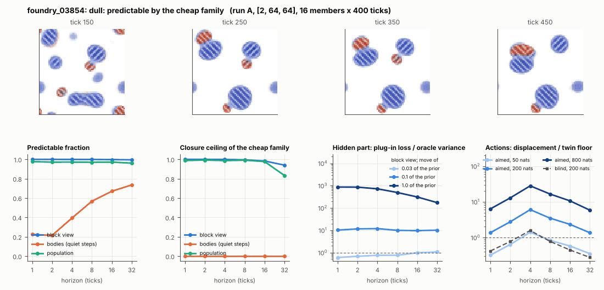

# World card: foundry_03854

Family foundry, role candidate. Lattice [2, 64, 64], 4 substeps per tick; input: wind 2 x 8 x 8, noise std 0.25. Hidden part: 240 weights of the law net (+ 10 scalars, kept by the neighbours) (prior: round5/foundry/tnca.py draw_theta; neighbour = round 5's weight neighbour). Views: block means of each kind and of S^2 on 8 px blocks; blob tracker on S / mean(S) > 2.

**Verdict** run A: dull: predictable by the cheap family; run late: dull: predictable by the cheap family. sigma_hat 0.015 at the pop level.

Sizes: 16 members (8 fit), 400 ticks after 50 of burn-in, 32 test states x 6 replicas x 32 ticks; neighbours at [0.03, 0.1, 1.0] of the prior (2 directions x 2). Ratios are from medians over test states (typical state); `mean` marks the mean-based value.

## 1. Predictability at 1 / 2 / 4 / 8 / 16 / 32 ticks

| level | predictable fraction | closure ceiling (cheap family) | ceiling at 8, mean-based |
|---|---|---|---|
| block view | 1.00 / 1.00 / 1.00 / 1.00 / 1.00 / 0.99 | 1.00 / 1.00 / 1.00 / 1.00 / 0.98 / 0.94 | 0.99 |
| bodies, displacement on quiet steps | 0.22 / 0.21 / 0.39 / 0.57 / 0.67 / 0.74 | 0.00 / 0.00 / 0.00 / 0.00 / 0.00 / 0.00 | 0.003 |
| population (count, tracked_mass, mean_speed, mass_sd, mass_max, kind_share) | 0.98 / 0.97 / 0.97 / 0.97 / 0.97 / 0.96 | 0.99 / 0.99 / 0.99 / 0.99 / 0.98 / 0.83 | 0.96 |

## 2. Structure

- Bodies: 6.64 +- 2.69 (slots 24, full 0.0% of the time), 93.7% of the matter, radius 4.38 px, half-life 114 ticks, net speed 0.085 px/tick.
- Events per 100 ticks and member: 5.62 fusions, 3.84 fissions, 0.22 births, 0.34 deaths.
- Scales: wavelength 9.44 px; neighbouring-block correlation 0.23; block-view autocorrelation at 1 / 8 / 32 ticks 1.00 / 0.99 / 0.91; 2.8% of the matter relocated per tick.
- Single-body law (displacement, quiet steps) at 1 / 4 / 8 / 16 ticks: ceiling 0.00 / 0.00 / 0.00 / 0.00; constant velocity alone 0.00 / 0.00 / 0.00 / 0.00; with the surrounding block view 0.00 / 0.00 / 0.00 / 0.00. Quiet share of 8-tick steps 0.91 (149 test rows).

## 3. Stationarity

- Share of the variance that is a function of the tick alone (mean over channels; largest channel in brackets): block view 7.9e-04 [0.002], population 0.513 [0.894] (count 0.79, tracked_mass 0.89, mean_speed 0.16, mass_sd 0.46, mass_max 0.43, kind_share 0.34).
- Share between members' time-means: block view 0.054, population 0.226.
- Late window (+1950 ticks) against early: largest shift of a block-channel mean 0.11 sd, largest log sd ratio 0.34, body count x 0.23, events 9.47 -> 0.078, ceiling at 8 1.00 -> 1.00, sigma_hat 0.008 -> 8.3e-04. Same statistics: **no**.

## 4. Effective laws

- Linear local law on the block view: ceiling 1.000 at 1 tick; falls below 0.5 at no horizon up to 32 ticks; the worst tenth of (state, block) cells carries 86.4% of its excess error at 8 ticks.
- Population law at 8 ticks: linear ceiling 0.99, quadratic 0.99.
- Kind-share law ds = b1 s(1-s) + b2 (1-2s) at 8 / 32 ticks: ceiling 0.15 / 0.37, a constant drift 0.015 / 0.062, a line in s 0.16 / 0.36 (predictable fraction of the change 0.84 / 0.87).

## 5. Levels

- The slot list added to the block view's predictor lowers its error at 8 ticks by 2.5e-06 of the variance; the block view added to the body law by -0.007; block moments added to the population law by -7.3e-04; the population law beats persistence by 0.020.

## 6. Learned variable (slow features of the 2 x 2 sub-blocks against the hand block view)

- Ceiling gain at 8 / 16 / 32 ticks, halves AB: -0.001 / -0.003 / -0.004; BA: -0.002 / -0.005 / -0.009. Predictable-fraction gain at 8: -0.001 / -0.001. Smallest R^2 of a learned component on the hand channels: 0.004.

## 7. Actions (block view, 4 ticks after the input starts)

- The aimed 200-nat shift is 0.011 of the block view's variance, 4.818 of the cheap family's error.
- Predictable shift / oracle variance: aimed 50 / 200 / 800 nats 2.77 / 12.0 / 54.7; displacement of the aimed 200-nat input / twin floor 6.03; aimed / blind 4.46. Population level: 2.96.

## 8. Hidden part

- Plug-in loss / oracle variance at 8 ticks for a move of 3% / 10% / 100% of the prior: block view 0.76 / 9.95 / 494; population 0.002 / 0.48 / 2972.
- Weight of a prior-sized error, w_theta at 4 / 8 / 16 ticks: block view 0.54 / 0.67 / 0.77; sigma_hat block view 0.008, population 0.015.
- Response to the aimed 200-nat input changes by 4.18 oracle variances when the hidden part moves by the prior. Evidence index for a 10% move: 983 nats per tick (3 nats in 0.003 ticks).
- Noise twins: 5.1% of the matter placed differently after 8 ticks; doubling time 11.2 ticks.

## 9. Cost

- 0.047 ms per member-tick on the job's GPU with the tracker on every member, compile excluded (21472 member-ticks/s); USD 0.026 per million member-ticks at USD 1.99/h.

## Gates and robustness

| gate | run A | run late |
|---|---|---|
| exam_worthy | no | no |
| structure | yes | no |
| interaction | yes | yes |
| reading_worthy | yes | no |
| actions | yes | yes |
| stationary | yes | no |
| levels_add | no | no |
| learned_differs | no | no |

Estimator size (even against odd test states, block view at 8 ticks): predictable fraction 1.00 / 1.00, ceiling 0.99 / 1.00.

Source: run A: job r6-cards-001; run late: job r6-cards-001; files `out/cards/foundry_03854__<run>.json` on origin/gpu-jobs; numbers recomputed by `make_cards.py` from those cards (`card.json` here holds the derived numbers and gates of every run). Pilot: never an exam instance.
