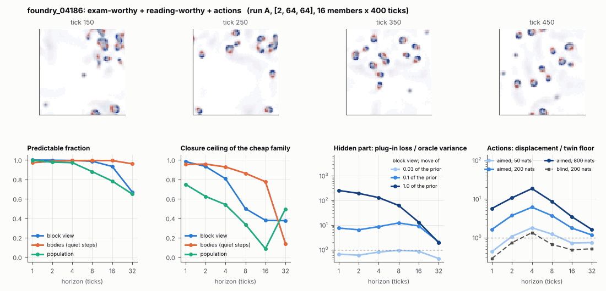

# World card: foundry_04186

Family foundry, role shortlist. Lattice [2, 64, 64], 4 substeps per tick; input: wind 2 x 8 x 8, noise std 0.25. Hidden part: 240 weights of the law net (+ 10 scalars, kept by the neighbours) (prior: round5/foundry/tnca.py draw_theta; neighbour = round 5's weight neighbour). Views: block means of each kind and of S^2 on 8 px blocks; blob tracker on S / mean(S) > 2.

**Verdict** run A: exam-worthy + reading-worthy + actions; run B: exam-worthy + reading-worthy + actions; run late: exam-worthy + reading-worthy + actions. sigma_hat 0.68 at the pop level.

Sizes: 16 members (8 fit), 400 ticks after 50 of burn-in, 32 test states x 6 replicas x 32 ticks; neighbours at [0.03, 0.1, 1.0] of the prior (2 directions x 2). Ratios are from medians over test states (typical state); `mean` marks the mean-based value.

## 1. Predictability at 1 / 2 / 4 / 8 / 16 / 32 ticks

| level | predictable fraction | closure ceiling (cheap family) | ceiling at 8, mean-based |
|---|---|---|---|
| block view | 1.00 / 1.00 / 0.99 / 0.99 / 0.93 / 0.67 | 0.98 / 0.93 / 0.81 / 0.50 / 0.38 / 0.37 | 0.53 |
| bodies, displacement on quiet steps | 0.97 / 0.99 / 0.99 / 0.99 / 0.99 / 0.96 | 0.95 / 0.96 / 0.93 / 0.86 / 0.78 / 0.14 | 0.78 |
| population (count, tracked_mass, mean_speed, mass_sd, mass_max) | 1.00 / 0.98 / 0.97 / 0.88 / 0.78 / 0.65 | 0.75 / 0.62 / 0.54 / 0.34 / 0.086 / 0.50 | 0.39 |

## 2. Structure

- Bodies: 10.1 +- 2.88 (slots 24, full 0.047% of the time), 86.1% of the matter, radius 2.32 px, half-life 20.4 ticks, net speed 0.67 px/tick.
- Events per 100 ticks and member: 44.1 fusions, 39.6 fissions, 3.05 births, 0.98 deaths.
- Scales: wavelength 5.87 px; neighbouring-block correlation 0.26; block-view autocorrelation at 1 / 8 / 32 ticks 0.97 / 0.40 / 0.26; 33.0% of the matter relocated per tick.
- Single-body law (displacement, quiet steps) at 1 / 4 / 8 / 16 ticks: ceiling 0.95 / 0.93 / 0.86 / 0.78; constant velocity alone 0.95 / 0.93 / 0.86 / 0.78; with the surrounding block view 0.95 / 0.93 / 0.88 / 0.78. Quiet share of 8-tick steps 0.54 (117 test rows).

## 3. Stationarity

- Share of the variance that is a function of the tick alone (mean over channels; largest channel in brackets): block view 1.4e-05 [3.4e-05], population 0.175 [0.358] (count 0.36, tracked_mass 0.35, mean_speed 0.071, mass_sd 0.050, mass_max 0.043).
- Share between members' time-means: block view 0.058, population 0.042.
- Late window (+1950 ticks) against early: largest shift of a block-channel mean 0.004 sd, largest log sd ratio 0.009, body count x 0.92, events 83.7 -> 83.2, ceiling at 8 0.50 -> 0.52, sigma_hat 0.44 -> 0.44. Same statistics: **yes**.

## 4. Effective laws

- Linear local law on the block view: ceiling 0.982 at 1 tick; falls below 0.5 at 8 ticks; the worst tenth of (state, block) cells carries 62.5% of its excess error at 8 ticks.
- Population law at 8 ticks: linear ceiling 0.34, quadratic 0.40.

## 5. Levels

- The slot list added to the block view's predictor lowers its error at 8 ticks by 0.005 of the variance; the block view added to the body law by 0.023; block moments added to the population law by 0.041; the population law beats persistence by 0.747.

## 6. Learned variable (slow features of the 2 x 2 sub-blocks against the hand block view)

- Ceiling gain at 8 / 16 / 32 ticks, halves AB: -0.29 / -0.14 / -0.18; BA: -0.26 / -0.21 / -0.22. Predictable-fraction gain at 8: -0.092 / -0.096. Smallest R^2 of a learned component on the hand channels: 0.003.

## 7. Actions (block view, 4 ticks after the input starts)

- The aimed 200-nat shift is 0.076 of the block view's variance, 0.378 of the cheap family's error.
- Predictable shift / oracle variance: aimed 50 / 200 / 800 nats 2.92 / 12.1 / 34.9; displacement of the aimed 200-nat input / twin floor 6.09; aimed / blind 8.49. Population level: 1.20.

## 8. Hidden part

- Plug-in loss / oracle variance at 8 ticks for a move of 3% / 10% / 100% of the prior: block view 0.94 / 12.1 / 61.9; population 0.16 / 5.26 / 823.
- Weight of a prior-sized error, w_theta at 4 / 8 / 16 ticks: block view 0.81 / 0.90 / 0.95; sigma_hat block view 0.44, population 0.68.
- Response to the aimed 200-nat input changes by 10.8 oracle variances when the hidden part moves by the prior. Evidence index for a 10% move: 721 nats per tick (3 nats in 0.004 ticks).
- Noise twins: 21.2% of the matter placed differently after 8 ticks; doubling time 5.3 ticks.

## 9. Cost

- 0.049 ms per member-tick on the job's GPU with the tracker on every member, compile excluded (20467 member-ticks/s); USD 0.027 per million member-ticks at USD 1.99/h.

## Gates and robustness

| gate | run A | run B | run late |
|---|---|---|---|
| exam_worthy | yes | yes | yes |
| structure | yes | yes | yes |
| interaction | yes | yes | yes |
| reading_worthy | yes | yes | yes |
| actions | yes | yes | yes |
| stationary | yes | yes | yes |
| levels_add | yes | yes | yes |
| learned_differs | no | no | no |

Seed (A against B): 28 of 30 entries agree; not robust: grid.aim_ratio, l.dceil16_AB.

Size (64 px against foundry128_04186; counts per area, action entries left out): 23 of 26 entries agree; not robust: pop.ceil8, pop.tick_share, l.dceil16_AB.

Estimator size (even against odd test states, block view at 8 ticks): predictable fraction 0.99 / 0.99, ceiling 0.51 / 0.52.

Source: run A: job r6-cards-001; run B: job r6-cards-001; run late: job r6-cards-001; files `out/cards/foundry_04186__<run>.json` on origin/gpu-jobs; numbers recomputed by `make_cards.py` from those cards (`card.json` here holds the derived numbers and gates of every run). Pilot: never an exam instance.
