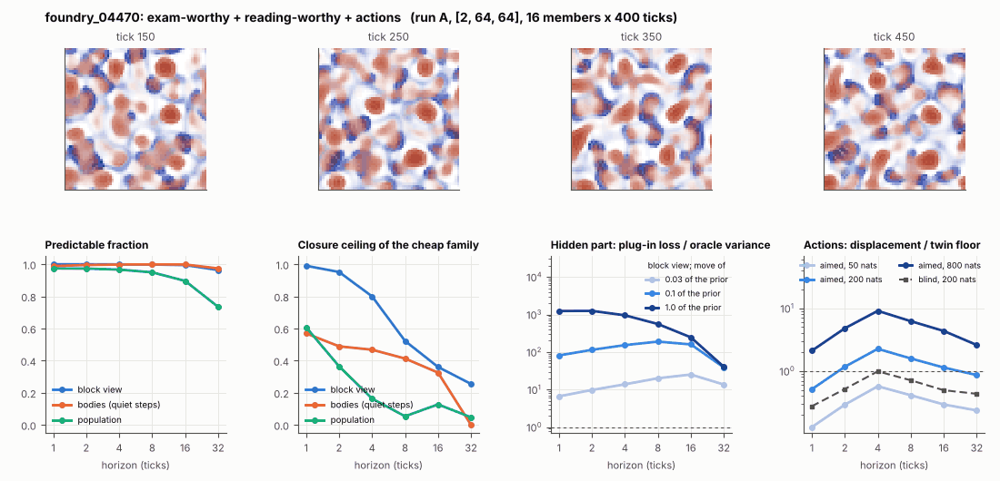

# World card: foundry_04470

Family foundry, role shortlist. Lattice [2, 64, 64], 4 substeps per tick; input: wind 2 x 8 x 8, noise std 0.25. Hidden part: 240 weights of the law net (+ 10 scalars, kept by the neighbours) (prior: round5/foundry/tnca.py draw_theta; neighbour = round 5's weight neighbour). Views: block means of each kind and of S^2 on 8 px blocks; blob tracker on S / mean(S) > 2.

**Verdict** run A: exam-worthy + reading-worthy + actions; run B: exam-worthy + reading-worthy + actions; run late: exam-worthy + reading-worthy + actions. sigma_hat 0.89 at the pop level.

Sizes: 16 members (8 fit), 400 ticks after 50 of burn-in, 32 test states x 6 replicas x 32 ticks; neighbours at [0.03, 0.1, 1.0] of the prior (2 directions x 2). Ratios are from medians over test states (typical state); `mean` marks the mean-based value.

## 1. Predictability at 1 / 2 / 4 / 8 / 16 / 32 ticks

| level | predictable fraction | closure ceiling (cheap family) | ceiling at 8, mean-based |
|---|---|---|---|
| block view | 1.00 / 1.00 / 1.00 / 1.00 / 0.99 / 0.96 | 0.99 / 0.95 / 0.80 / 0.52 / 0.36 / 0.25 | 0.53 |
| bodies, displacement on quiet steps | 0.99 / 1.00 / 1.00 / 1.00 / 1.00 / 0.97 | 0.57 / 0.49 / 0.47 / 0.41 / 0.33 / 0.00 | 0.38 |
| population (count, tracked_mass, mean_speed, mass_sd, mass_max, kind_share) | 0.97 / 0.97 / 0.97 / 0.95 / 0.90 / 0.73 | 0.61 / 0.36 / 0.16 / 0.053 / 0.13 / 0.047 | 0.071 |

## 2. Structure

- Bodies: 18.9 +- 2.08 (slots 24, full 0.7% of the time), 35.3% of the matter, radius 2.14 px, half-life 22.0 ticks, net speed 0.56 px/tick.
- Events per 100 ticks and member: 30.6 fusions, 51.9 fissions, 64.4 births, 85.2 deaths.
- Scales: wavelength 9.05 px; neighbouring-block correlation -0.042; block-view autocorrelation at 1 / 8 / 32 ticks 0.97 / 0.35 / 0.29; 14.0% of the matter relocated per tick.
- Single-body law (displacement, quiet steps) at 1 / 4 / 8 / 16 ticks: ceiling 0.57 / 0.47 / 0.41 / 0.33; constant velocity alone 0.47 / 0.47 / 0.36 / 0.33; with the surrounding block view 0.57 / 0.47 / 0.42 / 0.33. Quiet share of 8-tick steps 0.38 (197 test rows).

## 3. Stationarity

- Share of the variance that is a function of the tick alone (mean over channels; largest channel in brackets): block view 2.5e-05 [7.4e-05], population 0.049 [0.068] (count 0.064, tracked_mass 0.068, mean_speed 0.052, mass_sd 0.041, mass_max 0.016, kind_share 0.055).
- Share between members' time-means: block view 0.150, population 0.052.
- Late window (+1950 ticks) against early: largest shift of a block-channel mean 0.015 sd, largest log sd ratio 0.042, body count x 1.03, events 82.4 -> 83.0, ceiling at 8 0.52 -> 0.52, sigma_hat 0.44 -> 0.44. Same statistics: **yes**.

## 4. Effective laws

- Linear local law on the block view: ceiling 0.991 at 1 tick; falls below 0.5 at 16 ticks; the worst tenth of (state, block) cells carries 45.6% of its excess error at 8 ticks.
- Population law at 8 ticks: linear ceiling 0.053, quadratic 0.11.
- Kind-share law ds = b1 s(1-s) + b2 (1-2s) at 8 / 32 ticks: ceiling 0.43 / 0.64, a constant drift 0.002 / 0.003, a line in s 0.43 / 0.63 (predictable fraction of the change 0.91 / 0.83).

## 5. Levels

- The slot list added to the block view's predictor lowers its error at 8 ticks by 0.013 of the variance; the block view added to the body law by -0.007; block moments added to the population law by 0.031; the population law beats persistence by 0.706.

## 6. Learned variable (slow features of the 2 x 2 sub-blocks against the hand block view)

- Ceiling gain at 8 / 16 / 32 ticks, halves AB: 0.018 / 0.093 / 0.13; BA: -0.002 / 0.097 / 0.14. Predictable-fraction gain at 8: -5.4e-04 / -5.3e-04. Smallest R^2 of a learned component on the hand channels: 1.8e-04.

## 7. Actions (block view, 4 ticks after the input starts)

- The aimed 200-nat shift is 0.003 of the block view's variance, 0.015 of the cheap family's error.
- Predictable shift / oracle variance: aimed 50 / 200 / 800 nats 1.03 / 4.19 / 16.5; displacement of the aimed 200-nat input / twin floor 2.26; aimed / blind 2.59. Population level: 0.15.

## 8. Hidden part

- Plug-in loss / oracle variance at 8 ticks for a move of 3% / 10% / 100% of the prior: block view 20.0 / 189 / 557; population 7.99 / 84.1 / 694.
- Weight of a prior-sized error, w_theta at 4 / 8 / 16 ticks: block view 0.68 / 0.96 / 1.27; sigma_hat block view 0.44, population 0.89.
- Response to the aimed 200-nat input changes by 3.16 oracle variances when the hidden part moves by the prior. Evidence index for a 10% move: 7785 nats per tick (3 nats in 3.9e-04 ticks).
- Noise twins: 4.7% of the matter placed differently after 8 ticks; doubling time 9.4 ticks.

## 9. Cost

- 0.045 ms per member-tick on the job's GPU with the tracker on every member, compile excluded (22254 member-ticks/s); USD 0.025 per million member-ticks at USD 1.99/h.

## Gates and robustness

| gate | run A | run B | run late |
|---|---|---|---|
| exam_worthy | yes | yes | yes |
| structure | yes | yes | yes |
| interaction | yes | yes | yes |
| reading_worthy | yes | yes | yes |
| actions | yes | yes | yes |
| stationary | yes | no | yes |
| levels_add | yes | yes | yes |
| learned_differs | no | no | no |

Seed (A against B): 24 of 30 entries agree; not robust: grid.gap8, grid.aim_ratio, grid.member_share, pop.ceil8, pop.sigma_hat, k.law32.

Size (64 px against foundry128_04470; counts per area, action entries left out): 22 of 26 entries agree; not robust: grid.member_share, pop.ceil8, pop.sigma_hat, k.law32.

Estimator size (even against odd test states, block view at 8 ticks): predictable fraction 1.00 / 1.00, ceiling 0.52 / 0.53.

Source: run A: job r6-cards-001; run B: job r6-cards-001; run late: job r6-cards-001; files `out/cards/foundry_04470__<run>.json` on origin/gpu-jobs; numbers recomputed by `make_cards.py` from those cards (`card.json` here holds the derived numbers and gates of every run). Pilot: never an exam instance.
