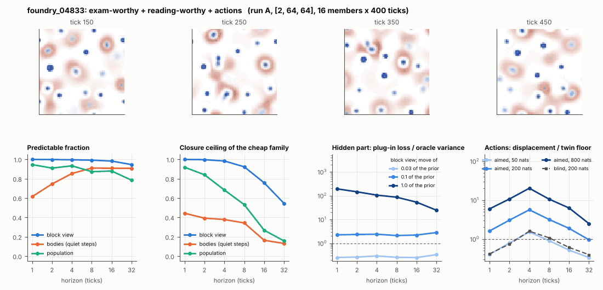

# World card: foundry_04833

Family foundry, role candidate. Lattice [2, 64, 64], 4 substeps per tick; input: wind 2 x 8 x 8, noise std 0.25. Hidden part: 240 weights of the law net (+ 10 scalars, kept by the neighbours) (prior: round5/foundry/tnca.py draw_theta; neighbour = round 5's weight neighbour). Views: block means of each kind and of S^2 on 8 px blocks; blob tracker on S / mean(S) > 2.

**Verdict** run A: exam-worthy + reading-worthy + actions; run late: exam-worthy + reading-worthy + actions. sigma_hat 0.51 at the pop level.

Sizes: 16 members (8 fit), 400 ticks after 50 of burn-in, 32 test states x 6 replicas x 32 ticks; neighbours at [0.03, 0.1, 1.0] of the prior (2 directions x 2). Ratios are from medians over test states (typical state); `mean` marks the mean-based value.

## 1. Predictability at 1 / 2 / 4 / 8 / 16 / 32 ticks

| level | predictable fraction | closure ceiling (cheap family) | ceiling at 8, mean-based |
|---|---|---|---|
| block view | 1.00 / 1.00 / 1.00 / 0.99 / 0.98 / 0.95 | 1.00 / 1.00 / 0.98 / 0.92 / 0.76 / 0.54 | 0.91 |
| bodies, displacement on quiet steps | 0.61 / 0.75 / 0.85 / 0.91 / 0.91 / 0.91 | 0.44 / 0.39 / 0.38 / 0.34 / 0.16 / 0.13 | 0.26 |
| population (count, tracked_mass, mean_speed, mass_sd, mass_max, kind_share) | 0.95 / 0.91 / 0.93 / 0.87 / 0.88 / 0.78 | 0.92 / 0.84 / 0.68 / 0.53 / 0.27 / 0.16 | 0.47 |

## 2. Structure

- Bodies: 17.3 +- 2.09 (slots 24, full 0.062% of the time), 74.9% of the matter, radius 2.04 px, half-life 85.3 ticks, net speed 0.14 px/tick.
- Events per 100 ticks and member: 12.9 fusions, 19.0 fissions, 3.02 births, 9.31 deaths.
- Scales: wavelength 7.16 px; neighbouring-block correlation 0.017; block-view autocorrelation at 1 / 8 / 32 ticks 1.00 / 0.91 / 0.54; 6.3% of the matter relocated per tick.
- Single-body law (displacement, quiet steps) at 1 / 4 / 8 / 16 ticks: ceiling 0.44 / 0.38 / 0.34 / 0.16; constant velocity alone 0.00 / 0.012 / 0.00 / 0.00; with the surrounding block view 0.45 / 0.40 / 0.37 / 0.21. Quiet share of 8-tick steps 0.84 (437 test rows).

## 3. Stationarity

- Share of the variance that is a function of the tick alone (mean over channels; largest channel in brackets): block view 5.4e-04 [8.3e-04], population 0.237 [0.497] (count 0.072, tracked_mass 0.50, mean_speed 0.030, mass_sd 0.43, mass_max 0.29, kind_share 0.11).
- Share between members' time-means: block view 0.143, population 0.048.
- Late window (+1950 ticks) against early: largest shift of a block-channel mean 0.047 sd, largest log sd ratio 0.20, body count x 0.94, events 31.9 -> 33.6, ceiling at 8 0.92 -> 0.92, sigma_hat 0.11 -> 0.11. Same statistics: **yes**.

## 4. Effective laws

- Linear local law on the block view: ceiling 0.999 at 1 tick; falls below 0.5 at no horizon up to 32 ticks; the worst tenth of (state, block) cells carries 79.8% of its excess error at 8 ticks.
- Population law at 8 ticks: linear ceiling 0.53, quadratic 0.51.
- Kind-share law ds = b1 s(1-s) + b2 (1-2s) at 8 / 32 ticks: ceiling 0.46 / 0.45, a constant drift 0.006 / 0.080, a line in s 0.46 / 0.45 (predictable fraction of the change 0.90 / 0.72).

## 5. Levels

- The slot list added to the block view's predictor lowers its error at 8 ticks by 6.1e-05 of the variance; the block view added to the body law by 0.007; block moments added to the population law by 0.081; the population law beats persistence by 0.402.

## 6. Learned variable (slow features of the 2 x 2 sub-blocks against the hand block view)

- Ceiling gain at 8 / 16 / 32 ticks, halves AB: 0.034 / 0.084 / 0.034; BA: 0.031 / 0.069 / 0.023. Predictable-fraction gain at 8: -0.011 / -0.009. Smallest R^2 of a learned component on the hand channels: 0.003.

## 7. Actions (block view, 4 ticks after the input starts)

- The aimed 200-nat shift is 0.044 of the block view's variance, 1.955 of the cheap family's error.
- Predictable shift / oracle variance: aimed 50 / 200 / 800 nats 2.34 / 9.10 / 35.1; displacement of the aimed 200-nat input / twin floor 5.63; aimed / blind 6.10. Population level: 2.81.

## 8. Hidden part

- Plug-in loss / oracle variance at 8 ticks for a move of 3% / 10% / 100% of the prior: block view 0.26 / 2.11 / 86.0; population 0.28 / 4.19 / 160.
- Weight of a prior-sized error, w_theta at 4 / 8 / 16 ticks: block view 0.49 / 0.73 / 0.98; sigma_hat block view 0.11, population 0.51.
- Response to the aimed 200-nat input changes by 5.57 oracle variances when the hidden part moves by the prior. Evidence index for a 10% move: 217 nats per tick (3 nats in 0.014 ticks).
- Noise twins: 11.0% of the matter placed differently after 8 ticks; doubling time 7.6 ticks.

## 9. Cost

- 0.045 ms per member-tick on the job's GPU with the tracker on every member, compile excluded (22018 member-ticks/s); USD 0.025 per million member-ticks at USD 1.99/h.

## Gates and robustness

| gate | run A | run late |
|---|---|---|
| exam_worthy | yes | yes |
| structure | yes | yes |
| interaction | yes | yes |
| reading_worthy | yes | yes |
| actions | yes | yes |
| stationary | yes | yes |
| levels_add | yes | yes |
| learned_differs | no | no |

Estimator size (even against odd test states, block view at 8 ticks): predictable fraction 0.99 / 0.99, ceiling 0.92 / 0.93.

Source: run A: job r6-cards-001; run late: job r6-cards-001; files `out/cards/foundry_04833__<run>.json` on origin/gpu-jobs; numbers recomputed by `make_cards.py` from those cards (`card.json` here holds the derived numbers and gates of every run). Pilot: never an exam instance.
