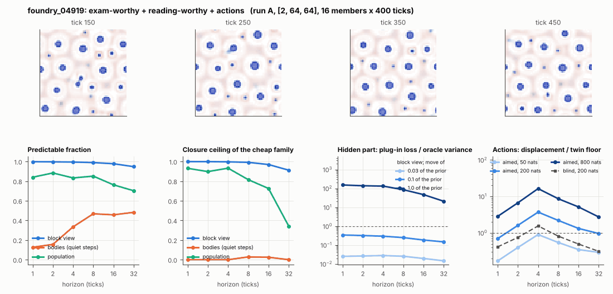

# World card: foundry_04919

Family foundry, role candidate. Lattice [2, 64, 64], 4 substeps per tick; input: wind 2 x 8 x 8, noise std 0.25. Hidden part: 240 weights of the law net (+ 10 scalars, kept by the neighbours) (prior: round5/foundry/tnca.py draw_theta; neighbour = round 5's weight neighbour). Views: block means of each kind and of S^2 on 8 px blocks; blob tracker on S / mean(S) > 2.

**Verdict** run A: exam-worthy + reading-worthy + actions; run late: exam-worthy + reading-worthy + actions. sigma_hat 0.18 at the pop level.

Sizes: 16 members (8 fit), 400 ticks after 50 of burn-in, 32 test states x 6 replicas x 32 ticks; neighbours at [0.03, 0.1, 1.0] of the prior (2 directions x 2). Ratios are from medians over test states (typical state); `mean` marks the mean-based value.

## 1. Predictability at 1 / 2 / 4 / 8 / 16 / 32 ticks

| level | predictable fraction | closure ceiling (cheap family) | ceiling at 8, mean-based |
|---|---|---|---|
| block view | 1.00 / 1.00 / 0.99 / 0.99 / 0.98 / 0.95 | 1.00 / 1.00 / 1.00 / 0.99 / 0.97 / 0.91 | 0.99 |
| bodies, displacement on quiet steps | 0.13 / 0.16 / 0.33 / 0.47 / 0.46 / 0.48 | 0.00 / 0.00 / 0.00 / 0.028 / 0.025 / 0.00 | 0.024 |
| population (count, tracked_mass, mean_speed, mass_sd, mass_max) | 0.84 / 0.88 / 0.83 / 0.85 / 0.76 / 0.70 | 0.93 / 0.90 / 0.93 / 0.81 / 0.73 / 0.34 | 0.78 |

## 2. Structure

- Bodies: 19.2 +- 2.22 (slots 24, full 2.9% of the time), 73.8% of the matter, radius 1.50 px, half-life 96.5 ticks, net speed 0.057 px/tick.
- Events per 100 ticks and member: 12.9 fusions, 0.00 fissions, 15.0 births, 2.41 deaths.
- Scales: wavelength 5.96 px; neighbouring-block correlation -0.099; block-view autocorrelation at 1 / 8 / 32 ticks 1.00 / 0.97 / 0.86; 5.0% of the matter relocated per tick.
- Single-body law (displacement, quiet steps) at 1 / 4 / 8 / 16 ticks: ceiling 0.00 / 0.00 / 0.028 / 0.025; constant velocity alone 0.00 / 0.00 / 0.00 / 0.00; with the surrounding block view 0.00 / 0.00 / 0.016 / 0.068. Quiet share of 8-tick steps 0.92 (553 test rows).

## 3. Stationarity

- Share of the variance that is a function of the tick alone (mean over channels; largest channel in brackets): block view 0.056 [0.165], population 0.394 [0.983] (count 0.16, tracked_mass 0.98, mean_speed 0.13, mass_sd 0.49, mass_max 0.20).
- Share between members' time-means: block view 5.0e-04, population 0.111.
- Late window (+1950 ticks) against early: largest shift of a block-channel mean 0.21 sd, largest log sd ratio 0.22, body count x 0.98, events 12.9 -> 10.2, ceiling at 8 0.99 -> 0.99, sigma_hat 0.014 -> 0.015. Same statistics: **yes**.

## 4. Effective laws

- Linear local law on the block view: ceiling 0.999 at 1 tick; falls below 0.5 at no horizon up to 32 ticks; the worst tenth of (state, block) cells carries 76.5% of its excess error at 8 ticks.
- Population law at 8 ticks: linear ceiling 0.81, quadratic 0.84.

## 5. Levels

- The slot list added to the block view's predictor lowers its error at 8 ticks by 2.4e-05 of the variance; the block view added to the body law by 0.013; block moments added to the population law by 0.002; the population law beats persistence by 0.096.

## 6. Learned variable (slow features of the 2 x 2 sub-blocks against the hand block view)

- Ceiling gain at 8 / 16 / 32 ticks, halves AB: -2.7e-04 / -1.5e-04 / -0.007; BA: -8.3e-04 / -0.002 / -0.018. Predictable-fraction gain at 8: 0.007 / 0.007. Smallest R^2 of a learned component on the hand channels: 6.6e-04.

## 7. Actions (block view, 4 ticks after the input starts)

- The aimed 200-nat shift is 0.038 of the block view's variance, 4.672 of the cheap family's error.
- Predictable shift / oracle variance: aimed 50 / 200 / 800 nats 1.71 / 7.54 / 36.0; displacement of the aimed 200-nat input / twin floor 3.71; aimed / blind 2.93. Population level: 20.1.

## 8. Hidden part

- Plug-in loss / oracle variance at 8 ticks for a move of 3% / 10% / 100% of the prior: block view 0.026 / 0.25 / 85.1; population 0.044 / 0.43 / 651.
- Weight of a prior-sized error, w_theta at 4 / 8 / 16 ticks: block view 0.70 / 0.92 / 1.08; sigma_hat block view 0.014, population 0.18.
- Response to the aimed 200-nat input changes by 6.48 oracle variances when the hidden part moves by the prior. Evidence index for a 10% move: 32.7 nats per tick (3 nats in 0.092 ticks).
- Noise twins: 14.2% of the matter placed differently after 8 ticks; doubling time 6.4 ticks.

## 9. Cost

- 0.045 ms per member-tick on the job's GPU with the tracker on every member, compile excluded (22432 member-ticks/s); USD 0.025 per million member-ticks at USD 1.99/h.

## Gates and robustness

| gate | run A | run late |
|---|---|---|
| exam_worthy | yes | yes |
| structure | yes | yes |
| interaction | yes | yes |
| reading_worthy | yes | yes |
| actions | yes | yes |
| stationary | yes | yes |
| levels_add | yes | yes |
| learned_differs | no | no |

Estimator size (even against odd test states, block view at 8 ticks): predictable fraction 0.99 / 0.99, ceiling 0.99 / 0.99.

Source: run A: job r6-cards-001; run late: job r6-cards-001; files `out/cards/foundry_04919__<run>.json` on origin/gpu-jobs; numbers recomputed by `make_cards.py` from those cards (`card.json` here holds the derived numbers and gates of every run). Pilot: never an exam instance.
