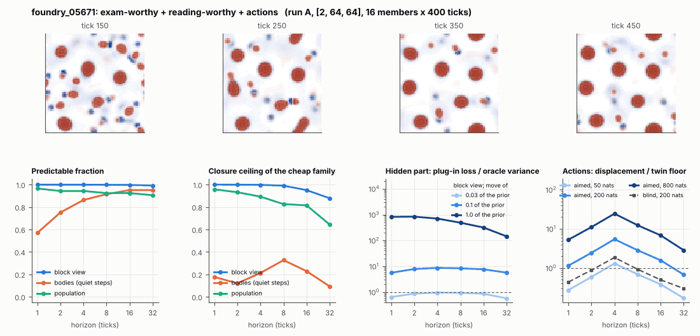

# World card: foundry_05671

Family foundry, role candidate. Lattice [2, 64, 64], 4 substeps per tick; input: wind 2 x 8 x 8, noise std 0.25. Hidden part: 240 weights of the law net (+ 10 scalars, kept by the neighbours) (prior: round5/foundry/tnca.py draw_theta; neighbour = round 5's weight neighbour). Views: block means of each kind and of S^2 on 8 px blocks; blob tracker on S / mean(S) > 2.

**Verdict** run A: exam-worthy + reading-worthy + actions; run late: dull: predictable by the cheap family. sigma_hat 0.16 at the pop level.

Sizes: 16 members (8 fit), 400 ticks after 50 of burn-in, 32 test states x 6 replicas x 32 ticks; neighbours at [0.03, 0.1, 1.0] of the prior (2 directions x 2). Ratios are from medians over test states (typical state); `mean` marks the mean-based value.

## 1. Predictability at 1 / 2 / 4 / 8 / 16 / 32 ticks

| level | predictable fraction | closure ceiling (cheap family) | ceiling at 8, mean-based |
|---|---|---|---|
| block view | 1.00 / 1.00 / 1.00 / 1.00 / 1.00 / 0.99 | 1.00 / 1.00 / 1.00 / 0.99 / 0.95 / 0.88 | 0.98 |
| bodies, displacement on quiet steps | 0.57 / 0.75 / 0.86 / 0.91 / 0.95 / 0.95 | 0.18 / 0.12 / 0.21 / 0.33 / 0.23 / 0.092 | 0.32 |
| population (count, tracked_mass, mean_speed, mass_sd, mass_max, kind_share) | 0.97 / 0.94 / 0.94 / 0.92 / 0.92 / 0.90 | 0.96 / 0.93 / 0.89 / 0.83 / 0.81 / 0.64 | 0.85 |

## 2. Structure

- Bodies: 14.1 +- 2.94 (slots 24, full 0.4% of the time), 87.0% of the matter, radius 2.66 px, half-life 80.2 ticks, net speed 0.084 px/tick.
- Events per 100 ticks and member: 12.8 fusions, 7.91 fissions, 11.3 births, 8.98 deaths.
- Scales: wavelength 11.7 px; neighbouring-block correlation -0.002; block-view autocorrelation at 1 / 8 / 32 ticks 1.00 / 0.96 / 0.82; 2.9% of the matter relocated per tick.
- Single-body law (displacement, quiet steps) at 1 / 4 / 8 / 16 ticks: ceiling 0.18 / 0.21 / 0.33 / 0.23; constant velocity alone 0.00 / 0.00 / 0.00 / 0.00; with the surrounding block view 0.077 / 0.29 / 0.33 / 0.20. Quiet share of 8-tick steps 0.86 (350 test rows).

## 3. Stationarity

- Share of the variance that is a function of the tick alone (mean over channels; largest channel in brackets): block view 0.017 [0.048], population 0.305 [0.553] (count 0.53, tracked_mass 0.55, mean_speed 0.50, mass_sd 0.063, mass_max 0.010, kind_share 0.17).
- Share between members' time-means: block view 0.110, population 0.300.
- Late window (+1950 ticks) against early: largest shift of a block-channel mean 0.32 sd, largest log sd ratio 0.28, body count x 0.70, events 20.7 -> 7.48, ceiling at 8 0.99 -> 1.00, sigma_hat 0.020 -> 1.6e-04. Same statistics: **yes**.

## 4. Effective laws

- Linear local law on the block view: ceiling 1.000 at 1 tick; falls below 0.5 at no horizon up to 32 ticks; the worst tenth of (state, block) cells carries 79.3% of its excess error at 8 ticks.
- Population law at 8 ticks: linear ceiling 0.83, quadratic 0.83.
- Kind-share law ds = b1 s(1-s) + b2 (1-2s) at 8 / 32 ticks: ceiling 0.00 / 0.13, a constant drift 0.070 / 0.060, a line in s 0.00 / 0.22 (predictable fraction of the change 0.73 / 0.82).

## 5. Levels

- The slot list added to the block view's predictor lowers its error at 8 ticks by -8.2e-05 of the variance; the block view added to the body law by 0.016; block moments added to the population law by 0.015; the population law beats persistence by -0.029.

## 6. Learned variable (slow features of the 2 x 2 sub-blocks against the hand block view)

- Ceiling gain at 8 / 16 / 32 ticks, halves AB: 0.002 / 0.025 / 0.064; BA: 0.003 / 0.023 / 0.054. Predictable-fraction gain at 8: -0.001 / -0.001. Smallest R^2 of a learned component on the hand channels: 0.001.

## 7. Actions (block view, 4 ticks after the input starts)

- The aimed 200-nat shift is 0.009 of the block view's variance, 3.135 of the cheap family's error.
- Predictable shift / oracle variance: aimed 50 / 200 / 800 nats 2.68 / 10.8 / 46.6; displacement of the aimed 200-nat input / twin floor 5.42; aimed / blind 2.96. Population level: 3.22.

## 8. Hidden part

- Plug-in loss / oracle variance at 8 ticks for a move of 3% / 10% / 100% of the prior: block view 0.93 / 8.34 / 485; population 0.098 / 1.38 / 1949.
- Weight of a prior-sized error, w_theta at 4 / 8 / 16 ticks: block view 0.63 / 0.81 / 1.01; sigma_hat block view 0.020, population 0.16.
- Response to the aimed 200-nat input changes by 7.89 oracle variances when the hidden part moves by the prior. Evidence index for a 10% move: 538 nats per tick (3 nats in 0.006 ticks).
- Noise twins: 5.5% of the matter placed differently after 8 ticks; doubling time 10.5 ticks.

## 9. Cost

- 0.045 ms per member-tick on the job's GPU with the tracker on every member, compile excluded (21978 member-ticks/s); USD 0.025 per million member-ticks at USD 1.99/h.

## Gates and robustness

| gate | run A | run late |
|---|---|---|
| exam_worthy | yes | no |
| structure | yes | yes |
| interaction | yes | no |
| reading_worthy | yes | no |
| actions | yes | yes |
| stationary | yes | no |
| levels_add | yes | no |
| learned_differs | no | no |

Estimator size (even against odd test states, block view at 8 ticks): predictable fraction 1.00 / 1.00, ceiling 0.99 / 0.99.

Source: run A: job r6-cards-001; run late: job r6-cards-001; files `out/cards/foundry_05671__<run>.json` on origin/gpu-jobs; numbers recomputed by `make_cards.py` from those cards (`card.json` here holds the derived numbers and gates of every run). Pilot: never an exam instance.
