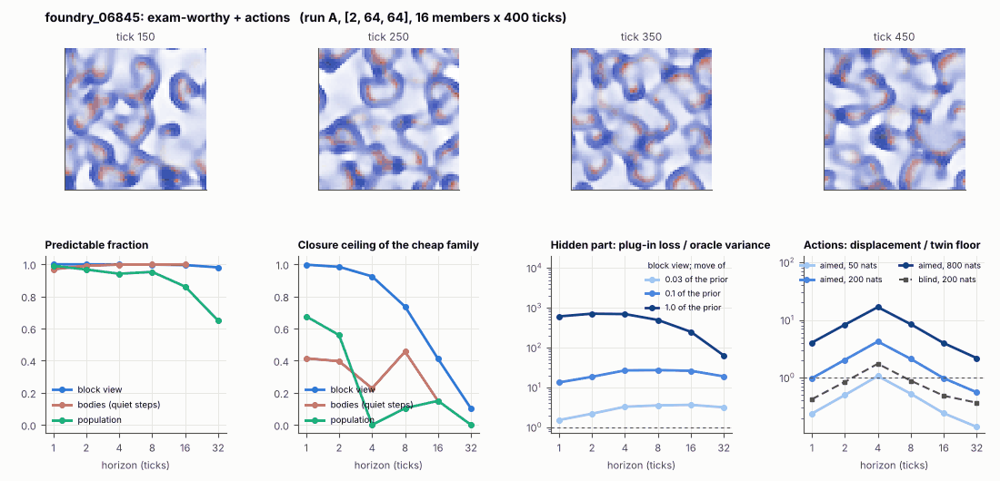

# World card: foundry_06845

Family foundry, role shortlist. Lattice [2, 64, 64], 4 substeps per tick; input: wind 2 x 8 x 8, noise std 0.25. Hidden part: 240 weights of the law net (+ 10 scalars, kept by the neighbours) (prior: round5/foundry/tnca.py draw_theta; neighbour = round 5's weight neighbour). Views: block means of each kind and of S^2 on 8 px blocks; blob tracker on S / mean(S) > 2.

**Verdict** run A: exam-worthy + actions; run B: exam-worthy + actions; run late: exam-worthy + actions. sigma_hat 0.92 at the pop level.

Sizes: 16 members (8 fit), 400 ticks after 50 of burn-in, 32 test states x 6 replicas x 32 ticks; neighbours at [0.03, 0.1, 1.0] of the prior (2 directions x 2). Ratios are from medians over test states (typical state); `mean` marks the mean-based value.

## 1. Predictability at 1 / 2 / 4 / 8 / 16 / 32 ticks

| level | predictable fraction | closure ceiling (cheap family) | ceiling at 8, mean-based |
|---|---|---|---|
| block view | 1.00 / 1.00 / 1.00 / 1.00 / 0.99 / 0.98 | 1.00 / 0.98 / 0.92 / 0.74 / 0.41 / 0.10 | 0.72 |
| bodies, displacement on quiet steps | 0.97 / 0.99 / 1.00 / 1.00 / 1.00 / n/a | 0.41 / 0.40 / 0.23 / 0.46 / 0.15 / n/a | 0.29 |
| population (count, tracked_mass, mean_speed, mass_sd, mass_max) | 0.99 / 0.97 / 0.94 / 0.95 / 0.86 / 0.65 | 0.68 / 0.56 / 0.00 / 0.10 / 0.15 / 0.00 | 0.16 |

## 2. Structure

- Bodies: 12.4 +- 1.84 (slots 24, full 0.0% of the time), 29.1% of the matter, radius 2.72 px, half-life 14.2 ticks, net speed 0.61 px/tick.
- Events per 100 ticks and member: 28.9 fusions, 50.0 fissions, 37.2 births, 57.8 deaths.
- Scales: wavelength 10.2 px; neighbouring-block correlation -0.016; block-view autocorrelation at 1 / 8 / 32 ticks 0.99 / 0.43 / 0.10; 9.2% of the matter relocated per tick.
- Single-body law (displacement, quiet steps) at 1 / 4 / 8 / 16 ticks: ceiling 0.41 / 0.23 / 0.46 / 0.15; constant velocity alone 0.35 / 0.23 / 0.46 / 0.00; with the surrounding block view 0.46 / 0.23 / 0.55 / 0.37. Quiet share of 8-tick steps 0.27 (70.0 test rows).

## 3. Stationarity

- Share of the variance that is a function of the tick alone (mean over channels; largest channel in brackets): block view 8.3e-06 [2.5e-05], population 0.004 [0.022] (count 0.016, tracked_mass 0.016, mean_speed 0.022, mass_sd -0.011, mass_max -0.024).
- Share between members' time-means: block view 0.113, population 0.059.
- Late window (+1950 ticks) against early: largest shift of a block-channel mean 0.005 sd, largest log sd ratio 0.018, body count x 1.01, events 78.9 -> 79.1, ceiling at 8 0.74 -> 0.72, sigma_hat 0.31 -> 0.33. Same statistics: **yes**.

## 4. Effective laws

- Linear local law on the block view: ceiling 0.997 at 1 tick; falls below 0.5 at 16 ticks; the worst tenth of (state, block) cells carries 46.5% of its excess error at 8 ticks.
- Population law at 8 ticks: linear ceiling 0.10, quadratic 0.16.

## 5. Levels

- The slot list added to the block view's predictor lowers its error at 8 ticks by 0.010 of the variance; the block view added to the body law by 0.043; block moments added to the population law by 0.074; the population law beats persistence by 0.647.

## 6. Learned variable (slow features of the 2 x 2 sub-blocks against the hand block view)

- Ceiling gain at 8 / 16 / 32 ticks, halves AB: -0.32 / -0.30 / -0.090; BA: -0.32 / -0.30 / -0.078. Predictable-fraction gain at 8: -0.003 / -0.002. Smallest R^2 of a learned component on the hand channels: 8.1e-04.

## 7. Actions (block view, 4 ticks after the input starts)

- The aimed 200-nat shift is 0.008 of the block view's variance, 0.098 of the cheap family's error.
- Predictable shift / oracle variance: aimed 50 / 200 / 800 nats 2.10 / 8.38 / 35.2; displacement of the aimed 200-nat input / twin floor 4.24; aimed / blind 2.64. Population level: 0.15.

## 8. Hidden part

- Plug-in loss / oracle variance at 8 ticks for a move of 3% / 10% / 100% of the prior: block view 3.54 / 27.2 / 495; population 8.12 / 72.5 / 671.
- Weight of a prior-sized error, w_theta at 4 / 8 / 16 ticks: block view 0.62 / 1.02 / 1.27; sigma_hat block view 0.31, population 0.92.
- Response to the aimed 200-nat input changes by 6.02 oracle variances when the hidden part moves by the prior. Evidence index for a 10% move: 1281 nats per tick (3 nats in 0.002 ticks).
- Noise twins: 4.0% of the matter placed differently after 8 ticks; doubling time 9.2 ticks.

## 9. Cost

- 0.048 ms per member-tick on the job's GPU with the tracker on every member, compile excluded (20619 member-ticks/s); USD 0.027 per million member-ticks at USD 1.99/h.

## Gates and robustness

| gate | run A | run B | run late |
|---|---|---|---|
| exam_worthy | yes | yes | yes |
| structure | no | no | no |
| interaction | yes | yes | yes |
| reading_worthy | no | no | no |
| actions | yes | yes | yes |
| stationary | yes | yes | yes |
| levels_add | yes | yes | yes |
| learned_differs | no | no | no |

Seed (A against B): 25 of 30 entries agree; not robust: grid.member_share, pop.ceil8, pop.act_ms, b.ceil_disp8, b.ceil_field_disp8.

Size (64 px against foundry128_06845; counts per area, action entries left out): 24 of 26 entries agree; not robust: b.ceil_disp8, b.ceil_field_disp8.

Estimator size (even against odd test states, block view at 8 ticks): predictable fraction 1.00 / 1.00, ceiling 0.75 / 0.72.

Source: run A: job r6-cards-001; run B: job r6-cards-001; run late: job r6-cards-001; files `out/cards/foundry_06845__<run>.json` on origin/gpu-jobs; numbers recomputed by `make_cards.py` from those cards (`card.json` here holds the derived numbers and gates of every run). Pilot: never an exam instance.
