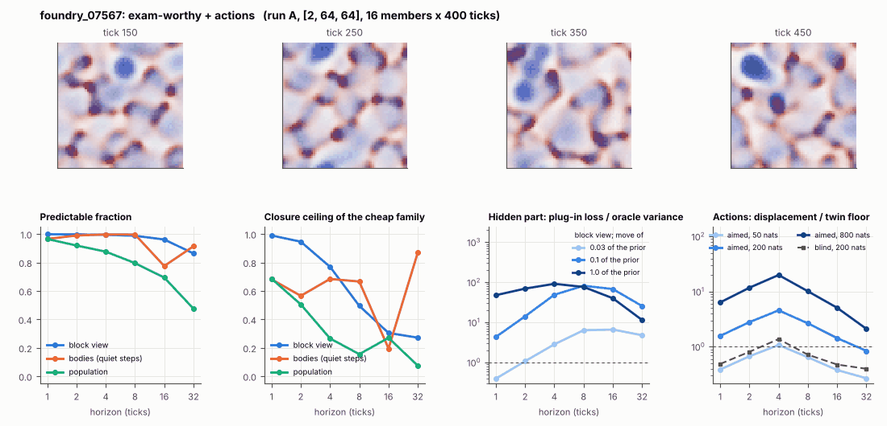

# World card: foundry_07567

Family foundry, role shortlist. Lattice [2, 64, 64], 4 substeps per tick; input: wind 2 x 8 x 8, noise std 0.25. Hidden part: 240 weights of the law net (+ 10 scalars, kept by the neighbours) (prior: round5/foundry/tnca.py draw_theta; neighbour = round 5's weight neighbour). Views: block means of each kind and of S^2 on 8 px blocks; blob tracker on S / mean(S) > 2.

**Verdict** run A: exam-worthy + actions; run B: exam-worthy + actions; run late: exam-worthy + actions. sigma_hat 0.77 at the pop level.

Sizes: 16 members (8 fit), 400 ticks after 50 of burn-in, 32 test states x 6 replicas x 32 ticks; neighbours at [0.03, 0.1, 1.0] of the prior (2 directions x 2). Ratios are from medians over test states (typical state); `mean` marks the mean-based value.

## 1. Predictability at 1 / 2 / 4 / 8 / 16 / 32 ticks

| level | predictable fraction | closure ceiling (cheap family) | ceiling at 8, mean-based |
|---|---|---|---|
| block view | 1.00 / 1.00 / 0.99 / 0.99 / 0.96 / 0.86 | 0.99 / 0.95 / 0.77 / 0.50 / 0.30 / 0.27 | 0.48 |
| bodies, displacement on quiet steps | 0.97 / 0.99 / 1.00 / 1.00 / 0.78 / 0.91 | 0.68 / 0.57 / 0.68 / 0.67 / 0.20 / 0.87 | 0.24 |
| population (count, tracked_mass, mean_speed, mass_sd, mass_max, kind_share) | 0.97 / 0.92 / 0.88 / 0.80 / 0.69 / 0.48 | 0.69 / 0.51 / 0.27 / 0.16 / 0.27 / 0.075 | 0.12 |

## 2. Structure

- Bodies: 11.1 +- 1.79 (slots 24, full 0.0% of the time), 35.3% of the matter, radius 2.62 px, half-life 11.2 ticks, net speed 1.07 px/tick.
- Events per 100 ticks and member: 52.7 fusions, 75.5 fissions, 38.9 births, 61.5 deaths.
- Scales: wavelength 12.6 px; neighbouring-block correlation 0.12; block-view autocorrelation at 1 / 8 / 32 ticks 0.97 / 0.19 / 0.15; 14.0% of the matter relocated per tick.
- Single-body law (displacement, quiet steps) at 1 / 4 / 8 / 16 ticks: ceiling 0.68 / 0.68 / 0.67 / 0.20; constant velocity alone 0.65 / 0.68 / 0.67 / 0.00; with the surrounding block view 0.67 / 0.68 / 0.67 / 0.00. Quiet share of 8-tick steps 0.19 (37.0 test rows).

## 3. Stationarity

- Share of the variance that is a function of the tick alone (mean over channels; largest channel in brackets): block view 2.8e-05 [4.8e-05], population 0.016 [0.036] (count 0.031, tracked_mass 0.036, mean_speed 0.023, mass_sd -0.015, mass_max -0.006, kind_share 0.025).
- Share between members' time-means: block view 0.095, population 0.069.
- Late window (+1950 ticks) against early: largest shift of a block-channel mean 0.030 sd, largest log sd ratio 0.20, body count x 1.05, events 128 -> 131, ceiling at 8 0.50 -> 0.55, sigma_hat 0.48 -> 0.42. Same statistics: **yes**.

## 4. Effective laws

- Linear local law on the block view: ceiling 0.990 at 1 tick; falls below 0.5 at 8 ticks; the worst tenth of (state, block) cells carries 59.0% of its excess error at 8 ticks.
- Population law at 8 ticks: linear ceiling 0.16, quadratic 0.058.
- Kind-share law ds = b1 s(1-s) + b2 (1-2s) at 8 / 32 ticks: ceiling 0.35 / 0.79, a constant drift 0.00 / 0.00, a line in s 0.37 / 0.78 (predictable fraction of the change 0.82 / 0.63).

## 5. Levels

- The slot list added to the block view's predictor lowers its error at 8 ticks by 0.005 of the variance; the block view added to the body law by -0.016; block moments added to the population law by 0.086; the population law beats persistence by 0.743.

## 6. Learned variable (slow features of the 2 x 2 sub-blocks against the hand block view)

- Ceiling gain at 8 / 16 / 32 ticks, halves AB: -0.12 / 0.049 / 0.089; BA: -0.029 / 0.063 / 0.10. Predictable-fraction gain at 8: -0.012 / -0.011. Smallest R^2 of a learned component on the hand channels: 0.006.

## 7. Actions (block view, 4 ticks after the input starts)

- The aimed 200-nat shift is 0.039 of the block view's variance, 0.161 of the cheap family's error.
- Predictable shift / oracle variance: aimed 50 / 200 / 800 nats 1.80 / 7.33 / 33.6; displacement of the aimed 200-nat input / twin floor 4.57; aimed / blind 3.31. Population level: 1.06.

## 8. Hidden part

- Plug-in loss / oracle variance at 8 ticks for a move of 3% / 10% / 100% of the prior: block view 6.35 / 81.9 / 76.5; population 1.28 / 8.98 / 82.8.
- Weight of a prior-sized error, w_theta at 4 / 8 / 16 ticks: block view 0.47 / 0.95 / 1.59; sigma_hat block view 0.48, population 0.77.
- Response to the aimed 200-nat input changes by 8.17 oracle variances when the hidden part moves by the prior. Evidence index for a 10% move: 414 nats per tick (3 nats in 0.007 ticks).
- Noise twins: 8.8% of the matter placed differently after 8 ticks; doubling time 7.8 ticks.

## 9. Cost

- 0.049 ms per member-tick on the job's GPU with the tracker on every member, compile excluded (20506 member-ticks/s); USD 0.027 per million member-ticks at USD 1.99/h.

## Gates and robustness

| gate | run A | run B | run late |
|---|---|---|---|
| exam_worthy | yes | yes | yes |
| structure | no | no | no |
| interaction | yes | yes | yes |
| reading_worthy | no | no | no |
| actions | yes | yes | yes |
| stationary | yes | yes | yes |
| levels_add | yes | yes | yes |
| learned_differs | no | no | no |

Seed (A against B): 23 of 30 entries agree; not robust: grid.pl_ratio0.1_8, grid.xresp, pop.ceil8, pop.act_ms, b.ceil_disp8, b.ceil_field_disp8, k.law32.

Size (64 px against foundry128_07567; counts per area, action entries left out): 20 of 26 entries agree; not robust: grid.pl_ratio0.03_8, grid.pl_ratio0.1_8, pop.ceil8, pop.tick_share, b.ceil_disp8, b.ceil_field_disp8.

Estimator size (even against odd test states, block view at 8 ticks): predictable fraction 0.99 / 0.99, ceiling 0.49 / 0.47.

Source: run A: job r6-cards-001; run B: job r6-cards-001; run late: job r6-cards-001; files `out/cards/foundry_07567__<run>.json` on origin/gpu-jobs; numbers recomputed by `make_cards.py` from those cards (`card.json` here holds the derived numbers and gates of every run). Pilot: never an exam instance.
