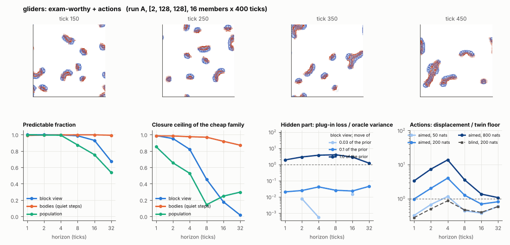

# World card: gliders

Family gliders, role designed. Lattice [2, 128, 128], 20 substeps per tick; input: wind 2 x 8 x 8, noise std 0.05. Hidden part: lR, dm_00, ls_00, lh (4 global parameters of the Flow-Lenia law) (prior: track2/gliders_exam/results/prior.json (uniform box, shrunk by 0.6); theta = the centre). Views: Phi_coarse (block means of 2 channels and of S^2, 16 px blocks); the port's blob tracker (12 slots).

**Verdict** run A: exam-worthy + actions; run B: exam-worthy + actions; run late: exam-worthy + actions. sigma_hat 0.20 at the pop level.

Sizes: 16 members (8 fit), 400 ticks after 50 of burn-in, 32 test states x 6 replicas x 32 ticks; neighbours at [0.03, 0.1, 1.0] of the prior (2 directions x 2). Ratios are from medians over test states (typical state); `mean` marks the mean-based value.

## 1. Predictability at 1 / 2 / 4 / 8 / 16 / 32 ticks

| level | predictable fraction | closure ceiling (cheap family) | ceiling at 8, mean-based |
|---|---|---|---|
| block view | 1.00 / 1.00 / 1.00 / 0.99 / 0.93 / 0.67 | 0.99 / 0.95 / 0.82 / 0.45 / 0.18 / 0.016 | 0.46 |
| bodies, displacement on quiet steps | 0.99 / 0.99 / 1.00 / 1.00 / 1.00 / 0.99 | 0.99 / 0.98 / 0.97 / 0.97 / 0.92 / 0.87 | 0.88 |
| population (count, mean_speed, mass_sd, mass_max, kind_share) | 1.00 / 0.99 / 0.99 / 0.87 / 0.75 / 0.54 | 0.85 / 0.65 / 0.53 / 0.14 / 0.25 / 0.30 | 0.33 |

## 2. Structure

- Bodies: 7.47 +- 1.46 (slots 12, full 0.2% of the time), 99.9% of the matter, radius 6.58 px, half-life 23.4 ticks, net speed 1.74 px/tick.
- Events per 100 ticks and member: 23.5 fusions, 23.3 fissions, 0.016 births, 0.00 deaths.
- Scales: wavelength 11.9 px; neighbouring-block correlation 0.14; block-view autocorrelation at 1 / 8 / 32 ticks 0.97 / 0.26 / -0.088; 44.6% of the matter relocated per tick.
- Single-body law (displacement, quiet steps) at 1 / 4 / 8 / 16 ticks: ceiling 0.99 / 0.97 / 0.97 / 0.92; constant velocity alone 0.99 / 0.97 / 0.97 / 0.92; with the surrounding block view 0.99 / 0.97 / 0.97 / 0.92. Quiet share of 8-tick steps 0.52 (106 test rows).

## 3. Stationarity

- Share of the variance that is a function of the tick alone (mean over channels; largest channel in brackets): block view 4.6e-07 [1.4e-06], population 0.023 [0.042] (count 0.034, mean_speed 0.042, mass_sd 0.025, mass_max 0.015, kind_share 0.001).
- Share between members' time-means: block view 0.727, population 0.118.
- Late window (+600 ticks) against early: largest shift of a block-channel mean 0.001 sd, largest log sd ratio 0.014, body count x 0.98, events 46.8 -> 43.7, ceiling at 8 0.45 -> 0.50, sigma_hat 0.097 -> 0.100. Same statistics: **yes**.

## 4. Effective laws

- Linear local law on the block view: ceiling 0.987 at 1 tick; falls below 0.5 at 8 ticks; the worst tenth of (state, block) cells carries 59.3% of its excess error at 8 ticks.
- Population law at 8 ticks: linear ceiling 0.14, quadratic 0.12.
- Kind-share law ds = b1 s(1-s) + b2 (1-2s) at 8 / 32 ticks: ceiling 0.40 / 0.59, a constant drift 0.005 / 0.006, a line in s 0.41 / 0.59 (predictable fraction of the change 0.78 / 0.51).

## 5. Levels

- The slot list added to the block view's predictor lowers its error at 8 ticks by 0.034 of the variance; the block view added to the body law by 0.005; block moments added to the population law by 0.014; the population law beats persistence by 0.185.

## 6. Learned variable (slow features of the 2 x 2 sub-blocks against the hand block view)

- Ceiling gain at 8 / 16 / 32 ticks, halves AB: -0.27 / -0.14 / 0.035; BA: -0.29 / -0.14 / -0.001. Predictable-fraction gain at 8: -0.177 / -0.185. Smallest R^2 of a learned component on the hand channels: 0.022.

## 7. Actions (block view, 4 ticks after the input starts)

- The aimed 200-nat shift is 0.023 of the block view's variance, 0.133 of the cheap family's error.
- Predictable shift / oracle variance: aimed 50 / 200 / 800 nats 1.76 / 6.42 / 25.3; displacement of the aimed 200-nat input / twin floor 4.01; aimed / blind 4.25. Population level: 0.28.

## 8. Hidden part

- Plug-in loss / oracle variance at 8 ticks for a move of 3% / 10% / 100% of the prior: block view -0.003 / 0.026 / 4.01; population 8.9e-04 / 0.006 / 1.79.
- Weight of a prior-sized error, w_theta at 4 / 8 / 16 ticks: block view 0.014 / 0.058 / 0.22; sigma_hat block view 0.097, population 0.20.
- Response to the aimed 200-nat input changes by 0.062 oracle variances when the hidden part moves by the prior. Evidence index for a 10% move: 2.00 nats per tick (3 nats in 1.503 ticks).
- Noise twins: 31.2% of the matter placed differently after 8 ticks; doubling time 8.0 ticks.

## 9. Cost

- 1.497 ms per member-tick on the job's GPU with the tracker on every member, compile excluded (668 member-ticks/s); USD 0.83 per million member-ticks at USD 1.99/h.

## Gates and robustness

| gate | run A | run B | run late |
|---|---|---|---|
| exam_worthy | yes | yes | yes |
| structure | yes | yes | yes |
| interaction | no | no | no |
| reading_worthy | no | no | no |
| actions | yes | yes | yes |
| stationary | no | no | no |
| levels_add | yes | yes | yes |
| learned_differs | no | no | no |

Seed (A against B): 27 of 30 entries agree; not robust: grid.aim_ratio, pop.ceil8, l.dceil16_AB.

Estimator size (even against odd test states, block view at 8 ticks): predictable fraction 0.99 / 0.99, ceiling 0.46 / 0.44.

Source: run A: job r6-cards-001; run B: job r6-cards-001; run late: job r6-cards-001; files `out/cards/gliders__<run>.json` on origin/gpu-jobs; numbers recomputed by `make_cards.py` from those cards (`card.json` here holds the derived numbers and gates of every run). Pilot: never an exam instance.
