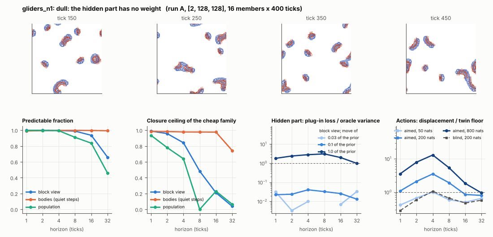

# World card: gliders_n1

Family gliders, role designed. Lattice [2, 128, 128], 20 substeps per tick; input: wind 2 x 8 x 8, noise std 0.05. Hidden part: lR (1 global parameter(s) of the Flow-Lenia law) (prior: round 5 ladder's box for this hidden set (scanned box x 0.6; for 4 parameters = track2/gliders_exam/results/prior.json); theta = the centre). Views: Phi_coarse (block means of 2 channels and of S^2, 16 px blocks); the port's blob tracker (12 slots).

**Verdict** run A: dull: the hidden part has no weight; run B: dull: the hidden part has no weight. sigma_hat 0.098 at the pop level.

Sizes: 16 members (8 fit), 400 ticks after 50 of burn-in, 32 test states x 6 replicas x 32 ticks; neighbours at [0.03, 0.1, 1.0] of the prior (2 directions x 2). Ratios are from medians over test states (typical state); `mean` marks the mean-based value.

## 1. Predictability at 1 / 2 / 4 / 8 / 16 / 32 ticks

| level | predictable fraction | closure ceiling (cheap family) | ceiling at 8, mean-based |
|---|---|---|---|
| block view | 1.00 / 1.00 / 1.00 / 0.99 / 0.94 / 0.66 | 0.99 / 0.96 / 0.84 / 0.48 / 0.21 / 0.038 | 0.49 |
| bodies, displacement on quiet steps | 0.99 / 0.99 / 1.00 / 1.00 / 1.00 / 0.99 | 0.99 / 0.98 / 0.98 / 0.98 / 0.98 / 0.74 | 0.87 |
| population (count, mean_speed, mass_sd, mass_max, kind_share) | 1.00 / 1.00 / 0.99 / 0.91 / 0.84 / 0.46 | 0.94 / 0.78 / 0.64 / 0.00 / 0.23 / 0.064 | 0.16 |

## 2. Structure

- Bodies: 7.52 +- 1.34 (slots 12, full 0.047% of the time), 99.9% of the matter, radius 6.55 px, half-life 23.3 ticks, net speed 1.76 px/tick.
- Events per 100 ticks and member: 23.1 fusions, 22.9 fissions, 0.00 births, 0.00 deaths.
- Scales: wavelength 12.1 px; neighbouring-block correlation 0.12; block-view autocorrelation at 1 / 8 / 32 ticks 0.97 / 0.21 / -0.076; 45.4% of the matter relocated per tick.
- Single-body law (displacement, quiet steps) at 1 / 4 / 8 / 16 ticks: ceiling 0.99 / 0.98 / 0.98 / 0.98; constant velocity alone 0.99 / 0.98 / 0.98 / 0.98; with the surrounding block view 0.99 / 0.98 / 0.98 / 0.98. Quiet share of 8-tick steps 0.52 (98.0 test rows).

## 3. Stationarity

- Share of the variance that is a function of the tick alone (mean over channels; largest channel in brackets): block view 1.9e-07 [5.8e-07], population 0.018 [0.045] (count -0.006, mean_speed 0.045, mass_sd 0.019, mass_max 0.016, kind_share 0.018).
- Share between members' time-means: block view 0.740, population 0.109.

## 4. Effective laws

- Linear local law on the block view: ceiling 0.989 at 1 tick; falls below 0.5 at 8 ticks; the worst tenth of (state, block) cells carries 62.0% of its excess error at 8 ticks.
- Population law at 8 ticks: linear ceiling 0.00, quadratic 0.00.
- Kind-share law ds = b1 s(1-s) + b2 (1-2s) at 8 / 32 ticks: ceiling 0.16 / 0.35, a constant drift 0.00 / 0.004, a line in s 0.16 / 0.34 (predictable fraction of the change 0.86 / 0.65).

## 5. Levels

- The slot list added to the block view's predictor lowers its error at 8 ticks by 0.005 of the variance; the block view added to the body law by -0.003; block moments added to the population law by 0.011; the population law beats persistence by 0.588.

## 6. Learned variable (slow features of the 2 x 2 sub-blocks against the hand block view)

- Ceiling gain at 8 / 16 / 32 ticks, halves AB: -0.29 / -0.14 / -0.046; BA: -0.36 / -0.15 / -0.015. Predictable-fraction gain at 8: -0.187 / -0.194. Smallest R^2 of a learned component on the hand channels: 2.8e-04.

## 7. Actions (block view, 4 ticks after the input starts)

- The aimed 200-nat shift is 0.024 of the block view's variance, 0.139 of the cheap family's error.
- Predictable shift / oracle variance: aimed 50 / 200 / 800 nats 1.45 / 6.10 / 24.7; displacement of the aimed 200-nat input / twin floor 3.53; aimed / blind 3.80. Population level: 0.78.

## 8. Hidden part

- Plug-in loss / oracle variance at 8 ticks for a move of 3% / 10% / 100% of the prior: block view -1.5e-04 / 0.033 / 3.09; population 5.2e-04 / -9.8e-04 / 1.24.
- Weight of a prior-sized error, w_theta at 4 / 8 / 16 ticks: block view 0.010 / 0.037 / 0.14; sigma_hat block view 0.061, population 0.098.
- Response to the aimed 200-nat input changes by 0.30 oracle variances when the hidden part moves by the prior. Evidence index for a 10% move: 2.15 nats per tick (3 nats in 1.394 ticks).
- Noise twins: 30.4% of the matter placed differently after 8 ticks; doubling time 8.2 ticks.

## 9. Cost

- 1.452 ms per member-tick on the job's GPU with the tracker on every member, compile excluded (688 member-ticks/s); USD 0.80 per million member-ticks at USD 1.99/h.

## Gates and robustness

| gate | run A | run B |
|---|---|---|
| exam_worthy | no | no |
| structure | yes | yes |
| interaction | no | no |
| reading_worthy | no | no |
| actions | yes | yes |
| stationary | no | no |
| levels_add | yes | yes |
| learned_differs | no | no |

Seed (A against B): 27 of 30 entries agree; not robust: pop.ceil8, pop.act_ms, l.dceil16_AB.

Estimator size (even against odd test states, block view at 8 ticks): predictable fraction 0.99 / 0.99, ceiling 0.45 / 0.51.

Source: run A: job r6-cards-002; run B: job r6-cards-002; files `out/cards/gliders_n1__<run>.json` on origin/gpu-jobs; numbers recomputed by `make_cards.py` from those cards (`card.json` here holds the derived numbers and gates of every run). Pilot: never an exam instance.
