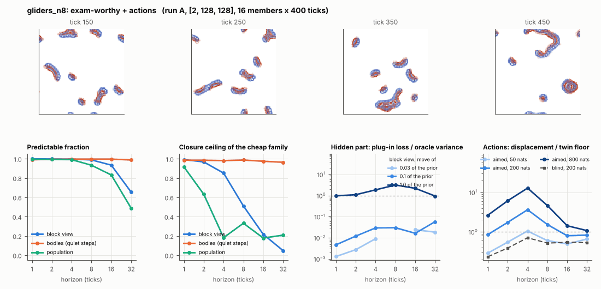

# World card: gliders_n8

Family gliders, role designed. Lattice [2, 128, 128], 20 substeps per tick; input: wind 2 x 8 x 8, noise std 0.05. Hidden part: lR, dm_00, ls_00, lh, dm_10, ls_01, dm_01, lA (8 global parameter(s) of the Flow-Lenia law) (prior: round 5 ladder's box for this hidden set (scanned box x 0.6; for 4 parameters = track2/gliders_exam/results/prior.json); theta = the centre). Views: Phi_coarse (block means of 2 channels and of S^2, 16 px blocks); the port's blob tracker (12 slots).

**Verdict** run A: exam-worthy + actions; run B: dull: the hidden part has no weight. sigma_hat 0.17 at the pop level.

Sizes: 16 members (8 fit), 400 ticks after 50 of burn-in, 32 test states x 6 replicas x 32 ticks; neighbours at [0.03, 0.1, 1.0] of the prior (2 directions x 2). Ratios are from medians over test states (typical state); `mean` marks the mean-based value.

## 1. Predictability at 1 / 2 / 4 / 8 / 16 / 32 ticks

| level | predictable fraction | closure ceiling (cheap family) | ceiling at 8, mean-based |
|---|---|---|---|
| block view | 1.00 / 1.00 / 1.00 / 0.99 / 0.93 / 0.66 | 0.99 / 0.97 / 0.85 / 0.51 / 0.22 / 0.048 | 0.49 |
| bodies, displacement on quiet steps | 0.99 / 0.99 / 1.00 / 1.00 / 1.00 / 0.99 | 0.99 / 0.98 / 0.98 / 0.99 / 0.97 / 0.96 | 0.85 |
| population (count, mean_speed, mass_sd, mass_max, kind_share) | 1.00 / 0.99 / 0.99 / 0.93 / 0.83 / 0.49 | 0.92 / 0.63 / 0.18 / 0.33 / 0.18 / 0.21 | 0.15 |

## 2. Structure

- Bodies: 7.43 +- 1.35 (slots 12, full 0.031% of the time), 100.0% of the matter, radius 6.61 px, half-life 23.8 ticks, net speed 1.75 px/tick.
- Events per 100 ticks and member: 23.2 fusions, 23.1 fissions, 0.00 births, 0.00 deaths.
- Scales: wavelength 12.0 px; neighbouring-block correlation 0.12; block-view autocorrelation at 1 / 8 / 32 ticks 0.97 / 0.24 / -0.064; 44.5% of the matter relocated per tick.
- Single-body law (displacement, quiet steps) at 1 / 4 / 8 / 16 ticks: ceiling 0.99 / 0.98 / 0.99 / 0.97; constant velocity alone 0.99 / 0.98 / 0.99 / 0.97; with the surrounding block view 0.99 / 0.98 / 0.99 / 0.97. Quiet share of 8-tick steps 0.51 (82.0 test rows).

## 3. Stationarity

- Share of the variance that is a function of the tick alone (mean over channels; largest channel in brackets): block view 1.2e-07 [3.6e-07], population 0.015 [0.026] (count 0.012, mean_speed 0.005, mass_sd 0.024, mass_max 0.026, kind_share 0.010).
- Share between members' time-means: block view 0.738, population 0.112.

## 4. Effective laws

- Linear local law on the block view: ceiling 0.992 at 1 tick; falls below 0.5 at 16 ticks; the worst tenth of (state, block) cells carries 60.8% of its excess error at 8 ticks.
- Population law at 8 ticks: linear ceiling 0.33, quadratic 0.29.
- Kind-share law ds = b1 s(1-s) + b2 (1-2s) at 8 / 32 ticks: ceiling 0.24 / 0.57, a constant drift 0.00 / 0.00, a line in s 0.24 / 0.55 (predictable fraction of the change 0.85 / 0.64).

## 5. Levels

- The slot list added to the block view's predictor lowers its error at 8 ticks by 0.034 of the variance; the block view added to the body law by 0.018; block moments added to the population law by 0.004; the population law beats persistence by 0.349.

## 6. Learned variable (slow features of the 2 x 2 sub-blocks against the hand block view)

- Ceiling gain at 8 / 16 / 32 ticks, halves AB: -0.29 / -0.17 / -0.026; BA: -0.33 / -0.15 / -0.054. Predictable-fraction gain at 8: -0.179 / -0.168. Smallest R^2 of a learned component on the hand channels: 0.005.

## 7. Actions (block view, 4 ticks after the input starts)

- The aimed 200-nat shift is 0.024 of the block view's variance, 0.161 of the cheap family's error.
- Predictable shift / oracle variance: aimed 50 / 200 / 800 nats 1.75 / 6.45 / 23.7; displacement of the aimed 200-nat input / twin floor 3.63; aimed / blind 4.96. Population level: 0.25.

## 8. Hidden part

- Plug-in loss / oracle variance at 8 ticks for a move of 3% / 10% / 100% of the prior: block view -1.8e-04 / 0.030 / 3.19; population -0.001 / 0.005 / 0.80.
- Weight of a prior-sized error, w_theta at 4 / 8 / 16 ticks: block view 0.007 / 0.037 / 0.16; sigma_hat block view 0.067, population 0.17.
- Response to the aimed 200-nat input changes by 0.25 oracle variances when the hidden part moves by the prior. Evidence index for a 10% move: 0.45 nats per tick (3 nats in 6.704 ticks).
- Noise twins: 30.9% of the matter placed differently after 8 ticks; doubling time 8.1 ticks.

## 9. Cost

- 1.452 ms per member-tick on the job's GPU with the tracker on every member, compile excluded (689 member-ticks/s); USD 0.80 per million member-ticks at USD 1.99/h.

## Gates and robustness

| gate | run A | run B |
|---|---|---|
| exam_worthy | yes | no |
| structure | yes | yes |
| interaction | no | no |
| reading_worthy | no | no |
| actions | yes | yes |
| stationary | no | no |
| levels_add | yes | yes |
| learned_differs | no | no |

Seed (A against B): 27 of 30 entries agree; not robust: pop.ceil8, pop.sigma_hat, pop.act_ms.

Estimator size (even against odd test states, block view at 8 ticks): predictable fraction 0.99 / 0.99, ceiling 0.54 / 0.47.

Source: run A: job r6-cards-002; run B: job r6-cards-002; files `out/cards/gliders_n8__<run>.json` on origin/gpu-jobs; numbers recomputed by `make_cards.py` from those cards (`card.json` here holds the derived numbers and gates of every run). Pilot: never an exam instance.
