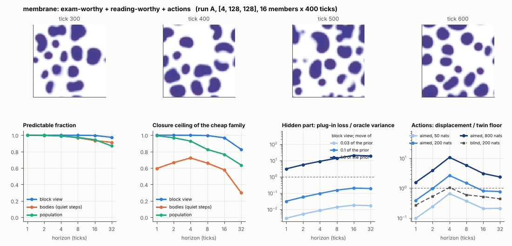

# World card: membrane

Family membrane, role designed. Lattice [4, 128, 128], 20 substeps per tick; input: substrate 256 bumps, noise std 0.01. Hidden part: r, a, th, F, b, dL, c, dK, chi (9 rate parameters) (prior: declared in this study: uniform +-10% box around the default of each; no exam prior exists). Views: block means of (S, K, L, phi) on 16 px blocks; cell tracker (48 slots).

**Verdict** run A: exam-worthy + reading-worthy + actions; run B: dull: the hidden part has no weight; run late: dull: the hidden part has no weight. sigma_hat 0.16 at the pop level.

Sizes: 16 members (8 fit), 400 ticks after 200 of burn-in, 32 test states x 6 replicas x 32 ticks; neighbours at [0.03, 0.1, 1.0] of the prior (2 directions x 2). Ratios are from medians over test states (typical state); `mean` marks the mean-based value.

## 1. Predictability at 1 / 2 / 4 / 8 / 16 / 32 ticks

| level | predictable fraction | closure ceiling (cheap family) | ceiling at 8, mean-based |
|---|---|---|---|
| block view | 1.00 / 1.00 / 1.00 / 1.00 / 1.00 / 0.97 | 1.00 / 1.00 / 1.00 / 1.00 / 0.97 / 0.83 | 0.99 |
| bodies, displacement on quiet steps | 1.00 / 1.00 / 0.99 / 0.97 / 0.93 / 0.91 | 0.59 / 0.67 / 0.72 / 0.66 / 0.58 / 0.30 | 0.64 |
| population (count, tracked_mass, mean_speed, mass_sd, mass_max) | 1.00 / 1.00 / 0.99 / 0.97 / 0.94 / 0.87 | 0.99 / 0.97 / 0.93 / 0.83 / 0.77 / 0.64 | 0.83 |

## 2. Structure

- Bodies: 14.5 +- 2.67 (slots 48, full 0.0% of the time), 85.6% of the matter, radius 6.45 px, half-life 215 ticks, net speed 0.13 px/tick.
- Events per 100 ticks and member: 0.016 fusions, 5.36 fissions, 1.72 births, 6.70 deaths.
- Scales: wavelength 27.7 px; neighbouring-block correlation 0.17; block-view autocorrelation at 1 / 8 / 32 ticks 1.00 / 0.97 / 0.68; 1.2% of the matter relocated per tick.
- Single-body law (displacement, quiet steps) at 1 / 4 / 8 / 16 ticks: ceiling 0.59 / 0.72 / 0.66 / 0.58; constant velocity alone 0.59 / 0.62 / 0.56 / 0.39; with the surrounding block view 0.59 / 0.72 / 0.72 / 0.68. Quiet share of 8-tick steps 0.84 (393 test rows).

## 3. Stationarity

- Share of the variance that is a function of the tick alone (mean over channels; largest channel in brackets): block view -0.001 [-7.7e-05], population -0.004 [0.058] (count 0.058, tracked_mass -0.063, mean_speed 0.019, mass_sd -0.022, mass_max -0.011).
- Share between members' time-means: block view 0.073, population 0.189.
- Late window (+600 ticks) against early: largest shift of a block-channel mean 0.023 sd, largest log sd ratio 0.033, body count x 1.04, events 5.38 -> 5.31, ceiling at 8 1.00 -> 0.99, sigma_hat 0.012 -> 0.014. Same statistics: **yes**.

## 4. Effective laws

- Linear local law on the block view: ceiling 1.000 at 1 tick; falls below 0.5 at no horizon up to 32 ticks; the worst tenth of (state, block) cells carries 58.2% of its excess error at 8 ticks.
- Population law at 8 ticks: linear ceiling 0.83, quadratic 0.80.

## 5. Levels

- The slot list added to the block view's predictor lowers its error at 8 ticks by 4.3e-05 of the variance; the block view added to the body law by 0.021; block moments added to the population law by 0.006; the population law beats persistence by 0.067.

## 6. Learned variable (slow features of the 2 x 2 sub-blocks against the hand block view)

- Ceiling gain at 8 / 16 / 32 ticks, halves AB: -0.010 / -0.028 / -0.063; BA: -0.011 / -0.028 / -0.058. Predictable-fraction gain at 8: -2.5e-04 / -1.9e-04. Smallest R^2 of a learned component on the hand channels: 7.8e-04.

## 7. Actions (block view, 4 ticks after the input starts)

- The aimed 200-nat shift is 0.003 of the block view's variance, 2.190 of the cheap family's error.
- Predictable shift / oracle variance: aimed 50 / 200 / 800 nats 1.31 / 5.25 / 21.3; displacement of the aimed 200-nat input / twin floor 2.66; aimed / blind 2.55. Population level: 0.14.

## 8. Hidden part

- Plug-in loss / oracle variance at 8 ticks for a move of 3% / 10% / 100% of the prior: block view 0.014 / 0.15 / 14.0; population -0.021 / 0.21 / 16.4.
- Weight of a prior-sized error, w_theta at 4 / 8 / 16 ticks: block view 0.006 / 0.018 / 0.086; sigma_hat block view 0.012, population 0.16.
- Response to the aimed 200-nat input changes by 0.027 oracle variances when the hidden part moves by the prior. Evidence index for a 10% move: 4.04 nats per tick (3 nats in 0.742 ticks).
- Noise twins: 1.6% of the matter placed differently after 8 ticks; doubling time 2.4 ticks.

## 9. Cost

- 0.141 ms per member-tick on the job's GPU with the tracker on every member, compile excluded (7091 member-ticks/s); USD 0.078 per million member-ticks at USD 1.99/h.

## Gates and robustness

| gate | run A | run B | run late |
|---|---|---|---|
| exam_worthy | yes | no | no |
| structure | yes | yes | yes |
| interaction | yes | yes | yes |
| reading_worthy | yes | yes | yes |
| actions | yes | yes | yes |
| stationary | yes | yes | yes |
| levels_add | yes | yes | yes |
| learned_differs | no | no | no |

Seed (A against B): 27 of 30 entries agree; not robust: pop.sigma_hat, pop.tick_share, pop.act_ms.

Estimator size (even against odd test states, block view at 8 ticks): predictable fraction 1.00 / 1.00, ceiling 0.99 / 1.00.

Source: run A: job r6-cards-001; run B: job r6-cards-001; run late: job r6-cards-001; files `out/cards/membrane__<run>.json` on origin/gpu-jobs; numbers recomputed by `make_cards.py` from those cards (`card.json` here holds the derived numbers and gates of every run). Pilot: never an exam instance.
