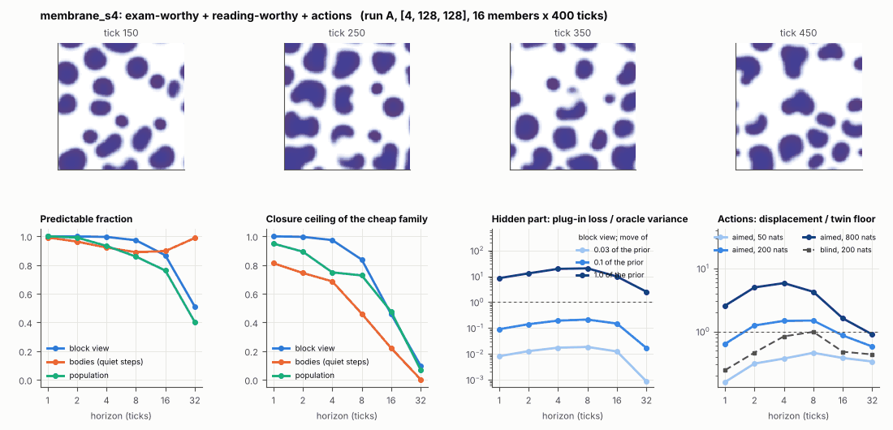

# World card: membrane_s4

Family membrane, role designed. Lattice [4, 128, 128], 80 substeps per tick; input: substrate 256 bumps, noise std 0.01, held over 4 world ticks. Hidden part: r, a, th, F, b, dL, c, dK, chi (9 rate parameters) (prior: declared in this study: uniform +-10% box around the default of each; no exam prior exists). Views: block means of (S, K, L, phi) on 16 px blocks; cell tracker (48 slots).

**Verdict** run A: exam-worthy + reading-worthy + actions; run B: exam-worthy + reading-worthy + actions; run late: exam-worthy + reading-worthy + actions. sigma_hat 0.35 at the pop level.

Sizes: 16 members (8 fit), 400 ticks after 50 of burn-in, 32 test states x 6 replicas x 32 ticks; neighbours at [0.03, 0.1, 1.0] of the prior (2 directions x 2). Ratios are from medians over test states (typical state); `mean` marks the mean-based value.

## 1. Predictability at 1 / 2 / 4 / 8 / 16 / 32 ticks

| level | predictable fraction | closure ceiling (cheap family) | ceiling at 8, mean-based |
|---|---|---|---|
| block view | 1.00 / 1.00 / 1.00 / 0.97 / 0.87 / 0.51 | 1.00 / 1.00 / 0.97 / 0.84 / 0.46 / 0.099 | 0.84 |
| bodies, displacement on quiet steps | 0.99 / 0.96 / 0.92 / 0.89 / 0.90 / 0.99 | 0.81 / 0.74 / 0.69 / 0.46 / 0.22 / 0.003 | 0.34 |
| population (count, tracked_mass, mean_speed, mass_sd, mass_max) | 1.00 / 0.99 / 0.93 / 0.86 / 0.76 / 0.40 | 0.95 / 0.89 / 0.75 / 0.73 / 0.48 / 0.070 | 0.61 |

## 2. Structure

(Ticks here are card ticks of 4 world ticks: multiply half-lives by 4 and divide speeds and event rates by 4 to compare with the card on the world's own clock; the structure gate's thresholds are in card ticks.)

- Bodies: 14.9 +- 2.29 (slots 48, full 0.0% of the time), 85.5% of the matter, radius 6.42 px, half-life 52.0 ticks, net speed 0.42 px/tick.
- Events per 100 ticks and member: 0.031 fusions, 18.7 fissions, 7.30 births, 25.2 deaths.
- Scales: wavelength 26.9 px; neighbouring-block correlation 0.16; block-view autocorrelation at 1 / 8 / 32 ticks 0.99 / 0.69 / -0.016; 4.6% of the matter relocated per tick.
- Single-body law (displacement, quiet steps) at 1 / 4 / 8 / 16 ticks: ceiling 0.81 / 0.69 / 0.46 / 0.22; constant velocity alone 0.81 / 0.69 / 0.43 / 0.00; with the surrounding block view 0.83 / 0.76 / 0.65 / 0.031. Quiet share of 8-tick steps 0.42 (133 test rows).

## 3. Stationarity

- Share of the variance that is a function of the tick alone (mean over channels; largest channel in brackets): block view -0.002 [-0.001], population -0.041 [0.028] (count -0.041, tracked_mass -0.060, mean_speed 0.028, mass_sd -0.069, mass_max -0.064).
- Share between members' time-means: block view 0.018, population 0.043.
- Late window (+150 ticks) against early: largest shift of a block-channel mean 0.006 sd, largest log sd ratio 0.005, body count x 1.01, events 18.8 -> 18.1, ceiling at 8 0.84 -> 0.82, sigma_hat 0.24 -> 0.25. The two windows share 62.5% of their ticks (same seed, slower clock), so this is not a test of stationarity.

## 4. Effective laws

- Linear local law on the block view: ceiling 0.999 at 1 tick; falls below 0.5 at 16 ticks; the worst tenth of (state, block) cells carries 47.0% of its excess error at 8 ticks.
- Population law at 8 ticks: linear ceiling 0.73, quadratic 0.59.

## 5. Levels

- The slot list added to the block view's predictor lowers its error at 8 ticks by 3.6e-04 of the variance; the block view added to the body law by 0.191; block moments added to the population law by 0.003; the population law beats persistence by 0.562.

## 6. Learned variable (slow features of the 2 x 2 sub-blocks against the hand block view)

- Ceiling gain at 8 / 16 / 32 ticks, halves AB: -0.063 / -0.053 / -0.008; BA: -0.053 / -0.059 / -0.052. Predictable-fraction gain at 8: 0.002 / 0.003. Smallest R^2 of a learned component on the hand channels: 8.3e-04.

## 7. Actions (block view, 4 ticks after the input starts)

- The aimed 200-nat shift is 0.014 of the block view's variance, 0.430 of the cheap family's error.
- Predictable shift / oracle variance: aimed 50 / 200 / 800 nats 0.75 / 2.91 / 10.5; displacement of the aimed 200-nat input / twin floor 1.48; aimed / blind 1.79. Population level: 3.61.

## 8. Hidden part

- Plug-in loss / oracle variance at 8 ticks for a move of 3% / 10% / 100% of the prior: block view 0.019 / 0.21 / 20.4; population 0.025 / 0.38 / 51.2.
- Weight of a prior-sized error, w_theta at 4 / 8 / 16 ticks: block view 0.090 / 0.58 / 1.51; sigma_hat block view 0.24, population 0.35.
- Response to the aimed 200-nat input changes by 0.17 oracle variances when the hidden part moves by the prior. Evidence index for a 10% move: 11.6 nats per tick (3 nats in 0.259 ticks).
- Noise twins: 8.7% of the matter placed differently after 8 ticks; doubling time 2.5 ticks.

## 9. Cost

- 0.417 ms per member-tick on the job's GPU with the tracker on every member, compile excluded (2396 member-ticks/s); USD 0.23 per million member-ticks at USD 1.99/h.

## Gates and robustness

| gate | run A | run B | run late |
|---|---|---|---|
| exam_worthy | yes | yes | yes |
| structure | yes | yes | yes |
| interaction | yes | yes | yes |
| reading_worthy | yes | yes | yes |
| actions | yes | yes | yes |
| stationary | yes | yes | yes |
| levels_add | yes | yes | yes |
| learned_differs | no | no | no |

Seed (A against B): 25 of 30 entries agree; not robust: grid.act_ms, grid.aim_ratio, grid.xresp, pop.tick_share, pop.act_ms.

Estimator size (even against odd test states, block view at 8 ticks): predictable fraction 0.97 / 0.98, ceiling 0.83 / 0.86.

Source: run A: job r6-cards-002; run B: job r6-cards-002; run late: job r6-cards-002; files `out/cards/membrane_s4__<run>.json` on origin/gpu-jobs; numbers recomputed by `make_cards.py` from those cards (`card.json` here holds the derived numbers and gates of every run). Pilot: never an exam instance.
