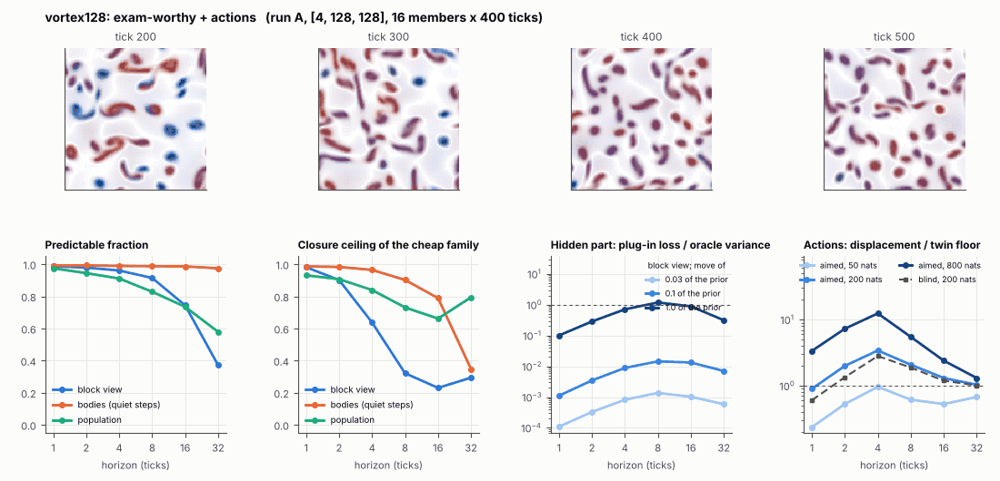

# World card: vortex128

Family vortex, role size. Lattice [4, 128, 128], 250 substeps per tick; input: stirring 64 bumps, noise std 0.005. Hidden part: eps (selection), nu (viscosity), e (eating rate) (prior: round5/vortexexam/prior.json (uniform box; pilot, never an exam); theta = the centre). Views: block means of (om, |om|, Y, |om| f_b) on 16 px blocks; vortex tracker (56 slots); kind share = share of kind-b vortices. Timeline: labels at t = 300 (tick 60), mutation every 50 t after; the card window starts at tick 100.

**Verdict** run A: exam-worthy + actions. sigma_hat 0.26 at the pop level.

Sizes: 16 members (8 fit), 400 ticks after 100 of burn-in, 32 test states x 6 replicas x 32 ticks; neighbours at [0.03, 0.1, 1.0] of the prior (2 directions x 2). Ratios are from medians over test states (typical state); `mean` marks the mean-based value.

## 1. Predictability at 1 / 2 / 4 / 8 / 16 / 32 ticks

| level | predictable fraction | closure ceiling (cheap family) | ceiling at 8, mean-based |
|---|---|---|---|
| block view | 0.99 / 0.98 / 0.96 / 0.91 / 0.74 / 0.37 | 0.98 / 0.90 / 0.64 / 0.32 / 0.23 / 0.29 | 0.30 |
| bodies, displacement on quiet steps | 0.99 / 0.99 / 0.99 / 0.99 / 0.99 / 0.97 | 0.99 / 0.98 / 0.96 / 0.90 / 0.79 / 0.35 | 0.84 |
| population (count, tracked_mass, mean_speed, mass_sd, mass_max, kind_share) | 0.97 / 0.94 / 0.91 / 0.83 / 0.73 / 0.58 | 0.93 / 0.91 / 0.84 / 0.73 / 0.66 / 0.79 | 0.66 |

## 2. Structure

- Bodies: 31.7 +- 3.87 (slots 56, full 0.0% of the time), 78.2% of the matter, radius 4.58 px, half-life 43.9 ticks, net speed 1.75 px/tick.
- Events per 100 ticks and member: 55.9 fusions, 63.0 fissions, 0.30 births, 6.52 deaths.
- Scales: wavelength 14.4 px; neighbouring-block correlation 0.18; block-view autocorrelation at 1 / 8 / 32 ticks 0.96 / 0.40 / 0.14; 28.5% of the matter relocated per tick.
- Single-body law (displacement, quiet steps) at 1 / 4 / 8 / 16 ticks: ceiling 0.99 / 0.96 / 0.90 / 0.79; constant velocity alone 0.99 / 0.96 / 0.89 / 0.79; with the surrounding block view 0.99 / 0.96 / 0.91 / 0.79. Quiet share of 8-tick steps 0.68 (416 test rows).

## 3. Stationarity

- Share of the variance that is a function of the tick alone (mean over channels; largest channel in brackets): block view 0.059 [0.132], population 0.403 [0.799] (count 0.24, tracked_mass 0.71, mean_speed 0.60, mass_sd 0.032, mass_max 0.037, kind_share 0.80).
- Share between members' time-means: block view 0.158, population 0.091.

## 4. Effective laws

- Linear local law on the block view: ceiling 0.982 at 1 tick; falls below 0.5 at 8 ticks; the worst tenth of (state, block) cells carries 36.2% of its excess error at 8 ticks.
- Population law at 8 ticks: linear ceiling 0.73, quadratic 0.69.
- Kind-share law ds = b1 s(1-s) + b2 (1-2s) at 8 / 32 ticks: ceiling 0.29 / 0.78, a constant drift 0.12 / 0.32, a line in s 0.23 / 0.66 (predictable fraction of the change 0.70 / 0.76).

## 5. Levels

- The slot list added to the block view's predictor lowers its error at 8 ticks by 0.003 of the variance; the block view added to the body law by 0.010; block moments added to the population law by 0.012; the population law beats persistence by 0.198.

## 6. Learned variable (slow features of the 2 x 2 sub-blocks against the hand block view)

- Ceiling gain at 8 / 16 / 32 ticks, halves AB: -6.2e-04 / -0.041 / 0.10; BA: 0.023 / -7.4e-04 / 0.061. Predictable-fraction gain at 8: 0.003 / 0.006. Smallest R^2 of a learned component on the hand channels: 0.005.

## 7. Actions (block view, 4 ticks after the input starts)

- The aimed 200-nat shift is 0.236 of the block view's variance, 0.618 of the cheap family's error.
- Predictable shift / oracle variance: aimed 50 / 200 / 800 nats 1.75 / 6.16 / 23.7; displacement of the aimed 200-nat input / twin floor 3.42; aimed / blind 1.28. Population level: 6.30.

## 8. Hidden part

- Plug-in loss / oracle variance at 8 ticks for a move of 3% / 10% / 100% of the prior: block view 0.001 / 0.014 / 1.18; population 0.008 / 0.093 / 8.19.
- Weight of a prior-sized error, w_theta at 4 / 8 / 16 ticks: block view 0.029 / 0.11 / 0.31; sigma_hat block view 0.15, population 0.26.
- Response to the aimed 200-nat input changes by -0.18 oracle variances when the hidden part moves by the prior. Evidence index for a 10% move: 0.14 nats per tick (3 nats in 21.1 ticks).
- Noise twins: 35.2% of the matter placed differently after 8 ticks; doubling time 3.8 ticks.

## 9. Cost

- 14.2 ms per member-tick on the job's GPU with the tracker on every member, COMPILE INCLUDED (this world's only run was the first call of its program) (70.3 member-ticks/s); USD 7.86 per million member-ticks at USD 1.99/h.

## Gates and robustness

| gate | run A |
|---|---|
| exam_worthy | yes |
| structure | yes |
| interaction | no |
| reading_worthy | no |
| actions | yes |
| stationary | yes |
| levels_add | yes |
| learned_differs | no |

Estimator size (even against odd test states, block view at 8 ticks): predictable fraction 0.92 / 0.91, ceiling 0.30 / 0.31.

Source: run A: job r6-cards-001; files `out/cards/vortex128__<run>.json` on origin/gpu-jobs; numbers recomputed by `make_cards.py` from those cards (`card.json` here holds the derived numbers and gates of every run). Pilot: never an exam instance.
