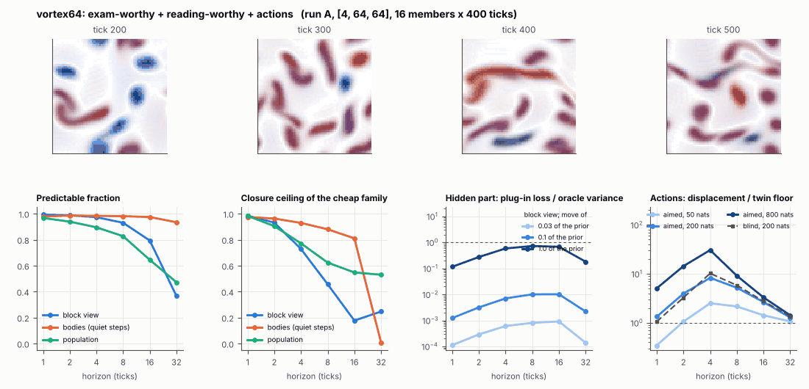

# World card: vortex64

Family vortex, role designed. Lattice [4, 64, 64], 250 substeps per tick; input: stirring 16 bumps, noise std 0.005. Hidden part: eps (selection), nu (viscosity), e (eating rate) (prior: round5/vortexexam/prior.json (uniform box; pilot, never an exam); theta = the centre). Views: block means of (om, |om|, Y, |om| f_b) on 8 px blocks; vortex tracker (24 slots); kind share = share of kind-b vortices. Timeline: labels at t = 300 (tick 60), mutation every 200 t after; the card window starts at tick 100.

**Verdict** run A: exam-worthy + reading-worthy + actions; run B: exam-worthy + reading-worthy + actions; run late: exam-worthy + reading-worthy + actions. sigma_hat 0.35 at the pop level.

Sizes: 16 members (8 fit), 400 ticks after 100 of burn-in, 32 test states x 6 replicas x 32 ticks; neighbours at [0.03, 0.1, 1.0] of the prior (2 directions x 2). Ratios are from medians over test states (typical state); `mean` marks the mean-based value.

## 1. Predictability at 1 / 2 / 4 / 8 / 16 / 32 ticks

| level | predictable fraction | closure ceiling (cheap family) | ceiling at 8, mean-based |
|---|---|---|---|
| block view | 0.99 / 0.99 / 0.97 / 0.93 / 0.79 / 0.37 | 0.98 / 0.93 / 0.73 / 0.46 / 0.18 / 0.25 | 0.40 |
| bodies, displacement on quiet steps | 0.98 / 0.99 / 0.98 / 0.98 / 0.97 / 0.93 | 0.97 / 0.96 / 0.93 / 0.88 / 0.81 / 0.009 | 0.86 |
| population (count, tracked_mass, mean_speed, mass_sd, mass_max, kind_share) | 0.97 / 0.94 / 0.90 / 0.83 / 0.64 / 0.47 | 0.98 / 0.90 / 0.77 / 0.62 / 0.55 / 0.53 | 0.56 |

## 2. Structure

- Bodies: 8.00 +- 1.62 (slots 24, full 0.0% of the time), 78.6% of the matter, radius 4.48 px, half-life 51.3 ticks, net speed 0.97 px/tick.
- Events per 100 ticks and member: 12.9 fusions, 14.3 fissions, 0.00 births, 1.20 deaths.
- Scales: wavelength 14.7 px; neighbouring-block correlation 0.32; block-view autocorrelation at 1 / 8 / 32 ticks 0.98 / 0.46 / 0.14; 16.5% of the matter relocated per tick.
- Single-body law (displacement, quiet steps) at 1 / 4 / 8 / 16 ticks: ceiling 0.97 / 0.93 / 0.88 / 0.81; constant velocity alone 0.97 / 0.93 / 0.88 / 0.81; with the surrounding block view 0.97 / 0.93 / 0.88 / 0.81. Quiet share of 8-tick steps 0.72 (118 test rows).

## 3. Stationarity

- Share of the variance that is a function of the tick alone (mean over channels; largest channel in brackets): block view 0.028 [0.056], population 0.219 [0.582] (count 0.067, tracked_mass 0.44, mean_speed 0.078, mass_sd 0.077, mass_max 0.068, kind_share 0.58).
- Share between members' time-means: block view 0.337, population 0.098.
- Late window (+400 ticks) against early: largest shift of a block-channel mean 0.18 sd, largest log sd ratio 0.11, body count x 1.08, events 27.2 -> 28.2, ceiling at 8 0.46 -> 0.28, sigma_hat 0.082 -> 0.073. Same statistics: **yes**.

## 4. Effective laws

- Linear local law on the block view: ceiling 0.984 at 1 tick; falls below 0.5 at 8 ticks; the worst tenth of (state, block) cells carries 46.8% of its excess error at 8 ticks.
- Population law at 8 ticks: linear ceiling 0.62, quadratic 0.49.
- Kind-share law ds = b1 s(1-s) + b2 (1-2s) at 8 / 32 ticks: ceiling 0.23 / 0.48, a constant drift 0.14 / 0.28, a line in s 0.25 / 0.52 (predictable fraction of the change 0.58 / 0.63).

## 5. Levels

- The slot list added to the block view's predictor lowers its error at 8 ticks by 0.003 of the variance; the block view added to the body law by -0.010; block moments added to the population law by 0.022; the population law beats persistence by 0.152.

## 6. Learned variable (slow features of the 2 x 2 sub-blocks against the hand block view)

- Ceiling gain at 8 / 16 / 32 ticks, halves AB: 0.001 / 0.037 / -0.022; BA: -0.013 / 0.034 / -0.058. Predictable-fraction gain at 8: 0.005 / -0.004. Smallest R^2 of a learned component on the hand channels: 0.027.

## 7. Actions (block view, 4 ticks after the input starts)

- The aimed 200-nat shift is 0.504 of the block view's variance, 1.811 of the cheap family's error.
- Predictable shift / oracle variance: aimed 50 / 200 / 800 nats 5.47 / 19.7 / 68.1; displacement of the aimed 200-nat input / twin floor 8.28; aimed / blind 0.85. Population level: 30.0.

## 8. Hidden part

- Plug-in loss / oracle variance at 8 ticks for a move of 3% / 10% / 100% of the prior: block view 8.1e-04 / 0.010 / 0.73; population 0.004 / 0.044 / 3.93.
- Weight of a prior-sized error, w_theta at 4 / 8 / 16 ticks: block view 0.016 / 0.055 / 0.18; sigma_hat block view 0.082, population 0.35.
- Response to the aimed 200-nat input changes by 0.023 oracle variances when the hidden part moves by the prior. Evidence index for a 10% move: 0.16 nats per tick (3 nats in 19.0 ticks).
- Noise twins: 26.4% of the matter placed differently after 8 ticks; doubling time 4.9 ticks.

## 9. Cost

- 4.780 ms per member-tick on the job's GPU with the tracker on every member, compile excluded (209 member-ticks/s); USD 2.64 per million member-ticks at USD 1.99/h.

## Gates and robustness

| gate | run A | run B | run late |
|---|---|---|---|
| exam_worthy | yes | yes | yes |
| structure | yes | yes | yes |
| interaction | yes | yes | yes |
| reading_worthy | yes | yes | yes |
| actions | yes | yes | yes |
| stationary | no | no | no |
| levels_add | yes | yes | yes |
| learned_differs | no | no | yes |

Seed (A against B): 27 of 29 entries agree; not robust: pop.act_ms, l.dceil16_AB.

Size (64 px against vortex128g16; counts per area, action entries left out): 17 of 26 entries agree; not robust: grid.ceil8, grid.gap8, grid.sigma_hat, grid.w_theta8, grid.member_share, pop.sigma_hat, pop.tick_share, s.v_net, k.law32.

Estimator size (even against odd test states, block view at 8 ticks): predictable fraction 0.92 / 0.93, ceiling 0.44 / 0.46.

Source: run A: job r6-cards-002; run B: job r6-cards-001; run late: job r6-cards-001; files `out/cards/vortex64__<run>.json` on origin/gpu-jobs; numbers recomputed by `make_cards.py` from those cards (`card.json` here holds the derived numbers and gates of every run). Pilot: never an exam instance.
