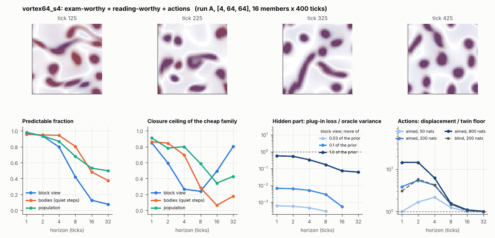

# World card: vortex64_s4

Family vortex, role designed. Lattice [4, 64, 64], 1000 substeps per tick; input: stirring 16 bumps, noise std 0.005, held over 4 world ticks. Hidden part: eps (selection), nu (viscosity), e (eating rate) (prior: round5/vortexexam/prior.json (uniform box; pilot, never an exam); theta = the centre). Views: block means of (om, |om|, Y, |om| f_b) on 8 px blocks; vortex tracker (24 slots); kind share = share of kind-b vortices. Timeline: labels at t = 300 (tick 60), mutation every 200 t after; the card window starts at tick 100.

**Verdict** run A: exam-worthy + reading-worthy + actions; run late: exam-worthy + reading-worthy + actions. sigma_hat 0.42 at the pop level.

Sizes: 16 members (8 fit), 400 ticks after 25 of burn-in, 32 test states x 6 replicas x 32 ticks; neighbours at [0.03, 0.1, 1.0] of the prior (2 directions x 2). Ratios are from medians over test states (typical state); `mean` marks the mean-based value.

## 1. Predictability at 1 / 2 / 4 / 8 / 16 / 32 ticks

| level | predictable fraction | closure ceiling (cheap family) | ceiling at 8, mean-based |
|---|---|---|---|
| block view | 0.98 / 0.94 / 0.80 / 0.42 / 0.13 / 0.076 | 0.85 / 0.60 / 0.26 / 0.24 / 0.49 / 0.80 | 0.24 |
| bodies, displacement on quiet steps | 0.95 / 0.95 / 0.94 / 0.80 / 0.48 / 0.37 | 0.86 / 0.84 / 0.70 / 0.28 / 0.062 / 0.18 | 0.00 |
| population (count, tracked_mass, mean_speed, mass_sd, mass_max, kind_share) | 0.97 / 0.94 / 0.87 / 0.68 / 0.53 / 0.50 | 0.91 / 0.78 / 0.80 / 0.59 / 0.34 / 0.43 | 0.64 |

## 2. Structure

(Ticks here are card ticks of 4 world ticks: multiply half-lives by 4 and divide speeds and event rates by 4 to compare with the card on the world's own clock; the structure gate's thresholds are in card ticks.)

- Bodies: 8.64 +- 1.73 (slots 24, full 0.0% of the time), 78.9% of the matter, radius 4.32 px, half-life 18.9 ticks, net speed 1.92 px/tick.
- Events per 100 ticks and member: 42.2 fusions, 41.5 fissions, 6.36 births, 5.48 deaths.
- Scales: wavelength 15.1 px; neighbouring-block correlation 0.26; block-view autocorrelation at 1 / 8 / 32 ticks 0.83 / 0.15 / 0.074; 30.4% of the matter relocated per tick.
- Single-body law (displacement, quiet steps) at 1 / 4 / 8 / 16 ticks: ceiling 0.86 / 0.70 / 0.28 / 0.062; constant velocity alone 0.86 / 0.55 / 0.00 / 0.00; with the surrounding block view 0.87 / 0.67 / 0.12 / 0.24. Quiet share of 8-tick steps 0.42 (69.0 test rows).

## 3. Stationarity

- Share of the variance that is a function of the tick alone (mean over channels; largest channel in brackets): block view 0.010 [0.024], population 0.201 [0.410] (count 0.004, tracked_mass 0.36, mean_speed 0.37, mass_sd 0.033, mass_max 0.030, kind_share 0.41).
- Share between members' time-means: block view 0.625, population 0.133.
- Late window (+100 ticks) against early: largest shift of a block-channel mean 0.042 sd, largest log sd ratio 0.088, body count x 1.04, events 83.6 -> 75.4, ceiling at 8 0.24 -> 0.28, sigma_hat 0.28 -> 0.20. The two windows share 75.0% of their ticks (same seed, slower clock), so this is not a test of stationarity.

## 4. Effective laws

- Linear local law on the block view: ceiling 0.851 at 1 tick; falls below 0.5 at 4 ticks; the worst tenth of (state, block) cells carries 47.0% of its excess error at 8 ticks.
- Population law at 8 ticks: linear ceiling 0.59, quadratic 0.58.
- Kind-share law ds = b1 s(1-s) + b2 (1-2s) at 8 / 32 ticks: ceiling 0.00 / 0.00, a constant drift 0.00 / 0.00, a line in s 0.00 / 0.00 (predictable fraction of the change 0.33 / 0.24).

## 5. Levels

- The slot list added to the block view's predictor lowers its error at 8 ticks by 4.3e-04 of the variance; the block view added to the body law by -0.008; block moments added to the population law by 0.065; the population law beats persistence by 0.246.

## 6. Learned variable (slow features of the 2 x 2 sub-blocks against the hand block view)

- Ceiling gain at 8 / 16 / 32 ticks, halves AB: 0.060 / 0.18 / -0.059; BA: -0.15 / -0.44 / -0.78. Predictable-fraction gain at 8: 0.089 / -0.097. Smallest R^2 of a learned component on the hand channels: 0.002.

## 7. Actions (block view, 4 ticks after the input starts)

- The aimed 200-nat shift is 1.398 of the block view's variance, 1.847 of the cheap family's error.
- Predictable shift / oracle variance: aimed 50 / 200 / 800 nats 3.39 / 7.13 / 11.7; displacement of the aimed 200-nat input / twin floor 4.19; aimed / blind 0.97. Population level: 37.2.

## 8. Hidden part

- Plug-in loss / oracle variance at 8 ticks for a move of 3% / 10% / 100% of the prior: block view 2.9e-04 / 0.003 / 0.17; population 0.004 / 0.043 / 3.27.
- Weight of a prior-sized error, w_theta at 4 / 8 / 16 ticks: block view 0.085 / 0.24 / 0.51; sigma_hat block view 0.28, population 0.42.
- Response to the aimed 200-nat input changes by 0.050 oracle variances when the hidden part moves by the prior. Evidence index for a 10% move: 0.86 nats per tick (3 nats in 3.478 ticks).
- Noise twins: 61.7% of the matter placed differently after 8 ticks; doubling time 4.3 ticks.

## 9. Cost

- 17.6 ms per member-tick on the job's GPU with the tracker on every member, compile excluded (57.0 member-ticks/s); USD 9.70 per million member-ticks at USD 1.99/h.

## Gates and robustness

| gate | run A | run late |
|---|---|---|
| exam_worthy | yes | yes |
| structure | yes | yes |
| interaction | yes | yes |
| reading_worthy | yes | yes |
| actions | yes | yes |
| stationary | no | no |
| levels_add | yes | yes |
| learned_differs | no | no |

Estimator size (even against odd test states, block view at 8 ticks): predictable fraction 0.41 / 0.43, ceiling 0.28 / 0.15.

Source: run A: job r6-cards-002; run late: job r6-cards-002; files `out/cards/vortex64_s4__<run>.json` on origin/gpu-jobs; numbers recomputed by `make_cards.py` from those cards (`card.json` here holds the derived numbers and gates of every run). Pilot: never an exam instance.
