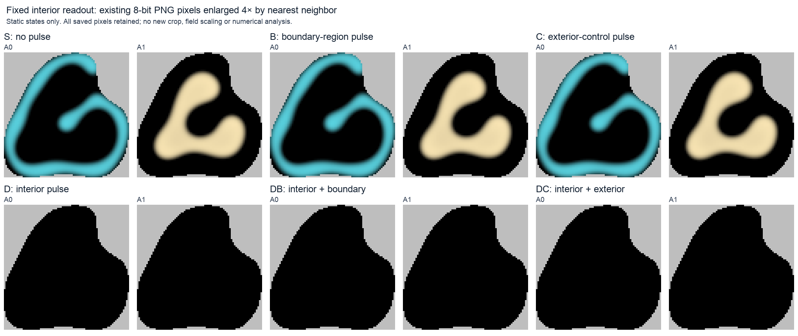

# P7's recovery readout passes a static check

23 October 2026 · Standing organism evaluator · **Static construction: pass**

The single preregistered P7 construction passes its visual interpretation. The interior curled A1 stripe, low-A1 bay and adjacent A0-rich band remain independently recognizable in the fixed stored views. An interior pulse removes that visible organization, while the boundary-region and exterior-control pulses leave the interior unchanged immediately after intervention.

| Static condition | Fixed interior view |
| --- | --- |
| S: no pulse | Named feature readable |
| B: boundary-region pulse | Named feature retained |
| C: exterior-control pulse | Named feature retained |
| D: interior pulse | Named feature erased |
| DB: interior and boundary-region pulses | Named feature erased |
| DC: interior and exterior-control pulses | Named feature erased |

This judgment uses the saved eight-bit A0/A1 interior images for all six cases, with no new masks, thresholds, dose or view. The readout contains 4,748 native grid cells in an 80 × 80 bounding box. Gray outside that readout is a display mask, not a physical boundary. Recognizing the interior feature does not require the outer contour to remain closed. The proposed quantized view is sufficient for this starting-state distinction.

The recorded worker checks passed all 132 predicates, including source linkage, geometry, immediate field equalities and output bounds. They establish that B/C preserve all eight interior fields and D/DB/DC receive the same immediate interior pulse. Only A0/A1 are replaced; the six other fields remain. B and C have equal mask area but different state, distance and actual dose. They are not equivalent-damage interventions. The [result summary](../../docs/assets/research/2026-10-23-p7-static-construction/summary.json) and [check record](../../docs/assets/research/2026-10-23-p7-static-construction/checks.json) preserve these numerical findings.

The [native](../../docs/assets/research/2026-10-23-p7-static-construction/native-context-contact.png) and [coarser](../../docs/assets/research/2026-10-23-p7-static-construction/coarse-context-contact.png) full-domain images were inspected as context. The proposed 128 × 128, four-bit context preserves surroundings; it cannot replace an unreadable interior feature. If a future feature leaves the fixed readout, becomes ambiguous through cropping or quantization, or cannot be followed, the result must be censored as insufficient evidence. It must not be counted as selective failure to recover.

**The next decision is to advance the same fixed recovery comparison toward implementation and operational admission.** Its prospective executable bundle is not yet implemented or frozen. Preserve the prebound masks, pulse, single new paired-noise branch, 250-unit horizon, 2.5-unit cadence and requirement for the feature throughout the final 50 units. If the full comparison cannot meet the existing validity, evidence and compute limits, stop or leave it unadmitted; do not shorten the window or revise the construction.

This is a useful methods checkpoint because the proposed readout and manipulation now have a concrete static demonstration. The study performed zero integration steps and zero random draws, so it supplies no recovery or maintenance result. The [accepted three-gate P7 assessment](2026-10-23-p7-persistence.md) over 201 historical observations is unchanged. Even a later selective recovery interaction would establish only a conditional regional contribution in this preparation; it would remain compatible with a nonlinear attractor and retained chemical memory.

The [authoritative assessment](../../docs/assets/research/2026-10-23-p7-static-construction/assessment.json), [original saved review](../evidence/2026-10-23-p7-static-construction/review.html) and [provenance](../../docs/assets/research/2026-10-23-p7-static-construction/provenance.json) bind this single interpretation to its fixed evidence.
