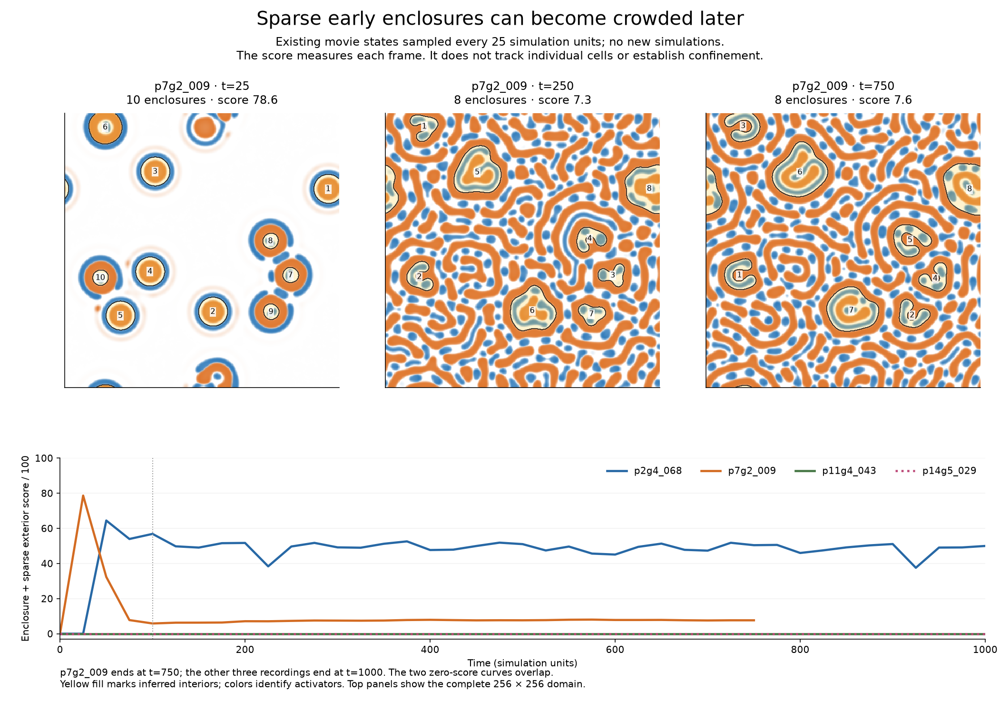

# Evaluator report — 23 October 2026

**The strongest spatial lead among the examples inspected is the earlier P7 compartment world. None of the inspected examples yet demonstrates all three organism criteria.** The immediate gap is whether a distinguishing internal feature stays with the same individual over time. More splitting or a longer-lived activity blob would not by itself close that gap.

These are existing snapshots of `p7g2_009`, with orange boundaries and blue/orange internal patterns amid open structures. The numbered annotations are per-frame detector ranks, **not tracked identities**. Colors show model activators, not proven material cargo. [Inspect the original final frame and overlay](../../docs/assets/research/2026-10-23-evaluation/p7g2_009-t750.png).

## What the examples establish

| Example | Localized individual | Distinguishing feature | Same-individual feature persistence |
| --- | --- | --- | --- |
| **P7 compartments** | Supported at inspected frames | Supported spatially at inspected frames | Insufficient: no boundary/feature identity track |
| **P2 ring comparison** | Supported at the inspected final frame | Insufficient: largely empty ring in the displayed fields | Insufficient: enclosure counts are not individual survival |
| **X1, W condition** | Supported for the recorded compact target | Insufficient: a retained high-Q state is a lead, but no spatial or functional organization was demonstrated | Insufficient for organism features; target identity and high-Q mean are retained |
| **Production/payment example** | Supported as a localized activity region; bounded size is unproven | Insufficient from the A-only view | Insufficient for a distinguishing feature |
| **Protective-action population** | Insufficient as a single tracked individual | Insufficient from binary masks | Insufficient: population persistence and splitting do not track a feature |

P7 has enclosure detections in 30 of 31 saved states through 750 simulation units. I inspected the actual images at 25, 250 and 750, not all 31 states. The final exterior occupancy is 62.3%; crowded surroundings make identity harder to establish, but do not themselves rule out individuals. P2's 39 of 41 enclosure-positive states through 1000 similarly cannot show that one ring survived.

I inspected every retained time in the [three existing movies](../updates/2026-10-20.md): 29 times through 100 for X1 and 31 through 150 for each other example. They display five simulation units per video second, hold the final sample for two seconds, and do not interpolate new states. The X1 movie is a fixed crop; its outline is an initial neighborhood, not a live boundary. The other views show their full domains. X1 and production show A only; protection shows a binary activity mask.

In X1, W preserves a compact target and high mean Q through 100. Q is an engineered model state variable, not an organism score, and its mean does not reveal spatial organization. I, S and U split around 50–52.5; the original identity is then censored, so offspring feature inheritance is unestablished. Production/payment provides useful causal activity evidence: the intact patch persists while controls fade, but its measured area grows from 203 to 817. Protective action preserves a population while its comparison fades. Those findings are real and narrower than an organism claim.

## Decision

**Hold the frozen restoring-feedback experiment and prioritize one bounded retrospective review of P7.** Its saved trajectory can address the most promising missing gate without first changing the world. Select and freeze one visible enclosure and its internal feature, follow it across every available subsequent saved state, and report the first identity or feature failure without switching to a better survivor. Use the P2 ring as a morphology-only comparison. If the cadence cannot resolve identity, state that limit; do not infer continuity from counts.

The frozen experiment could test bounded activity and causal feedback. Its 31 A snapshots and full chemical endpoints cannot establish a time-resolved internal chemical feature. It remains a legitimate narrower study, but is not the first priority for the clarified goal and should remain frozen rather than silently rewritten.

The [rubric v0.1](rubric-v0.1.md) keeps three essential gates, separate active-maintenance evidence and prospective version changes. Alternative world models remain open; any proposed change should name the organism-level advantage it predicts.
