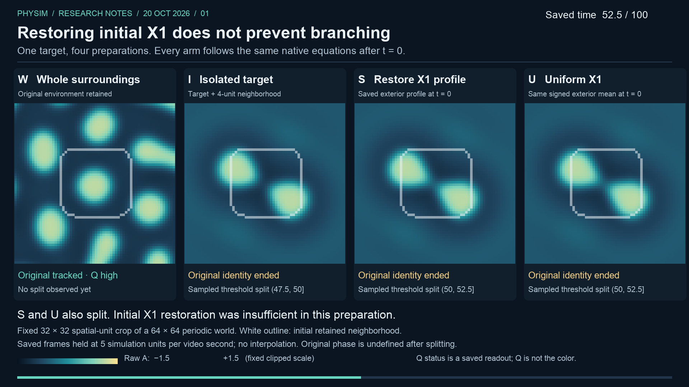
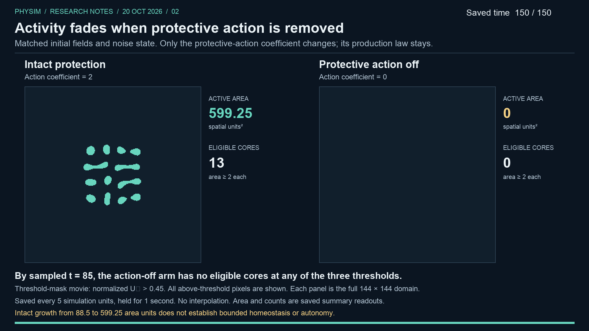

# What keeps a pattern going?

20 October 2026 · PhySim research update

Three comparisons probe why localized field activity persists: the surroundings
of one selected pattern, protective action in a separate preparation, and signal
production versus its resource charge. The videos render saved simulation outputs.

## Restoring the initial surrounding signal did not prevent branching

[Watch or download the video (22 seconds)](../../docs/assets/research/2026-10-20/initial-x1.mp4)

We kept the target and a four-unit neighborhood identical in four preparations
of a 19-field model:

| Arm | Initial surroundings | Selected original's first split |
| --- | --- | --- |
| W | Whole world retained | No split observed at the saved samples through 100 |
| I | Exterior replaced by the established bath | (47.5, 50] |
| S | I, with the saved exterior X₁ profile restored | (50, 52.5] |
| U | I, with uniform exterior X₁ at the same signed mean | (50, 52.5] |

“Split” means a sampled threshold-component event: normalized A > 0.45,
periodic four-connectivity, and robust component area ≥ 2. The tracked original
gives way to two robust components that each overlap its previous sampled mask;
this does not assign material ancestry.

The original X₁ profile was insufficient to preserve the unbranched target.
Restoration changed only the initial signal, not the surrounding A sources that
helped maintain it. Continued environmental influence and other mechanisms remain
open questions. The sampled brackets do not establish an exact 2.5-unit delay.

All identifiable original samples remained high-Q. Original identity and phase
became undefined after the first split. Later shapes are not evidence of material
lineage, inheritance, or reproduction.

The video shows raw A on a fixed scale and a fixed 32 × 32 crop of each 64 × 64
periodic world. Its white outline marks the initial retained neighborhood;
Q status is a saved readout, not the color.

## Removing protective action caused activity to fade

[Watch or download the video (32 seconds)](../../docs/assets/research/2026-10-20/protective-action.mp4)

Two copies of a separate, already-active 20-field preparation began with matched
fields and noise-generator state. Removing only P's protective-action coefficient
(2 → 0), while retaining its production law and the source conditions, produced
loss of activity. The first sampled absence of eligible cores at all three
thresholds was time 85; the fixed late-loss criterion at times 125–150 also passed.

The intact preparation retained activity at every sampled time and threshold.
Its primary active area grew from **88.5 to 599.25**, ending with 13 eligible
components. This supports dependence on the engineered protective action under
these conditions; it does not establish bounded homeostasis, recovery or autonomy.
An unchanged production law does not imply equal actual production or reciprocal
resource payment.

This movie shows **saved binary masks**, normalized U₀ > 0.45, across the full
144 × 144 domains. Intermediate U₀ concentrations at times 5–120 were not saved.
A subsequent audit passed all **1,456 consistency comparisons** of available
evidence; these correlated checks are not independent dynamics replications.
Conditions and action histories between saved states remain supported by the
original run's diagnostics; the audit does not independently reconstruct those
full trajectories.

## Removing the resource charge did not rescue production-off activity

[Watch or download the video (32 seconds)](../../docs/assets/research/2026-10-20/production-payment.mp4)

A third comparison used a distinct 19-field, source-supported preparation. It
separated two genome coefficients: protective-signal production β and the
associated resource debit γ. All three paths began from the same complete state,
including the stored signal and noise-generator state. After that, only the
listed coefficients differed.

| Arm | Production β | Payment γ | Sampled activity outcome |
| --- | --- | --- | --- |
| I · Intact | 0.1 | 0.1 | Present at every saved time and threshold through 150 |
| P · Production off | 0 | 0.1 | Present at 55; first sampled absence at 60; absent at every late sample |
| C · Both terms off | 0 | 0 | Present at 60; first sampled absence at 65; absent at every late sample |

Here absence means no raw A above each of 0.075, 0.1 and 0.125, with late
samples fixed at 125, 130, 135, 140, 145 and 150. It does not mean that every
field is exactly zero. No component-size filter is used to declare absence.

**Removing production caused late activity loss while retaining the payment
law. Removing the payment law as well did not restore late activity.** This
supports a conditional dependence on the production coefficient in this
preparation. The two production-off paths have different sampled loss brackets;
the shared late result does not imply that payment has no effect or establish an
exact five-unit delay.

A fixed γ preserves the formula γZY, not the amount actually paid or the resource
trajectory: integrated mean payment was approximately 0.12779 in I and 0.03237
in P. The contrast includes later feedback; it does not isolate a direct signal
effect under matched future resource histories. A fourth arm would be needed to
test payment removal when production remains enabled.

The movie shows saved raw A over the full 48 × 48 periodic domain, using one
fixed scale [−0.02, 0.45]. Area labels are saved measurements at A > 0.1. Intact
active area grows from **203 to 817**, so this result does not establish bounded
maintenance or autonomy. All 93 activity frames were retained; all-step reaction
and chemistry histories remain producer aggregates, with full fields saved only
at the common start and each endpoint, plus selected chemistry at time 25.

## Evidence and next questions

All three movies use fixed spatial views, nearest-neighbor display, visible
simulation times and held recorded frames at five simulation time units per video second.
The final frame is held for two seconds. There is no interpolated motion.
Area and count annotations come from saved summaries.

The current surroundings model has no exterior-only production switch that
preserves target production, so that causal question needs a different admissible
control. A separate priority is finding bounded functional behavior before
interpreting recovery tests on growing patterns. Signal production now has a
conditional positive result; releasing payment while production was off did not
restore late activity. Each reported result concerns one selected preparation
and a finite sampled horizon; no population generality or autonomous reproduction is established.

- [Provenance and exact hashes](../../docs/assets/research/2026-10-20/provenance.json)
- [Committed source evidence](../../docs/assets/research/2026-10-20/evidence)
- [Branching experiment summary](../../docs/assets/research/2026-10-20/evidence/x1-summary.json)
- [Protection experiment summary](../../docs/assets/research/2026-10-20/evidence/protection-summary.json)
- [Production/payment summary](../../docs/assets/research/2026-10-20/evidence/production-summary.json)
- [Evidence audit summary](../../docs/assets/research/2026-10-20/evidence/protection-audit-summary.json)
- [Presentation-only renderer](../../scripts/render_research_update.py)

The full website article is generated from
[its HTML source](../../docs_source/pages/research-2026-10-20.html).
To view it locally, run `python3 scripts/build_docs.py`, then serve `docs/` and open
`research-2026-10-20.html`.
