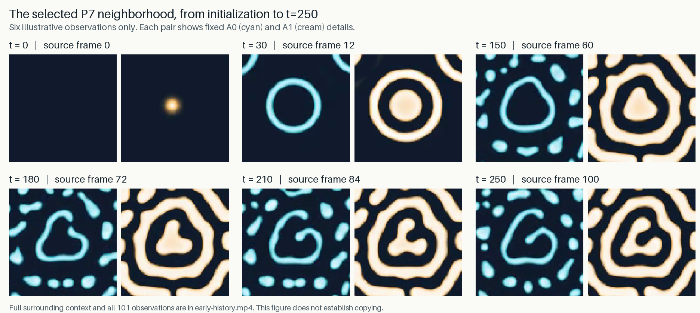

# P7 develops its curl from an initialized spot

23 October 2026 · Retained-evidence review · [Independent evaluator assessment](../evaluation/2026-10-23-p7-ancestry.md)

The selected P7 structure develops its distinctive internal curl from a spot
already present at initialization. The standing evaluator inspected all 101 saved
observations from simulation time 0 to 250 and found no parent producing multiple
continuing apparent individuals on this track. This adds a visible formation
sequence to the earlier persistence finding; it supplies no event for a copying
experiment.

[Watch the 12.625-second early-history movie](../../docs/assets/research/2026-10-23-p7-ancestry/early-history.mp4).
It shows all 101 observations, with full surrounding context above and a fixed
close-up below. The figure illustrates six times; it does not replace the full
review. A0 and A1 are two interacting numerical fields, shown in cyan and cream.
Simulation time is expressed in model units, not real seconds.

## What the evaluator saw

At time 0, a localized A1 spot is already present. By time 30, an A1 ring encloses
it, with an intervening A0 band. The central island becomes rounded triangular,
then lobed and indented. By time 210, the curled A1 stripe and low-A1 bay beside
the A0 band are recognizable. These are illustrative stages, not exact onset
thresholds. The same apparent structure leads into the selected time-250 view.

The evaluator traced one readable spatial precursor at each saved link. No
split, merge, disappearance or competing continuation was observed. The existing
assessment of persistence from time 250 to 750 is reused unchanged.

## What this changes

The three essential organization gates already support investigating feature
copying; active maintenance is strengthening evidence, not a fourth prerequisite.
But this exact retained track does not provide the needed parent-to-descendants
event. The evaluator closes this historical ancestry route without a copying
experiment, a longer simulation or a substitute individual.

This is a retrospective visual review of an existing movie, with no new simulation.
A spot was present at initialization, and the rendered panels do not establish
an unstructured full initial state or spontaneous origin. Apparent spatial
continuity is not material ancestry; events between the 2.5-unit samples remain
unresolved. No claim is made about every P7 individual or possible trajectory.

Read the [evaluator's complete account](../evaluation/2026-10-23-p7-ancestry.md),
[exact evidence and display conventions](../../docs/assets/research/2026-10-23-p7-ancestry/README.md),
and the earlier [persistence](../evaluation/2026-10-23-p7-persistence.md) and
[recovery](2026-10-23-p7-recovery.md) findings. A future copying study still needs
a traceable parent and continuing descendants whose distinguishing organization
can be assessed over time.
